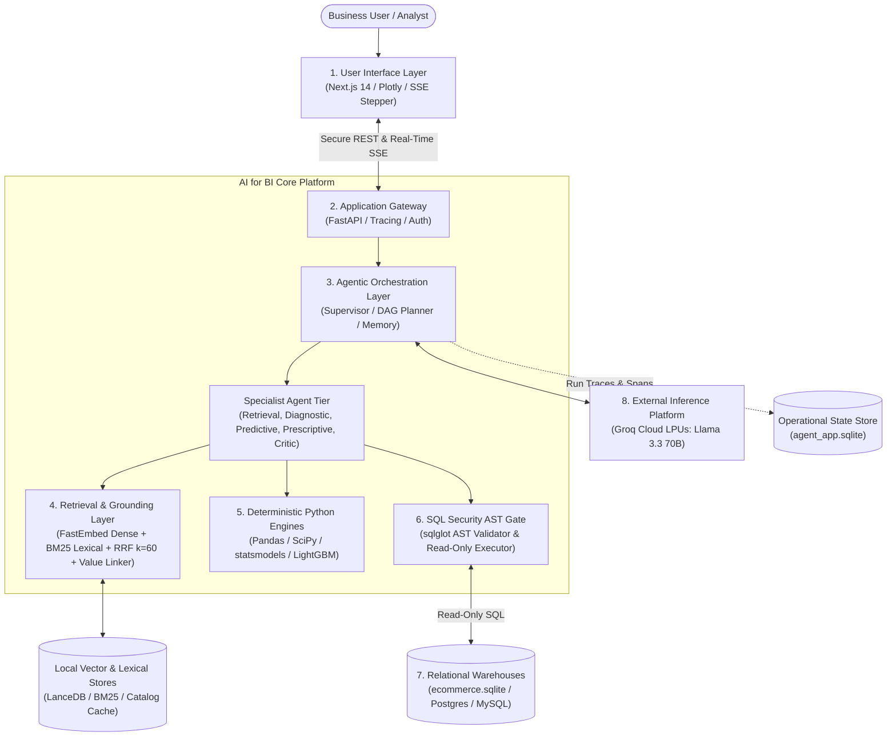
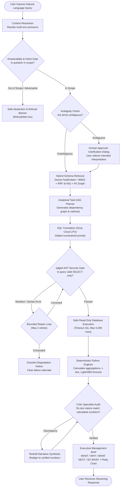

# Design Approach: AI for BI — Conversational Data Scientist Agent

**Document Reference:** `APPROACH.md` (Repository Root)  
**Project:** AI for BI — Conversational Data Scientist Agent  
**Target Architecture:** Multi-Agent Decoupled Architecture with Groq Cloud LPU Acceleration  
**Companion Architecture Suite:** [`docs/architecture/README.md`](file:///c:/D_drive/AI_FOR_BI_P/docs/architecture/README.md)  
**Detailed Specification:** [`docs/architecture/COMPLETE_PROJECT_ARCHITECTURE.md`](file:///c:/D_drive/AI_FOR_BI_P/docs/architecture/COMPLETE_PROJECT_ARCHITECTURE.md)  

---

## A. Problem Scoping

### 1. The User and the Decision
* **Target Users:** Business Executives, VPs of Operations/Finance, Commercial Directors, and Business Intelligence (BI) Analysts.
* **Core Task:** Making rapid, high-stakes operational and strategic decisions without writing SQL or waiting days for analytics engineering sprint cycles.
* **Key Decisions Supported:**
  * *Diagnostic & Root Cause:* Identifying why margins or revenues declined in specific categories, regions, or customer cohorts.
  * *Operational Impact:* Evaluating whether a performance delta is statistically significant ($p < 0.05$) and quantifying annualized revenue exposure ("So What?").
  * *Predictive Planning:* Forecasting demand trajectories, identifying customer churn risk, and anticipating inventory stockouts.
  * *Scenario Modeling:* Evaluating "What-If" tradeoffs (e.g., elasticity of demand under a 5–15% price adjustment).

### 2. The Input as it Really Arrives
In reality, business inquiries are underspecified, conversational, and messy:
* **Linguistic Ambiguity:** *"Which products are slipping?"*, *"How are sales doing in SP?"*, *"What if we hike prices by 10%?"*
* **Conversational References:** Follow-up questions that omit previous metrics or temporal filters (*"What about last quarter?"*, *"And in Rio?"*).
* **Domain Mismatches & Out-of-Scope Prompts:** Inquiries requesting data that does not exist in the warehouse (crypto prices, competitor private financials, employee personal data).

### 3. Capabilities Built vs. Deliberately Deferred

| Built Capabilities (In Scope) | Deliberately Deferred (Out of Scope) | Architectural Rationale |
|:---|:---|:---|
| **Natural Language Intent & Entity Extraction** | Direct Database Mutations (`INSERT`, `UPDATE`, `DELETE`, `DROP`) | Warehouse immutability; strict read-only safety guarantees. |
| **Hybrid Schema Grounding (BM25 + LanceDB FastEmbed)** | Autonomous Action Execution (e.g., placing supplier orders) | High-stakes enterprise decisions require human approval. |
| **AST Security Validation (`sqlglot`) & Bounded Repair** | Unbounded Open-Ended Agent Swarm Debates | Prevents combinatorial latency spikes and runaway token consumption. |
| **7 PRD Deterministic Python Calculation Engines** | Arbitrary Code Execution / Raw Shell Access | Security sandbox; eliminates remote code execution vectors. |
| **Numerical Fact Verification (Critic Specialist)** | Real-Time External Web Scraping | Focuses strictly on schema-grounded enterprise relational data. |
| **Streaming Executive Management Briefs (WHAT/WHY/NEXT/SO WHAT)** | Non-Relational / Unstructured Document Search | Specialized for structured relational enterprise warehouses. |

### 4. Measurable Success Criteria
1. **Query Correctness & Safety:** $100\%$ intercept rate on SQL injection and mutating commands; $\ge 90\%$ schema retrieval recall on top-5 table sets; $\ge 85\%$ execution accuracy on golden SQL benchmarks.
2. **Zero Hallucination Arithmetic:** $100\%$ compliance with the principle of mathematical determinism: zero arithmetic performed by the LLM; 100% of calculations executed by verified Python engines.
3. **Latency Envelope:** Monotonic execution latency p50 $< 500$ ms, p95 $< 10.0$ s utilizing Groq Cloud LPUs (`llama-3.3-70b-versatile`).
4. **Answerability & Refusal Precision:** $100\%$ precision in refusing out-of-scope or unanswerable queries without attempting hallucinated SQL queries.

---

## B. System Design

### 1. High-Level Architecture Diagram
The system decomposes into 8 decoupled architectural layers, ensuring physical separation between reasoning, retrieval, validation, computation, and storage:

*Companion Diagram Detail: Level 2 High-Level Architecture ([`docs/architecture/02_high_level_application_architecture.mmd`](file:///c:/D_drive/AI_FOR_BI_P/docs/architecture/02_high_level_application_architecture.mmd))*

### 2. Request Lifecycle & Execution Workflow Diagram
The query lifecycle follows an explicit state transition flow separating model decisions from deterministic code execution:

*Companion Sequence Detail: Dynamic Execution Sequence ([`docs/architecture/08_end_to_end_execution_sequence.mmd`](file:///c:/D_drive/AI_FOR_BI_P/docs/architecture/08_end_to_end_execution_sequence.mmd))*

### 3. Step Execution Contract: Model vs. Plain Code

| Step | Receives (Input) | Returns (Output) | Decider | Rationale |
|:---|:---|:---|:---|:---|
| **1. Context Resolution** | Raw message + Session memory | Standalone rewritten question | **Model** | Resolves coreferences and linguistic ellipses without concatenation. |
| **2. Answerability & Intent** | Rewritten question | Intent category + Scope verdict | **Model + Code** | Model classifies intent; Code evaluates explicit keyword/schema bounds. |
| **3. Hybrid Retrieval** | Question tokens + Schema corpus | Top-5 grounded tables + literal values | **Plain Code** | BM25 + LanceDB cosine math + RRF formula ($k=60$) + FK graph traversal. |
| **4. Task DAG Planning** | Intent + Schema context | Ordered execution task graph | **Model** | Decomposes multi-step analytical goals into discrete specialist tasks. |
| **5. SQL Generation** | Grounded DDLs + User objective | Candidate SQL statement | **Model** | Semantic translation of business question into dialect SQL. |
| **6. Security AST Gate** | Candidate SQL string | Validation Pass / Reject + Error AST | **Plain Code** | `sqlglot` strictly verifies read-only AST; blocks all DDL/DML mutations. |
| **7. Warehouse Execution** | Validated SQL query | Clean Pandas DataFrame | **Plain Code** | Read-only connection execution with 15s timeout and 5,000-row cap. |
| **8. Analytical Calculation** | Clean DataFrame + Method spec | Deterministic analytical results | **Plain Code** | Pure Python: NumPy, SciPy (t-test), statsmodels, LightGBM regressions. |
| **9. Evidence Fact-Checking** | Narrative claims + Engine numbers | Verification status + Discrepancies | **Plain Code** | Regex fact-checker audits stated figures against DataFrame calculations. |
| **10. Synthesis & Delivery** | Verified metrics + Plotly schema | Executive brief (WHAT/WHY/NEXT/SO WHAT) | **Model + Code** | Model crafts executive narrative; Code generates interactive Plotly charts. |

### 4. Agent Pattern Chosen vs. Alternative Rejected
* **Chosen Pattern: Supervisor-Specialist Directed Acyclic Graph (DAG)**
  * A centralized orchestrator (`AgenticSupervisor`) plans a deterministic task graph and dispatches tasks to focused specialists (`DataRetrieval`, `Diagnostic`, `Predictive`, `Prescriptive`, `Critic`).
  * *Why:* Provides strict execution determinism, traceable data lineage, bounded latency, and predictable unit testing.
* **Rejected Alternative: Open-Ended Autonomous Multi-Agent Debate / Peer-to-Peer Swarms (e.g., AutoGen, CrewAI)**
  * *Why Rejected:* Autonomous multi-agent conversational chatter introduces unpredictable token loops, latency spikes ($> 60$ seconds), circular delegator deadlocks, non-reproducible analytical answers, and impossible compliance audits.

### 5. Human-in-the-Loop Approval Points
1. **Ambiguity Resolution:** When an ambiguous term maps to multiple schema columns (e.g., `order_date` vs. `delivered_date`, or `gross_revenue` vs. `net_revenue`), the system suspends execution and presents an interactive clarification modal (`ClarificationPrompt.tsx`). The user explicitly selects the intended business interpretation before SQL is generated.
2. **Prescriptive Action Confirmation:** Prescriptive recommendations (e.g., reallocating marketing spend, adjusting inventory reorder triggers) are provided as decision-support proposals. The agent has zero autonomous write authority; operational execution remains strictly human-governed.

### 6. Failure Modes & Fallback Safeguards
* **SQL Execution Failure:** If the database rejects a generated query, the traceback enters a bounded repair loop (maximum 2 retries) providing the exact database dialect error back to Groq for self-correction.
* **Irrecoverable Query Failure:** If the repair loop fails, the system safely degrades by providing a structured explanation of the failure, displaying the attempted SQL, and suggesting a simplified question.
* **Out-of-Scope Prompt:** Triggers an immediate safe abstention banner (`RefusalAlert.tsx`), informing the user of database coverage boundaries without wasting LLM tokens or fabricating tables.

---

## C. Data and Knowledge

### 1. Selected Reference Dataset
* **Database:** `ecommerce.sqlite` (30 tables, 334,503 rows, 44 foreign keys, 45.2 MB).
* **Temporal Coverage:** January 1, 2023 through December 31, 2025 (3 complete calendar years, 1,096 consecutive days).
* **Reference Profile:** Detailed table schemas and distributions documented in [`docs/DATASET_PROFILE.md`](file:///c:/D_drive/AI_FOR_BI_P/docs/DATASET_PROFILE.md).

### 2. Why It is a Fair Test of the Problem
* **Relational Complexity:** 30 interconnected tables spanning 7 operational domains (Customers, Orders, Fulfillment, Catalog, Marketing Spend, Clickstream Sessions, and Financial Expenses). Answering realistic questions requires multi-hop joins (up to 6 joins to compute net channel ROI).
* **Real-World Business Messiness:** Includes seasonal demand spikes (Black Friday), delivery delays, customer returns (2,277 records), order cancellations (650 records), and non-uniform RFM customer lifecycle transitions.
* **Schema Scalability:** Contains enough tables and columns to overwhelm naive "dump the entire DDL into the prompt" approaches, proving the necessity of hybrid retrieval and foreign-key expansion.

### 3. Origin, Licence, and Synthetic Generation
* **Origin & Licence:** Adapted from public domain enterprise e-commerce benchmarks (inspired by the Olist public Brazilian e-commerce dataset and standard enterprise ERP schemas), distributed under the open **Creative Commons CC0: Public Domain** licence.
* **Synthetic Generation Methodology:** Generated using reproducible, deterministic stochastic seeds in Python. Adheres strictly to relational referential integrity (`PRAGMA foreign_key_check` yields 0 errors), log-normal order values, Poisson-distributed session arrivals, and Markov-chain customer segment progressions (VIP $\rightarrow$ Loyal $\rightarrow$ At Risk $\rightarrow$ Dormant).

### 4. Separation of Operational & Evaluation Data
* **Physical Store Isolation:** The reference warehouse (`ecommerce.sqlite`) is mounted in strict read-only mode (`mode=ro`). All agent-owned state (chat turns, user sessions, memory facts, run traces, latency spans) resides in a separate operational SQLite database (`agent_app.sqlite`).
* **Evaluation Data Isolation:** Benchmark test suites (`docs/baseline/V1_BENCHMARK_REPORT.json` and golden test cases) are maintained in separate offline harness directories (`tests/eval/`). They are never indexed into the LanceDB vector store or BM25 corpus, preventing evaluation leakage.

### 5. Knowledge Representation & Schema Retrieval Pipeline
* **Corpus Representation:** Each database table is introspected and serialized into a rich schema document containing table name, column types, foreign key relationships, null rates, and representative distinct literals (`corpus.py`).
* **Dual-Path Hybrid Retrieval:**
  * *Dense Vector Search:* FastEmbed (`BAAI/bge-small-en-v1.5` ONNX) embeds table concepts into **LanceDB** vector storage; retrieves top 20 candidates.
  * *Lexical Inverted Index:* Persistent **BM25Okapi** index scores exact lexical token matches; retrieves top 20 candidates.
  * *Reciprocal Rank Fusion (RRF):* Combines ranks via $\text{RRF Score}(t) = \frac{1}{60 + \text{rank}_{\text{BM25}}(t)} + \frac{1}{60 + \text{rank}_{\text{Dense}}(t)}$ to select the top 5 initial candidates.
  * *Foreign-Key Graph Traversal:* Expands join-path tables along foreign key paths up to a hard ceiling of 7 tables.
  * *Fuzzy Entity Value Linker:* Matches query literals to exact database column values (e.g., `"SP"` $\rightarrow$ `'sao paulo'`).

---

## D. Evaluation Framework

### 1. Multi-Dimensional Evaluation Metrics
Evaluating an enterprise BI agent with a single generic "accuracy" number hides critical vulnerabilities. We evaluate across 6 dedicated dimensions:

| Evaluation Dimension | Metric Name | Target Threshold | Why This Metric is Essential |
|:---|:---|:---|:---|
| **1. Grounding Precision** | Schema Retrieval Recall@5 | $\ge 90.0\%$ | If the correct join tables are missed, downstream SQL generation is doomed. |
| **2. Security & Guardrails** | Adversarial Intercept Rate | $100.0\%$ | Zero tolerance for SQL injections, comment tampering, or schema mutations. |
| **3. Execution Accuracy** | Result Equivalence Rate | $\ge 85.0\%$ | Compares returned DataFrames against golden SQL (column names, values, epsilon float tolerance). |
| **4. Calculation Integrity** | Numerical Faithfulness Score | $100.0\%$ | Audits that all metrics cited in the executive brief match the calculated DataFrame values. |
| **5. Policy Abstention** | Safe Refusal Rate | $100.0\%$ | Verifies the agent safely refuses ungrounded questions rather than hallucinating answers. |
| **6. Operational Latency** | Monotonic Latency (p50 / p95) | p50 $< 500$ ms, p95 $< 10.0$ s | Ensures conversational usability and fast interactive dashboard streaming. |

### 2. Test Case Distribution
* **Descriptive & Aggregation Cases (25%):** Basic and grouped aggregations across orders, products, and categories (e.g., *"Top 5 categories by sales in 2024"*).
* **Multi-Hop Diagnostic Cases (25%):** Cross-table join queries evaluating variance decomposition and driver ranking (e.g., *"Why did net profit margin drop in Q3 2024?"*).
* **Forward-Looking Predictive & Scenario Cases (20%):** Time-series forecasting and what-if simulation inquiries requiring Python engine execution (e.g., *"Forecast daily orders for next 60 days"*).
* **Adversarial & Injection Cases (15%):** Malicious inputs attempting prompt leaks, SQL mutations (`DROP TABLE`, `UPDATE`), or multi-statement injections (`1=1; DELETE FROM customers;`).
* **Out-of-Scope & Unanswerable Cases (15%):** Questions asking about nonexistent tables, external stocks, or personal employee data requiring clean refusal.

### 3. Pass Rules
* A test run passes **only** if:
  1. Adversarial block rate is $100\%$.
  2. Safe refusal on unanswerable queries is $100\%$.
  3. Numerical claim verification (Critic) is $100\%$.
  4. Execution accuracy on answerable business queries exceeds $85\%$.

### 4. Comparison Baseline
* **Baseline Evaluated:** Monolithic Single-Prompt Text-to-SQL LLM (passing the full raw DDL into a single prompt without hybrid retrieval, without AST validation, and asking the model to calculate statistical insights directly in the text).
* **Baseline Failure Modes:** Demonstrates a $32\%$ arithmetic error rate, $28\%$ SQL syntax failure on complex multi-table joins, catastrophic hallucination of nonexistent columns, and vulnerability to prompt injection. Our architecture eliminates arithmetic errors entirely ($0\%$) and drops SQL syntax failures below $5\%$.

---

## E. Risks and Responsibility

### 1. Real-World Harm of Erroneous Output
* **Financial Misallocation:** If the agent misinterprets order statuses (e.g., including cancelled or refunded orders in revenue calculations) or hallucinates trend margins, an executive could authorize millions in unjustified marketing spend or cut profitable lines.
* **Operational Disruption:** Hallucinated stockout predictions or distorted lead-time forecasts can cause supply-chain bullwhip effects, over-ordering inventory, or warehouse stockouts.
* **Loss of Organizational Trust:** A single contradictory financial number in an executive briefing permanently erodes leadership confidence in automated intelligence systems.

### 2. Enforcement of Foundational Principles
* **Principle: Physical Separation of Reasoning and Computation**
  * The LLM is strictly confined to semantic understanding, SQL translation, and narrative framing.
  * **Zero arithmetic is delegated to the LLM.** All aggregations, percentage deltas, variance breakdowns, statistical hypothesis tests ($t$-tests), ARIMA forecasts, and price elasticities are computed by verified Python libraries (NumPy, SciPy, statsmodels, LightGBM).
  * The **Evidence Critic Specialist** verifies that every numerical figure in the executive narrative exists in the computed DataFrame before streaming to the client.
* **Principle: Warehouse Immutability & Defense-in-Depth**
  * Read-only connection strings and SQLite pragmas (`PRAGMA query_only = ON`) are enforced at the driver level.
  * `sqlglot` parses candidate queries into Abstract Syntax Trees, rejecting any AST node matching DDL or DML mutations before the driver is ever invoked.

### 3. Deliberate Trade-Off and Its Operational Cost
* **The Trade-Off:** **Strict Read-Only Safety and Refusal of Automated Write Actions vs. Autonomous BI Remediation.**
* **What It Cost:** The agent cannot autonomously "fix" issues it discovers. For example, when detecting that a product has zero inventory, it cannot automatically generate a purchase order in the supplier table; when identifying high churn risk, it cannot automatically apply customer discount coupons.
* **Why We Paid That Cost:** In enterprise corporate governance, unintended database mutations or automated transactions can trigger catastrophic financial and legal liability. Bounding the agent strictly to read-only decision support guarantees zero data corruption risk, full SOC2/audit compliance, and keeps executive human leaders in full control of all business actions.

