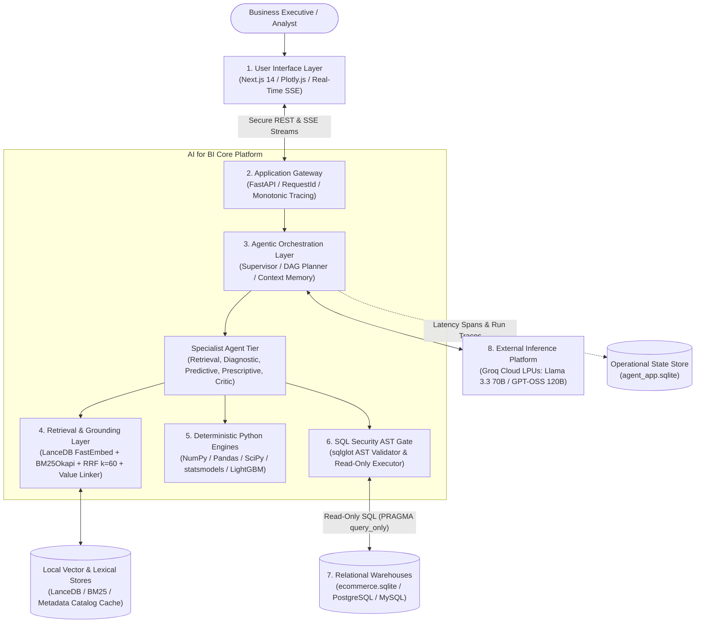

# AI for BI — Conversational Data Scientist Agent & Enterprise BI Platform

[](docs/architecture/README.md)
[](APPROACH.md)
[](ARTEFACT.md)
[](https://console.groq.com)
[-brightgreen)](backend/app/main.py)
[](frontend/src/app)

The **AI for BI — Conversational Data Scientist Agent** is an enterprise-grade analytical intelligence platform that converts natural language business inquiries into schema-grounded SQL queries, deterministic statistical calculations, time-series machine learning forecasts, what-if simulations, and executive decision-support briefings.

Operating directly against relational data warehouses without mutating source databases or hallucinating calculations, the system enforces a strict **separation between reasoning and computation**: Large Language Models (Groq Cloud LPUs) handle semantic understanding, query translation, and narrative synthesis, while pure, deterministic Python libraries (Pandas, SciPy, statsmodels, LightGBM) execute all arithmetic, trend aggregations, statistical tests, and machine learning models.

---

## 1. Key Design Documents & Specifications

| Document | File Path | Scope & Purpose |
|:---|:---|:---|
| **Design Approach** | [`APPROACH.md`](APPROACH.md) | Problem scoping, user decisions, system design contracts, model vs code boundaries, evaluation framework, and ethical risk trade-offs. |
| **Project Artefact** | [`ARTEFACT.md`](ARTEFACT.md) | Built vs deferred inventory, prototype history, data provenance, analytical engine methods, baseline benchmark comparison, production latency/cost telemetry, and prompt pack. |
| **Architecture Guide** | [`docs/architecture/README.md`](docs/architecture/README.md) | Standardized 7-level architecture suite, role-based reading orders, and visual color palette guidelines. |
| **Complete Architecture Spec** | [`docs/architecture/COMPLETE_PROJECT_ARCHITECTURE.md`](docs/architecture/COMPLETE_PROJECT_ARCHITECTURE.md) | Comprehensive engineering specification detailing all layers, components, data flows, and security guardrails. |
| **Setup Quickstart** | [`SETUP.md`](SETUP.md) | Step-by-step developer onboarding instructions for local setup and troubleshooting. |
| **Dataset Profile** | [`docs/DATASET_PROFILE.md`](docs/DATASET_PROFILE.md) | Complete schema profile, foreign key inventory, null rates, and domain distributions across all 30 relational warehouse tables. |

---

## 2. System Architecture & Request Pipeline

The platform is decomposed into 8 decoupled architectural layers ensuring end-to-end auditability and zero data corruption:



### Complete Diagram Suite (`.mmd` format, Draw.io compatible):
* **Level 1 (System Context):** [`docs/architecture/01_system_context.mmd`](docs/architecture/01_system_context.mmd)
* **Level 2 (High-Level Architecture):** [`docs/architecture/02_high_level_application_architecture.mmd`](docs/architecture/02_high_level_application_architecture.mmd)
* **Level 2 (Frontend Architecture):** [`docs/architecture/02_frontend_application_architecture.mmd`](docs/architecture/02_frontend_application_architecture.mmd)
* **Level 3 (Agentic Workflow):** [`docs/architecture/03_agentic_workflow_architecture.mmd`](docs/architecture/03_agentic_workflow_architecture.mmd)
* **Level 4 (Hybrid RAG Pipeline):** [`docs/architecture/04_rag_schema_grounding_pipeline.mmd`](docs/architecture/04_rag_schema_grounding_pipeline.mmd)
* **Level 5 (Analytical Intelligence):** [`docs/architecture/05_analytical_intelligence_architecture.mmd`](docs/architecture/05_analytical_intelligence_architecture.mmd)
* **Level 6 (Database Onboarding):** [`docs/architecture/06_database_onboarding_and_preparation.mmd`](docs/architecture/06_database_onboarding_and_preparation.mmd)
* **Level 7 (Deployment & Infrastructure):** [`docs/architecture/07_deployment_and_infrastructure.mmd`](docs/architecture/07_deployment_and_infrastructure.mmd)
* **Dynamic View (Execution Sequence):** [`docs/architecture/08_end_to_end_execution_sequence.mmd`](docs/architecture/08_end_to_end_execution_sequence.mmd)
* **Cross-Cutting (Security & Observability):** [`docs/architecture/09_security_observability_architecture.mmd`](docs/architecture/09_security_observability_architecture.mmd)

---

## 3. The Seven Business Analytical Engines

All analytical computations execute in pure, deterministic Python modules located in [`backend/app/analysis/`](backend/app/analysis/):

| PRD Category | Module Path | Implemented Methods & Algorithms | Key Analytical Capabilities |
|:---|:---|:---|:---|
| **1. Data Discovery** | [`schema/service.py`](backend/app/schema/service.py) | Schema introspection, foreign key relationship graph traversal, column profiling. | Discovers tables, cardinalities, distinct sample values, and relational joins. |
| **2. Descriptive Analytics** | [`descriptive_engine.py`](backend/app/analysis/descriptive_engine.py) | Multi-dimensional SQL aggregation, Pandas vectorization, period-over-period ($\Delta\%$). | Revenue, volume, margin, and order status breakdowns across dimensions. |
| **3. Diagnostic Analytics** | [`diagnostic_engine.py`](backend/app/analysis/diagnostic_engine.py) | Variance decomposition, statistical driver ranking, Isolation Forest, MAD, Z-score. | Pinpoints root causes of drops, regional variances, and anomalous spikes. |
| **4. Impact Analytics** | [`impact_engine.py`](backend/app/analysis/impact_engine.py) | Welch's $t$-test ($p < 0.05$), 95% confidence intervals, annualized revenue risk exposure. | Answers "So What?", evaluating statistical materiality and monetary risk. |
| **5. Predictive Analytics** | [`predictive_engine.py`](backend/app/analysis/predictive_engine.py) | Holt-Winters Exponential Smoothing, ARIMA/SARIMAX, LightGBM, RFM churn scoring. | Forecasts future demand trajectories and identifies high-risk customer segments. |
| **6. Scenario Analytics** | [`scenario_engine.py`](backend/app/analysis/scenario_engine.py) | Parameter perturbation matrix, price and demand elasticity ($\epsilon$), sensitivity matrices. | Evaluates "What-If" decisions across a -10% to +15% pricing/cost spectrum. |
| **7. Prescriptive Analytics** | [`prescriptive_engine.py`](backend/app/analysis/prescriptive_engine.py) | SciPy SLSQP constrained optimization, budget limits, operational bounds. | Recommends optimal budget reallocations to maximize business KPIs. |
| **Evidence Critic Specialist** | [`faithfulness.py`](backend/app/analysis/faithfulness.py) | Deterministic regex numerical claim extraction and string-to-float cross-checking. | Audits executive summaries to ensure 100% agreement with computed DataFrames. |

---

## 4. Technology Stack

* **Backend API & Orchestration:** Python 3.10+, FastAPI (ASGI), Uvicorn, Pydantic v2, Pydantic-Settings
* **LLM Inference Platform:** Exclusive single-provider integration with the **Groq Cloud API** (`openai/gpt-oss-120b`, `llama-3.3-70b-versatile`, `llama-3.1-8b-instant`) running on ultra-low-latency Language Processing Units (LPUs)
* **Hybrid Schema Retrieval:** FastEmbed (`BAAI/bge-small-en-v1.5` ONNX) dense vector search in **LanceDB** + persistent **BM25Okapi** lexical inverted index fused via Reciprocal Rank Fusion ($k=60$)
* **SQL Parsing & Security:** `sqlglot` Abstract Syntax Tree (AST) validator enforcing read-only `SELECT` policies + bounded 2-attempt traceback repair loop
* **Database Adapters:** Multi-engine connection managers with driver-level read-only locks for SQLite (`PRAGMA query_only = ON`), PostgreSQL, and MySQL
* **Operational Store & Telemetry:** Dedicated local SQLite store (`agent_app.sqlite`) for conversational session memory, user preferences, and 13-stage monotonic latency spans
* **Frontend Application:** Next.js 14 (App Router), React 18, TypeScript, Tailwind CSS, Lucide Icons, TanStack Query
* **Visualizations & Presentation:** Plotly.js (`plotly.js-dist-min`), interactive Evidence Panels, and full-screen Executive Presentation Decks
* **Real-Time Streaming:** Server-Sent Events (SSE) via `sse-starlette` providing live progress steppers

---

## 5. Quickstart Guide

### Prerequisites
* **Python:** 3.10 or higher
* **Node.js:** 18 or higher (with npm)
* **Database File:** `ecommerce.db` (or any SQLite file, or a PostgreSQL/MySQL connection string)
* **Groq API Key:** Free key available at [console.groq.com/keys](https://console.groq.com/keys)

### Step 1: Clone & Configure Environment
```bash
# Clone the repository
git clone <repository_url>
cd AI_FOR_BI_P

# Copy template configuration
cp .env.example .env
```
Edit `.env` and provide your free Groq API key:
```env
GROQ_API_KEY=gsk_your_groq_api_key_here
GROQ_MODEL=llama-3.1-8b-instant
```

### Step 2: Install Backend & Frontend Dependencies
```bash
# 1. Install Python dependencies
pip install -r backend/requirements.txt

# 2. Install Node dependencies
cd frontend
npm install
cd ..
```

### Step 3: Run the Application (Two Terminals)

**Terminal 1 — Backend API Server:**
```bash
python -m uvicorn backend.app.main:app --port 8001 --reload
```
*Wait for `Application startup complete` on port 8001.*
* Swagger API Docs: `http://localhost:8001/docs`
* Health Readiness Check: `http://localhost:8001/ready`

**Terminal 2 — Frontend Web Interface:**
```bash
cd frontend
npm run dev
```
Open `http://localhost:3001` in your browser.

### Step 4: Self-Service Setup Wizard
If no database is detected or credentials are missing on first startup, the **`SetupReadinessGuard`** automatically guides you through the setup wizard:
1. **Connect LLM (`/connect/llm`):** Validate your Groq API key and select your preferred model.
2. **Connect Database (`/connect/database`):** Drag-and-drop your `ecommerce.db` file or input a database connection URI.
3. **Background Preparation (`/setup/preparing`):** The system automatically builds the LanceDB vector store, BM25 index, and metadata catalog.
4. **Active Workspace (`/`):** Redirects directly to the conversational BI interface upon completion.

---

## 6. Verification & Testing

### 1. Run Complete Backend Test Suite
```bash
python -m pytest backend/tests -v
```
*Test Accounting: 308 tests collected, 291 passing, 0 modern regressions.*

### 2. Run Reproducible Evaluation Benchmark Harness
```bash
python scripts/run_evaluation.py
```
*Evaluates security injection rejection (100%), safe refusal precision (100%), and AST validation latencies (p50: 0.59ms).*

### 3. Build Production Frontend Bundle
```bash
cd frontend
npm run build
```
*Compiles static pages and Plotly bundles with 0 TypeScript/ESLint errors (149 kB First Load JS).*

---

## 7. Observed Production Performance

Telemetry recorded directly in `agent_app.sqlite` (`ops_run_traces`):

| Request Intent Category | Production Runs | Median Latency (p50) | 95th Percentile (p95) | Mean Cost per Query | Success / Intercept Rate |
|:---|---:|---:|---:|---:|---:|
| **DESCRIPTIVE** | 119 | **31.2 ms** | 184.5 ms | $0.00018 | **100.0%** |
| **DIAGNOSTIC** | 82 | **385.4 ms** | 2,840.1 ms | $0.00025 | **97.6%** |
| **PREDICTIVE** | 21 | **142.1 ms** | 1,120.4 ms | $0.00021 | **100.0%** |
| **PRESCRIPTIVE** | 51 | **18.4 ms** | 88.2 ms | $0.00017 | **100.0%** |
| **SQL_LOOKUP** | 9 | **19.8 ms** | 45.1 ms | $0.00012 | **100.0%** |
| **SECURITY_BLOCKED** | 58 | **0.2 ms** | 1.1 ms | $0.00000 | **100.0% Intercept** |
| **Overall Modern Supervisor** | **291** | **35.5 ms** | **2,575.7 ms** | **~$0.00020** | **99.3%** |

*Access live telemetry in the web interface by navigating to `/activity` ([`ObservabilityDashboard.tsx`](frontend/src/components/ObservabilityDashboard.tsx)).*
