# Verified Dataset Profile: `ecommerce.sqlite`

> **Status:** Phase 0 Reconnaissance Complete
>
> **Database File:** `ecommerce.sqlite` (47,439,872 bytes / ~45.2 MB)
>
> **Access Mode:** Strict Read-Only (`mode=ro`)
>
> **Total Tables:** 30
>
> **Total Views:** 0
>
> **Total Rows:** 334,503
>
> **Total Indexes:** 61
>
> **Total Foreign Key Relationships:** 44
>
> **Foreign Key Integrity Violations:** 0 (Verified via `PRAGMA foreign_key_check`)
>
> **Temporal Span:** 2023-01-01 to 2025-12-31 (3 full calendar years, 1,096 consecutive days)

---

## 1. Executive Summary & Data Domains
The database is an enterprise e-commerce operational and analytical warehouse containing 30 interconnected tables. The dataset represents 3 years of complete business history (January 1, 2023 to December 31, 2025) covering orders, fulfillment, logistics, catalog management, inventory levels, customer lifecycle, multi-touch web tracking, advertising spend, reviews, returns, and support interactions.
### Functional Domain Breakdown
| Domain | Tables Included | Primary Business Purpose |
|---|---|---|
| **Customers & Segments** | `customers`, `customer_addresses`, `customer_segments`, `customer_segment_history` | 5,000 customers across Brazilian states; longitudinal RFM-based segment transitions (VIP, Loyal, Occasional, New, At Risk, Dormant). |
| **Orders & Transactions** | `orders`, `order_items`, `payments`, `shipments`, `shipment_events` | 17,924 orders (17,274 delivered, 650 cancelled) totaling $21,761,969.17 gross revenue; 30,707 order line items. |
| **Merchandising & Catalog** | `brands`, `categories`, `product_categories`, `products`, `seller_products`, `promotions` | 1,000 products, 30 brands, 30 categories, 4 targeted promotional campaigns. |
| **Supply Chain & Warehousing** | `warehouses`, `suppliers`, `purchase_orders`, `inventory`, `sellers` | 20 regional distribution centers, 24 suppliers, 3,000 POs, monthly inventory snapshots (12,960 records). |
| **Marketing & Attribution** | `marketing_channels`, `marketing_spend`, `website_sessions`, `session_events` | 8 acquisition channels (Paid Search, Social, Email, Direct, etc.), daily spend across 8,768 records, 71,046 web sessions, 34,640 clickstream events. |
| **Post-Purchase & Service** | `returns`, `refunds`, `reviews`, `support_tickets` | 2,277 returns, 1,853 refunds, 9,224 customer reviews (1-5 stars), 2,174 support tickets with CSAT scores. |
| **Financials & Planning** | `expenses`, `daily_targets` | 6,576 expense records (logistics, marketing, payroll, software), 1,096 daily sales/order target benchmarks. |

## 2. Entity-Relationship Graph
Below is the structural relationship graph derived directly from foreign key declarations:

```mermaid
graph TD
    customers --> customer_addresses
    customers --> customer_segment_history
    customer_segments --> customer_segment_history
    customers --> orders
    marketing_channels --> orders
    promotions --> orders
    orders --> order_items
    products --> order_items
    sellers --> order_items
    orders --> payments
    orders --> shipments
    warehouses --> shipments
    shipments --> shipment_events
    orders --> returns
    returns --> refunds
    orders --> reviews
    customers --> support_tickets
    orders --> support_tickets
    categories --> categories
    brands --> products
    categories --> products
    products --> product_categories
    categories --> product_categories
    products --> seller_products
    sellers --> seller_products
    suppliers --> purchase_orders
    warehouses --> purchase_orders
    products --> purchase_orders
    warehouses --> inventory
    products --> inventory
    marketing_channels --> marketing_spend
    marketing_channels --> website_sessions
    customers --> website_sessions
    orders --> website_sessions
    website_sessions --> session_events
    products --> session_events
    marketing_channels --> daily_targets
    warehouses --> expenses
```

## 3. Comprehensive Table Inventory (30 Tables)

### Table: `brands`
- **Row Count:** 30
- **Total Columns:** 3
- **Foreign Keys:** None
- **Indexes (1):** `sqlite_autoindex_brands_1` (UNIQUE [brand_name])

**Columns Definition:**

| Column | SQLite Type | PK | Not Null | Null % | Distinct | Value Range / Sample |
|---|---|---|---|---|---|---|
| `brand_id` | `INTEGER` | ✓ |  | 0.0% | 30 | `1` to `30` |
| `brand_name` | `TEXT` |  | ✓ | 0.0% | 30 | `Alvorada` to `Zircon` |
| `country_of_origin` | `TEXT` |  | ✓ | 0.0% | 5 | `Argentina` to `United States` |

---

### Table: `categories`
- **Row Count:** 30
- **Total Columns:** 4
- **Foreign Keys (1):** `parent_category_id` -> `categories.category_id`
- **Indexes (2):** `idx_categories_parent` ([parent_category_id]), `sqlite_autoindex_categories_1` (UNIQUE [category_name])

**Columns Definition:**

| Column | SQLite Type | PK | Not Null | Null % | Distinct | Value Range / Sample |
|---|---|---|---|---|---|---|
| `category_id` | `INTEGER` | ✓ |  | 0.0% | 30 | `1` to `30` |
| `parent_category_id` | `INTEGER` |  |  | 20.0% | 6 | `1` to `26` |
| `category_name` | `TEXT` |  | ✓ | 0.0% | 30 | `Accessories` to `Wearables` |
| `description` | `TEXT` |  | ✓ | 0.0% | 30 | `Accessories products within Fashion.` to `Wearables products within Electronics.` |

---

### Table: `customer_addresses`
- **Row Count:** 6,915
- **Total Columns:** 8
- **Foreign Keys (1):** `customer_id` -> `customers.customer_id`
- **Indexes (2):** `uq_customer_default_address` (UNIQUE [customer_id]), `idx_addresses_customer` ([customer_id])

**Columns Definition:**

| Column | SQLite Type | PK | Not Null | Null % | Distinct | Value Range / Sample |
|---|---|---|---|---|---|---|
| `address_id` | `INTEGER` | ✓ |  | 0.0% | 6,915 | `1` to `6915` |
| `customer_id` | `INTEGER` |  | ✓ | 0.0% | 5,000 | `1` to `5000` |
| `address_type` | `TEXT` |  | ✓ | 0.0% | 2 | `billing` to `shipping` |
| `city` | `TEXT` |  | ✓ | 0.0% | 24 | `Aracaju` to `Vitoria` |
| `state` | `TEXT` |  | ✓ | 0.0% | 23 | `AL` to `TO` |
| `postal_code` | `TEXT` |  | ✓ | 0.0% | 6,915 | `01028-375` to `99971-124` |
| `country` | `TEXT` |  | ✓ | 0.0% | 1 | `Brazil` |
| `is_default` | `INTEGER` |  | ✓ | 0.0% | 2 | `0` to `1` |

---

### Table: `customer_segment_history`
- **Row Count:** 10,199
- **Total Columns:** 5
- **Foreign Keys (2):** `segment_id` -> `customer_segments.segment_id`, `customer_id` -> `customers.customer_id`
- **Indexes (3):** `uq_open_segment_per_customer` (UNIQUE [customer_id]), `idx_segment_history_segment` ([segment_id]), `idx_segment_history_customer` ([customer_id, valid_from])

**Columns Definition:**

| Column | SQLite Type | PK | Not Null | Null % | Distinct | Value Range / Sample |
|---|---|---|---|---|---|---|
| `history_id` | `INTEGER` | ✓ |  | 0.0% | 10,199 | `1` to `10199` |
| `customer_id` | `INTEGER` |  | ✓ | 0.0% | 5,000 | `1` to `5000` |
| `segment_id` | `INTEGER` |  | ✓ | 0.0% | 6 | `1` to `6` |
| `valid_from` | `TEXT` |  | ✓ | 0.0% | 1,422 | `2022-01-04` to `2025-12-31` |
| `valid_to` | `TEXT` |  |  | 49.02% | 1,078 | `2023-01-05` to `2025-12-31` |

---

### Table: `customer_segments`
- **Row Count:** 6
- **Total Columns:** 3
- **Foreign Keys:** None
- **Indexes (1):** `sqlite_autoindex_customer_segments_1` (UNIQUE [segment_name])

**Columns Definition:**

| Column | SQLite Type | PK | Not Null | Null % | Distinct | Value Range / Sample |
|---|---|---|---|---|---|---|
| `segment_id` | `INTEGER` | ✓ |  | 0.0% | 6 | `1` to `6` |
| `segment_name` | `TEXT` |  | ✓ | 0.0% | 6 | `At Risk` to `VIP` |
| `description` | `TEXT` |  | ✓ | 0.0% | 6 | `Customers with 0-1 orders who signed up in the las` to `Repeat customers with 6-11 lifetime orders.` |

---

### Table: `customers`
- **Row Count:** 5,000
- **Total Columns:** 12
- **Foreign Keys (1):** `acquisition_channel_id` -> `marketing_channels.channel_id`
- **Indexes (4):** `idx_customers_status` ([status]), `idx_customers_acquisition` ([acquisition_channel_id]), `idx_customers_signup` ([signup_date]), `sqlite_autoindex_customers_1` (UNIQUE [email])

**Columns Definition:**

| Column | SQLite Type | PK | Not Null | Null % | Distinct | Value Range / Sample |
|---|---|---|---|---|---|---|
| `customer_id` | `INTEGER` | ✓ |  | 0.0% | 5,000 | `1` to `5000` |
| `customer_name` | `TEXT` |  | ✓ | 0.0% | 4,715 | `Agatha Andrade` to `Ísis da Rocha` |
| `email` | `TEXT` |  | ✓ | 0.0% | 5,000 | `agatha.almeida.4413@example.com.br` to `zoe.viana.3445@gmail.com` |
| `signup_date` | `TEXT` |  | ✓ | 0.0% | 1,389 | `2022-01-04` to `2025-12-31` |
| `gender` | `TEXT` |  | ✓ | 0.0% | 4 | `female` to `unknown` |
| `birth_date` | `TEXT` |  |  | 0.0% | 4,426 | `1949-05-13` to `2007-10-11` |
| `acquisition_channel_id` | `INTEGER` |  | ✓ | 0.0% | 8 | `1` to `8` |
| `status` | `TEXT` |  | ✓ | 0.0% | 1 | `active` |
| `city` | `TEXT` |  | ✓ | 0.0% | 24 | `Aracaju` to `Vitoria` |
| `state` | `TEXT` |  | ✓ | 0.0% | 23 | `AL` to `TO` |
| `country` | `TEXT` |  | ✓ | 0.0% | 1 | `Brazil` |
| `created_at` | `TEXT` |  | ✓ | 0.0% | 4,996 | `2022-01-04T21:14:07` to `2025-12-31T21:55:44` |

---

### Table: `daily_targets`
- **Row Count:** 1,096
- **Total Columns:** 6
- **Foreign Keys (1):** `channel_id` -> `marketing_channels.channel_id`
- **Indexes (1):** `idx_daily_targets_date` ([target_date])

**Columns Definition:**

| Column | SQLite Type | PK | Not Null | Null % | Distinct | Value Range / Sample |
|---|---|---|---|---|---|---|
| `target_id` | `INTEGER` | ✓ |  | 0.0% | 1,096 | `1` to `1096` |
| `target_date` | `TEXT` |  | ✓ | 0.0% | 1,096 | `2023-01-01` to `2025-12-31` |
| `channel_id` | `INTEGER` |  |  | 100.0% | 0 | N/A |
| `target_revenue` | `REAL` |  | ✓ | 0.0% | 16 | `3840.0` to `8960.0` |
| `target_orders` | `INTEGER` |  | ✓ | 0.0% | 16 | `12` to `28` |
| `target_margin` | `REAL` |  | ✓ | 0.0% | 1 | `0.42` |

---

### Table: `expenses`
- **Row Count:** 6,576
- **Total Columns:** 6
- **Foreign Keys (1):** `warehouse_id` -> `warehouses.warehouse_id`
- **Indexes (2):** `idx_expenses_category` ([expense_category]), `idx_expenses_date` ([expense_date])

**Columns Definition:**

| Column | SQLite Type | PK | Not Null | Null % | Distinct | Value Range / Sample |
|---|---|---|---|---|---|---|
| `expense_id` | `INTEGER` | ✓ |  | 0.0% | 6,576 | `1` to `6576` |
| `expense_date` | `TEXT` |  | ✓ | 0.0% | 1,096 | `2023-01-01` to `2025-12-31` |
| `expense_category` | `TEXT` |  | ✓ | 0.0% | 6 | `logistics` to `software` |
| `warehouse_id` | `INTEGER` |  |  | 100.0% | 0 | N/A |
| `amount` | `REAL` |  | ✓ | 0.0% | 4,373 | `47.0` to `515.1` |
| `description` | `TEXT` |  | ✓ | 0.0% | 6 | `Daily logistics expense.` to `Daily software expense.` |

---

### Table: `inventory`
- **Row Count:** 12,960
- **Total Columns:** 7
- **Foreign Keys (2):** `product_id` -> `products.product_id`, `warehouse_id` -> `warehouses.warehouse_id`
- **Indexes (3):** `idx_inventory_warehouse_date` ([warehouse_id, snapshot_date]), `idx_inventory_product_date` ([product_id, snapshot_date]), `sqlite_autoindex_inventory_1` (UNIQUE [warehouse_id, product_id, snapshot_date])

**Columns Definition:**

| Column | SQLite Type | PK | Not Null | Null % | Distinct | Value Range / Sample |
|---|---|---|---|---|---|---|
| `inventory_id` | `INTEGER` | ✓ |  | 0.0% | 12,960 | `1` to `12960` |
| `warehouse_id` | `INTEGER` |  | ✓ | 0.0% | 20 | `1` to `20` |
| `product_id` | `INTEGER` |  | ✓ | 0.0% | 355 | `1` to `1000` |
| `snapshot_date` | `TEXT` |  | ✓ | 0.0% | 36 | `2023-01-01` to `2025-12-01` |
| `stock_on_hand` | `INTEGER` |  | ✓ | 0.0% | 349 | `0` to `373` |
| `reserved_quantity` | `INTEGER` |  | ✓ | 0.0% | 7 | `0` to `6` |
| `reorder_level` | `INTEGER` |  | ✓ | 0.0% | 58 | `9` to `66` |

---

### Table: `marketing_channels`
- **Row Count:** 8
- **Total Columns:** 3
- **Foreign Keys:** None
- **Indexes (1):** `sqlite_autoindex_marketing_channels_1` (UNIQUE [channel_name])

**Columns Definition:**

| Column | SQLite Type | PK | Not Null | Null % | Distinct | Value Range / Sample |
|---|---|---|---|---|---|---|
| `channel_id` | `INTEGER` | ✓ |  | 0.0% | 8 | `1` to `8` |
| `channel_name` | `TEXT` |  | ✓ | 0.0% | 8 | `Affiliates` to `Referral` |
| `channel_type` | `TEXT` |  | ✓ | 0.0% | 4 | `organic` to `referral` |

---

### Table: `marketing_spend`
- **Row Count:** 8,768
- **Total Columns:** 8
- **Foreign Keys (1):** `channel_id` -> `marketing_channels.channel_id`
- **Indexes (2):** `idx_marketing_spend_date` ([spend_date]), `sqlite_autoindex_marketing_spend_1` (UNIQUE [channel_id, spend_date])

**Columns Definition:**

| Column | SQLite Type | PK | Not Null | Null % | Distinct | Value Range / Sample |
|---|---|---|---|---|---|---|
| `spend_id` | `INTEGER` | ✓ |  | 0.0% | 8,768 | `1` to `8768` |
| `channel_id` | `INTEGER` |  | ✓ | 0.0% | 8 | `1` to `8` |
| `spend_date` | `TEXT` |  | ✓ | 0.0% | 1,096 | `2023-01-01` to `2025-12-31` |
| `campaign_id` | `TEXT` |  |  | 99.49% | 1 | `BF2024` |
| `spend_amount` | `REAL` |  | ✓ | 0.0% | 5,131 | `0.0` to `1729.53` |
| `impressions` | `INTEGER` |  | ✓ | 0.0% | 5,166 | `0` to `120868` |
| `clicks` | `INTEGER` |  | ✓ | 0.0% | 2,342 | `0` to `5959` |
| `conversions` | `INTEGER` |  | ✓ | 0.0% | 6 | `0` to `5` |

---

### Table: `order_items`
- **Row Count:** 30,707
- **Total Columns:** 10
- **Foreign Keys (4):** `seller_product_id` -> `seller_products.seller_product_id`, `seller_id` -> `sellers.seller_id`, `product_id` -> `products.product_id`, `order_id` -> `orders.order_id`
- **Indexes (4):** `idx_order_items_seller` ([seller_id]), `idx_order_items_product` ([product_id]), `idx_order_items_order` ([order_id]), `sqlite_autoindex_order_items_1` (UNIQUE [order_id, product_id])

**Columns Definition:**

| Column | SQLite Type | PK | Not Null | Null % | Distinct | Value Range / Sample |
|---|---|---|---|---|---|---|
| `order_item_id` | `INTEGER` | ✓ |  | 0.0% | 30,707 | `1` to `30707` |
| `order_id` | `INTEGER` |  | ✓ | 0.0% | 17,924 | `1` to `17924` |
| `product_id` | `INTEGER` |  | ✓ | 0.0% | 971 | `1` to `1000` |
| `seller_id` | `INTEGER` |  | ✓ | 0.0% | 100 | `1` to `100` |
| `seller_product_id` | `INTEGER` |  | ✓ | 0.0% | 1,899 | `1` to `2000` |
| `quantity` | `INTEGER` |  | ✓ | 0.0% | 3 | `1` to `3` |
| `unit_price` | `REAL` |  | ✓ | 0.0% | 1,873 | `15.61` to `2244.76` |
| `unit_cost` | `REAL` |  | ✓ | 0.0% | 1,632 | `10.09` to `892.82` |
| `discount_amount` | `REAL` |  | ✓ | 0.0% | 3,156 | `0.0` to `1346.86` |
| `line_total` | `REAL` |  | ✓ | 0.0% | 7,231 | `14.26` to `6734.28` |

---

### Table: `orders`
- **Row Count:** 17,924
- **Total Columns:** 14
- **Foreign Keys (3):** `promotion_id` -> `promotions.promotion_id`, `channel_id` -> `marketing_channels.channel_id`, `customer_id` -> `customers.customer_id`
- **Indexes (5):** `idx_orders_status` ([order_status]), `idx_orders_promotion` ([promotion_id]), `idx_orders_channel` ([channel_id]), `idx_orders_customer` ([customer_id, order_date]), `idx_orders_date` ([order_date])

**Columns Definition:**

| Column | SQLite Type | PK | Not Null | Null % | Distinct | Value Range / Sample |
|---|---|---|---|---|---|---|
| `order_id` | `INTEGER` | ✓ |  | 0.0% | 17,924 | `1` to `17924` |
| `customer_id` | `INTEGER` |  | ✓ | 0.0% | 3,308 | `1` to `5000` |
| `order_date` | `TEXT` |  | ✓ | 0.0% | 1,096 | `2023-01-01` to `2025-12-31` |
| `order_status` | `TEXT` |  | ✓ | 0.0% | 2 | `cancelled` to `delivered` |
| `currency` | `TEXT` |  | ✓ | 0.0% | 1 | `BRL` |
| `subtotal` | `REAL` |  | ✓ | 0.0% | 10,490 | `15.61` to `11977.32` |
| `discount_amount` | `REAL` |  | ✓ | 0.0% | 3,125 | `0.0` to `1799.69` |
| `shipping_fee` | `REAL` |  | ✓ | 0.0% | 4 | `0.0` to `39.9` |
| `tax_amount` | `REAL` |  | ✓ | 0.0% | 9,157 | `1.25` to `958.19` |
| `total_amount` | `REAL` |  | ✓ | 0.0% | 12,188 | `26.76` to `12935.51` |
| `sales_channel` | `TEXT` |  | ✓ | 0.0% | 4 | `marketplace` to `web` |
| `channel_id` | `INTEGER` |  |  | 44.53% | 8 | `1` to `8` |
| `promotion_id` | `INTEGER` |  |  | 97.95% | 4 | `1` to `4` |
| `created_at` | `TEXT` |  | ✓ | 0.0% | 17,891 | `2023-01-01T22:03:07` to `2025-12-31T23:27:12` |

---

### Table: `payments`
- **Row Count:** 17,924
- **Total Columns:** 7
- **Foreign Keys (1):** `order_id` -> `orders.order_id`
- **Indexes (4):** `idx_payments_status` ([payment_status]), `idx_payments_date` ([payment_date]), `sqlite_autoindex_payments_2` (UNIQUE [transaction_reference]), `sqlite_autoindex_payments_1` (UNIQUE [order_id])

**Columns Definition:**

| Column | SQLite Type | PK | Not Null | Null % | Distinct | Value Range / Sample |
|---|---|---|---|---|---|---|
| `payment_id` | `INTEGER` | ✓ |  | 0.0% | 17,924 | `1` to `17924` |
| `order_id` | `INTEGER` |  | ✓ | 0.0% | 17,924 | `1` to `17924` |
| `payment_date` | `TEXT` |  | ✓ | 0.0% | 1,096 | `2023-01-01` to `2025-12-31` |
| `payment_method` | `TEXT` |  | ✓ | 0.0% | 5 | `boleto` to `voucher` |
| `payment_status` | `TEXT` |  | ✓ | 0.0% | 2 | `paid` to `voided` |
| `amount` | `REAL` |  | ✓ | 0.0% | 12,188 | `26.76` to `12935.51` |
| `transaction_reference` | `TEXT` |  | ✓ | 0.0% | 17,924 | `PAY-00000001-440675` to `PAY-00017924-706721` |

---

### Table: `product_categories`
- **Row Count:** 414
- **Total Columns:** 2
- **Foreign Keys (2):** `category_id` -> `categories.category_id`, `product_id` -> `products.product_id`
- **Indexes (2):** `idx_product_categories_category` ([category_id]), `sqlite_autoindex_product_categories_1` (UNIQUE [product_id, category_id])

**Columns Definition:**

| Column | SQLite Type | PK | Not Null | Null % | Distinct | Value Range / Sample |
|---|---|---|---|---|---|---|
| `product_id` | `INTEGER` | ✓ | ✓ | 0.0% | 414 | `4` to `997` |
| `category_id` | `INTEGER` | ✓ | ✓ | 0.0% | 24 | `2` to `30` |

---

### Table: `products`
- **Row Count:** 1,000
- **Total Columns:** 12
- **Foreign Keys (2):** `category_id` -> `categories.category_id`, `brand_id` -> `brands.brand_id`
- **Indexes (4):** `idx_products_status` ([status]), `idx_products_brand` ([brand_id]), `idx_products_category` ([category_id]), `sqlite_autoindex_products_1` (UNIQUE [sku])

**Columns Definition:**

| Column | SQLite Type | PK | Not Null | Null % | Distinct | Value Range / Sample |
|---|---|---|---|---|---|---|
| `product_id` | `INTEGER` | ✓ |  | 0.0% | 1,000 | `1` to `1000` |
| `sku` | `TEXT` |  | ✓ | 0.0% | 1,000 | `SKU-000001` to `SKU-001000` |
| `product_name` | `TEXT` |  | ✓ | 0.0% | 1,000 | `Alvorada Classic Fragrances Kit 0184` to `Zircon Signature Team Sports Collection 0667` |
| `brand_id` | `INTEGER` |  | ✓ | 0.0% | 30 | `1` to `30` |
| `category_id` | `INTEGER` |  | ✓ | 0.0% | 24 | `2` to `30` |
| `cost_price` | `REAL` |  | ✓ | 0.0% | 981 | `10.09` to `797.16` |
| `list_price` | `REAL` |  | ✓ | 0.0% | 995 | `15.0` to `2003.23` |
| `weight_kg` | `REAL` |  | ✓ | 0.0% | 517 | `0.1` to `14.82` |
| `status` | `TEXT` |  | ✓ | 0.0% | 3 | `active` to `launched` |
| `launch_date` | `TEXT` |  | ✓ | 0.0% | 711 | `2020-07-16` to `2025-12-22` |
| `discontinue_date` | `TEXT` |  |  | 94.8% | 52 | `2021-05-05` to `2025-12-23` |
| `created_at` | `TEXT` |  | ✓ | 0.0% | 711 | `2020-07-16T08:00:00` to `2025-12-22T08:00:00` |

---

### Table: `promotions`
- **Row Count:** 4
- **Total Columns:** 8
- **Foreign Keys:** None
- **Indexes (1):** `idx_promotions_window` ([start_date, end_date])

**Columns Definition:**

| Column | SQLite Type | PK | Not Null | Null % | Distinct | Value Range / Sample |
|---|---|---|---|---|---|---|
| `promotion_id` | `INTEGER` | ✓ |  | 0.0% | 4 | `1` to `4` |
| `promotion_name` | `TEXT` |  | ✓ | 0.0% | 4 | `Black Friday 2024` to `Sports Week 2024` |
| `promotion_type` | `TEXT` |  | ✓ | 0.0% | 1 | `percentage` |
| `start_date` | `TEXT` |  | ✓ | 0.0% | 4 | `2023-09-01` to `2025-03-10` |
| `end_date` | `TEXT` |  | ✓ | 0.0% | 4 | `2023-09-10` to `2025-03-20` |
| `discount_rate` | `REAL` |  | ✓ | 0.0% | 4 | `0.07` to `0.2` |
| `campaign_id` | `TEXT` |  |  | 0.0% | 4 | `BF2024` to `SPORT2024` |
| `description` | `TEXT` |  |  | 0.0% | 4 | `10% off Fashion during Fashion Week.` to `8% off Home & Living assortment.` |

---

### Table: `purchase_orders`
- **Row Count:** 3,000
- **Total Columns:** 11
- **Foreign Keys (3):** `product_id` -> `products.product_id`, `warehouse_id` -> `warehouses.warehouse_id`, `supplier_id` -> `suppliers.supplier_id`
- **Indexes (3):** `idx_purchase_orders_warehouse` ([warehouse_id]), `idx_purchase_orders_product` ([product_id]), `idx_purchase_orders_supplier` ([supplier_id, order_date])

**Columns Definition:**

| Column | SQLite Type | PK | Not Null | Null % | Distinct | Value Range / Sample |
|---|---|---|---|---|---|---|
| `purchase_order_id` | `INTEGER` | ✓ |  | 0.0% | 3,000 | `1` to `3000` |
| `supplier_id` | `INTEGER` |  | ✓ | 0.0% | 24 | `1` to `24` |
| `warehouse_id` | `INTEGER` |  | ✓ | 0.0% | 20 | `1` to `20` |
| `product_id` | `INTEGER` |  | ✓ | 0.0% | 946 | `1` to `1000` |
| `order_date` | `TEXT` |  | ✓ | 0.0% | 998 | `2023-01-01` to `2025-11-30` |
| `expected_date` | `TEXT` |  | ✓ | 0.0% | 1,008 | `2023-01-08` to `2025-12-21` |
| `received_date` | `TEXT` |  |  | 0.0% | 1,011 | `2023-01-08` to `2025-12-21` |
| `quantity_ordered` | `INTEGER` |  | ✓ | 0.0% | 556 | `40` to `599` |
| `quantity_received` | `INTEGER` |  | ✓ | 0.0% | 554 | `32` to `598` |
| `unit_cost` | `REAL` |  | ✓ | 0.0% | 2,828 | `9.29` to `824.44` |
| `purchase_order_status` | `TEXT` |  | ✓ | 0.0% | 3 | `late` to `received` |

---

### Table: `refunds`
- **Row Count:** 1,853
- **Total Columns:** 8
- **Foreign Keys (3):** `return_id` -> `returns.return_id`, `order_id` -> `orders.order_id`, `payment_id` -> `payments.payment_id`
- **Indexes (3):** `idx_refunds_date` ([refund_date]), `idx_refunds_return` ([return_id]), `idx_refunds_order` ([order_id])

**Columns Definition:**

| Column | SQLite Type | PK | Not Null | Null % | Distinct | Value Range / Sample |
|---|---|---|---|---|---|---|
| `refund_id` | `INTEGER` | ✓ |  | 0.0% | 1,853 | `1` to `1853` |
| `payment_id` | `INTEGER` |  | ✓ | 0.0% | 1,782 | `8` to `17575` |
| `order_id` | `INTEGER` |  | ✓ | 0.0% | 1,782 | `8` to `17575` |
| `return_id` | `INTEGER` |  |  | 0.0% | 1,853 | `2` to `2275` |
| `refund_date` | `TEXT` |  | ✓ | 0.0% | 867 | `2023-01-14` to `2025-12-31` |
| `refund_amount` | `REAL` |  | ✓ | 0.0% | 1,149 | `14.29` to `6093.09` |
| `refund_reason` | `TEXT` |  | ✓ | 0.0% | 7 | `changed_mind` to `wrong_item` |
| `refund_status` | `TEXT` |  | ✓ | 0.0% | 2 | `pending` to `processed` |

---

### Table: `returns`
- **Row Count:** 2,277
- **Total Columns:** 7
- **Foreign Keys (1):** `order_item_id` -> `order_items.order_item_id`
- **Indexes (3):** `idx_returns_status` ([return_status]), `idx_returns_date` ([return_date]), `idx_returns_item` ([order_item_id])

**Columns Definition:**

| Column | SQLite Type | PK | Not Null | Null % | Distinct | Value Range / Sample |
|---|---|---|---|---|---|---|
| `return_id` | `INTEGER` | ✓ |  | 0.0% | 2,277 | `1` to `2277` |
| `order_item_id` | `INTEGER` |  | ✓ | 0.0% | 2,277 | `9` to `30375` |
| `return_date` | `TEXT` |  | ✓ | 0.0% | 935 | `2023-01-12` to `2025-12-31` |
| `return_reason` | `TEXT` |  | ✓ | 0.0% | 7 | `changed_mind` to `wrong_item` |
| `return_status` | `TEXT` |  | ✓ | 0.0% | 5 | `approved` to `requested` |
| `quantity_returned` | `INTEGER` |  | ✓ | 0.0% | 3 | `1` to `3` |
| `refund_amount` | `REAL` |  | ✓ | 0.0% | 1,356 | `14.29` to `6734.28` |

---

### Table: `reviews`
- **Row Count:** 9,224
- **Total Columns:** 8
- **Foreign Keys (3):** `order_item_id` -> `order_items.order_item_id`, `product_id` -> `products.product_id`, `customer_id` -> `customers.customer_id`
- **Indexes (4):** `idx_reviews_date` ([review_date]), `idx_reviews_customer` ([customer_id]), `idx_reviews_product_date` ([product_id, review_date]), `sqlite_autoindex_reviews_1` (UNIQUE [order_item_id])

**Columns Definition:**

| Column | SQLite Type | PK | Not Null | Null % | Distinct | Value Range / Sample |
|---|---|---|---|---|---|---|
| `review_id` | `INTEGER` | ✓ |  | 0.0% | 9,224 | `1` to `9224` |
| `customer_id` | `INTEGER` |  | ✓ | 0.0% | 2,434 | `1` to `4999` |
| `product_id` | `INTEGER` |  | ✓ | 0.0% | 912 | `1` to `1000` |
| `order_item_id` | `INTEGER` |  | ✓ | 0.0% | 9,224 | `1` to `30328` |
| `rating` | `INTEGER` |  | ✓ | 0.0% | 5 | `1` to `5` |
| `review_text` | `TEXT` |  | ✓ | 0.0% | 15 | `Arrived damaged or unusable.` to `Would not buy again.` |
| `review_date` | `TEXT` |  | ✓ | 0.0% | 1,084 | `2023-01-12` to `2025-12-31` |
| `verified_purchase` | `INTEGER` |  | ✓ | 0.0% | 1 | `1` |

---

### Table: `seller_products`
- **Row Count:** 2,000
- **Total Columns:** 7
- **Foreign Keys (2):** `product_id` -> `products.product_id`, `seller_id` -> `sellers.seller_id`
- **Indexes (4):** `idx_seller_products_seller` ([seller_id]), `idx_seller_products_product` ([product_id]), `sqlite_autoindex_seller_products_2` (UNIQUE [seller_id, seller_sku]), `sqlite_autoindex_seller_products_1` (UNIQUE [seller_id, product_id])

**Columns Definition:**

| Column | SQLite Type | PK | Not Null | Null % | Distinct | Value Range / Sample |
|---|---|---|---|---|---|---|
| `seller_product_id` | `INTEGER` | ✓ |  | 0.0% | 2,000 | `1` to `2000` |
| `seller_id` | `INTEGER` |  | ✓ | 0.0% | 100 | `1` to `100` |
| `product_id` | `INTEGER` |  | ✓ | 0.0% | 1,000 | `1` to `1000` |
| `seller_sku` | `TEXT` |  | ✓ | 0.0% | 2,000 | `001-000016-2` to `100-000943-1` |
| `selling_price` | `REAL` |  | ✓ | 0.0% | 1,970 | `15.61` to `2244.76` |
| `active_from` | `TEXT` |  | ✓ | 0.0% | 711 | `2020-07-16` to `2025-12-22` |
| `active_to` | `TEXT` |  |  | 100.0% | 0 | N/A |

---

### Table: `sellers`
- **Row Count:** 100
- **Total Columns:** 6
- **Foreign Keys:** None
- **Indexes:** None (using standard PK rowid)

**Columns Definition:**

| Column | SQLite Type | PK | Not Null | Null % | Distinct | Value Range / Sample |
|---|---|---|---|---|---|---|
| `seller_id` | `INTEGER` | ✓ |  | 0.0% | 100 | `1` to `100` |
| `seller_name` | `TEXT` |  | ✓ | 0.0% | 100 | `Seller 001 - Alves e Filhos` to `Seller 100 - Sampaio` |
| `city` | `TEXT` |  | ✓ | 0.0% | 8 | `Aracaju` to `Teresina` |
| `state` | `TEXT` |  | ✓ | 0.0% | 8 | `BA` to `SP` |
| `country` | `TEXT` |  | ✓ | 0.0% | 1 | `Brazil` |
| `created_at` | `TEXT` |  | ✓ | 0.0% | 100 | `2020-07-19T22:15:00` to `2022-09-02T22:31:35` |

---

### Table: `session_events`
- **Row Count:** 34,640
- **Total Columns:** 6
- **Foreign Keys (2):** `product_id` -> `products.product_id`, `session_id` -> `website_sessions.session_id`
- **Indexes (2):** `idx_session_events_time` ([event_timestamp]), `idx_session_events_session` ([session_id, event_timestamp])

**Columns Definition:**

| Column | SQLite Type | PK | Not Null | Null % | Distinct | Value Range / Sample |
|---|---|---|---|---|---|---|
| `event_id` | `INTEGER` | ✓ |  | 0.0% | 34,640 | `1` to `105880` |
| `session_id` | `INTEGER` |  | ✓ | 0.0% | 10,434 | `2` to `71043` |
| `event_timestamp` | `TEXT` |  | ✓ | 0.0% | 34,509 | `2023-01-01T22:03:34` to `2025-12-31T23:27:12` |
| `event_type` | `TEXT` |  | ✓ | 0.0% | 6 | `add_to_cart` to `search` |
| `product_id` | `INTEGER` |  |  | 51.05% | 944 | `1` to `1000` |
| `page_path` | `TEXT` |  | ✓ | 0.0% | 955 | `/` to `/search` |

---

### Table: `shipment_events`
- **Row Count:** 71,310
- **Total Columns:** 6
- **Foreign Keys (1):** `shipment_id` -> `shipments.shipment_id`
- **Indexes (2):** `idx_shipment_events_time` ([event_timestamp]), `idx_shipment_events_shipment` ([shipment_id, event_timestamp])

**Columns Definition:**

| Column | SQLite Type | PK | Not Null | Null % | Distinct | Value Range / Sample |
|---|---|---|---|---|---|---|
| `event_id` | `INTEGER` | ✓ |  | 0.0% | 71,310 | `18` to `105950` |
| `shipment_id` | `INTEGER` |  | ✓ | 0.0% | 17,274 | `1` to `17274` |
| `event_timestamp` | `TEXT` |  | ✓ | 0.0% | 67,181 | `2023-01-02T08:28:00` to `2026-01-16T10:42:00` |
| `event_type` | `TEXT` |  | ✓ | 0.0% | 5 | `delay_reported` to `picked_up` |
| `location` | `TEXT` |  | ✓ | 0.0% | 20 | `Aracaju, SE` to `Vitoria, ES` |
| `description` | `TEXT` |  |  | 0.0% | 8 | `CarrierA reported a transit delay.` to `Parcel in transit.` |

---

### Table: `shipments`
- **Row Count:** 17,274
- **Total Columns:** 10
- **Foreign Keys (2):** `warehouse_id` -> `warehouses.warehouse_id`, `order_id` -> `orders.order_id`
- **Indexes (6):** `idx_shipments_status` ([shipping_status]), `idx_shipments_warehouse` ([warehouse_id]), `idx_shipments_carrier` ([carrier]), `idx_shipments_shipped` ([shipped_at]), `idx_shipments_order` ([order_id]), `sqlite_autoindex_shipments_1` (UNIQUE [order_id])

**Columns Definition:**

| Column | SQLite Type | PK | Not Null | Null % | Distinct | Value Range / Sample |
|---|---|---|---|---|---|---|
| `shipment_id` | `INTEGER` | ✓ |  | 0.0% | 17,274 | `1` to `17274` |
| `order_id` | `INTEGER` |  | ✓ | 0.0% | 17,274 | `1` to `17924` |
| `warehouse_id` | `INTEGER` |  | ✓ | 0.0% | 20 | `1` to `20` |
| `carrier` | `TEXT` |  | ✓ | 0.0% | 4 | `CarrierA` to `CarrierD` |
| `shipping_method` | `TEXT` |  | ✓ | 0.0% | 3 | `economy` to `standard` |
| `shipped_at` | `TEXT` |  | ✓ | 0.0% | 17,050 | `2023-01-02T08:28:00` to `2026-01-02T18:39:00` |
| `estimated_delivery_at` | `TEXT` |  | ✓ | 0.0% | 1,106 | `2023-01-06T18:00:00` to `2026-01-16T18:00:00` |
| `delivered_at` | `TEXT` |  |  | 0.0% | 16,992 | `2023-01-04T13:51:00` to `2026-01-16T10:42:00` |
| `shipping_status` | `TEXT` |  | ✓ | 0.0% | 1 | `delivered` |
| `shipping_cost` | `REAL` |  | ✓ | 0.0% | 3,233 | `9.21` to `62.54` |

---

### Table: `suppliers`
- **Row Count:** 24
- **Total Columns:** 7
- **Foreign Keys:** None
- **Indexes:** None (using standard PK rowid)

**Columns Definition:**

| Column | SQLite Type | PK | Not Null | Null % | Distinct | Value Range / Sample |
|---|---|---|---|---|---|---|
| `supplier_id` | `INTEGER` | ✓ |  | 0.0% | 24 | `1` to `24` |
| `supplier_name` | `TEXT` |  | ✓ | 0.0% | 24 | `Supplier 01` to `Supplier 24` |
| `city` | `TEXT` |  | ✓ | 0.0% | 24 | `Aracaju` to `Vitoria` |
| `state` | `TEXT` |  | ✓ | 0.0% | 23 | `AL` to `TO` |
| `country` | `TEXT` |  | ✓ | 0.0% | 1 | `Brazil` |
| `lead_time_days` | `INTEGER` |  | ✓ | 0.0% | 12 | `3` to `25` |
| `reliability_score` | `REAL` |  | ✓ | 0.0% | 23 | `0.583` to `0.965` |

---

### Table: `support_tickets`
- **Row Count:** 2,174
- **Total Columns:** 9
- **Foreign Keys (2):** `order_id` -> `orders.order_id`, `customer_id` -> `customers.customer_id`
- **Indexes (4):** `idx_tickets_status` ([ticket_status]), `idx_tickets_order` ([order_id]), `idx_tickets_customer` ([customer_id]), `idx_tickets_created` ([created_at])

**Columns Definition:**

| Column | SQLite Type | PK | Not Null | Null % | Distinct | Value Range / Sample |
|---|---|---|---|---|---|---|
| `ticket_id` | `INTEGER` | ✓ |  | 0.0% | 2,174 | `1` to `2174` |
| `customer_id` | `INTEGER` |  | ✓ | 0.0% | 1,227 | `2` to `4999` |
| `order_id` | `INTEGER` |  |  | 0.0% | 2,084 | `32` to `17666` |
| `created_at` | `TEXT` |  | ✓ | 0.0% | 2,174 | `2023-01-14T21:33:22` to `2025-12-30T21:54:52` |
| `resolved_at` | `TEXT` |  |  | 13.98% | 1,870 | `2023-01-17T20:09:55` to `2025-12-31T20:33:24` |
| `issue_type` | `TEXT` |  | ✓ | 0.0% | 6 | `account` to `return_refund` |
| `priority` | `TEXT` |  | ✓ | 0.0% | 4 | `high` to `urgent` |
| `ticket_status` | `TEXT` |  | ✓ | 0.0% | 4 | `closed` to `resolved` |
| `satisfaction_score` | `INTEGER` |  |  | 13.98% | 5 | `1` to `5` |

---

### Table: `warehouses`
- **Row Count:** 20
- **Total Columns:** 6
- **Foreign Keys:** None
- **Indexes:** None (using standard PK rowid)

**Columns Definition:**

| Column | SQLite Type | PK | Not Null | Null % | Distinct | Value Range / Sample |
|---|---|---|---|---|---|---|
| `warehouse_id` | `INTEGER` | ✓ |  | 0.0% | 20 | `1` to `20` |
| `warehouse_name` | `TEXT` |  | ✓ | 0.0% | 20 | `Warehouse AL-18` to `Warehouse SP-02` |
| `city` | `TEXT` |  | ✓ | 0.0% | 20 | `Aracaju` to `Vitoria` |
| `state` | `TEXT` |  | ✓ | 0.0% | 19 | `AL` to `SP` |
| `country` | `TEXT` |  | ✓ | 0.0% | 1 | `Brazil` |
| `capacity` | `INTEGER` |  | ✓ | 0.0% | 19 | `29000` to `79500` |

---

### Table: `website_sessions`
- **Row Count:** 71,046
- **Total Columns:** 9
- **Foreign Keys (3):** `order_id` -> `orders.order_id`, `channel_id` -> `marketing_channels.channel_id`, `customer_id` -> `customers.customer_id`
- **Indexes (5):** `idx_sessions_converted` ([converted]), `idx_sessions_customer` ([customer_id]), `idx_sessions_channel_start` ([channel_id, session_start]), `idx_sessions_start` ([session_start]), `sqlite_autoindex_website_sessions_1` (UNIQUE [order_id])

**Columns Definition:**

| Column | SQLite Type | PK | Not Null | Null % | Distinct | Value Range / Sample |
|---|---|---|---|---|---|---|
| `session_id` | `INTEGER` | ✓ |  | 0.0% | 71,046 | `1` to `71046` |
| `customer_id` | `INTEGER` |  |  | 64.52% | 3,673 | `1` to `5000` |
| `channel_id` | `INTEGER` |  | ✓ | 0.0% | 8 | `1` to `8` |
| `session_start` | `TEXT` |  | ✓ | 0.0% | 70,440 | `2023-01-01T22:00:22` to `2025-12-31T22:59:21` |
| `session_end` | `TEXT` |  | ✓ | 0.0% | 70,543 | `2023-01-01T22:14:13` to `2025-12-31T23:31:06` |
| `device_type` | `TEXT` |  | ✓ | 0.0% | 3 | `desktop` to `tablet` |
| `landing_page` | `TEXT` |  | ✓ | 0.0% | 9 | `/` to `/search` |
| `converted` | `INTEGER` |  | ✓ | 0.0% | 2 | `0` to `1` |
| `order_id` | `INTEGER` |  |  | 95.08% | 3,493 | `1` to `17907` |

---

## 4. Data Quality & Anomaly Assessment

Through automated profiling, the following structural characteristics and anomalies were verified:

1. **100% Structural Consistency:** `PRAGMA foreign_key_check` reported 0 broken relational links across all 44 foreign key declarations.
2. **No Duplicate Primary Keys:** All 30 tables have defined primary keys with 0 duplicate values.
3. **100% Null Columns:**
   - `daily_targets.channel_id`: 100% NULL (Targets are set at the global company level per day, not partitioned per channel).
   - `expenses.warehouse_id`: 100% NULL (Operating expenses are categorized into payroll, software, logistics, marketing at corporate level, not warehouse level).
   - `seller_products.active_to`: 100% NULL (All 2,000 seller-product listings are currently active without a scheduled sunset date).
4. **High Null Rate Attributes (Design Patterns):**
   - `orders.promotion_id`: 98.0% NULL (Promotions are sparse campaigns; only 367 out of 17,924 orders utilized a promo code).
   - `marketing_spend.campaign_id`: 99.5% NULL (Spend is tracked primarily at the channel and date level, with only select tracked campaigns).
   - `products.discontinue_date`: 94.8% NULL (Only 52 products have been discontinued; 948 remain in active catalog).
   - `orders.channel_id`: 44.5% NULL (Represents direct, organic, or unattributed checkout flows).
   - `website_sessions.customer_id`: 64.5% NULL (Anonymous top-of-funnel browsing traffic prior to login or checkout).
   - `website_sessions.order_id`: 95.1% NULL (Reflects a realistic ~4.9% e-commerce session-to-order conversion rate).
5. **Financial Reconciliations:**
   - Delivered Orders: 17,274 orders totaling $20,891,624.33.
   - Paid Payments: 17,274 records totaling $20,891,624.33 (Exact 1:1 match with delivered orders).
   - Cancelled Orders: 650 orders totaling $870,344.84.
   - Voided Payments: 650 records totaling $870,344.84 (Exact 1:1 match with cancelled orders).

## 5. Analytical Suitability Matrix

| Analysis Type | Suitability | Supported Capabilities | Required Caveats / Defenses |
|---|---|---|---|
| **Descriptive Analytics (What)** | **Full Support** | Total revenue, order volumes, average order value (AOV), refund rates, fulfillment speed, regional breakdown. | Distinguish gross order value ($21.76M) from net delivered revenue ($20.89M) and handle refunds ($1.85M) accurately. |
| **Diagnostic Analytics (Why)** | **Full Support** | Category drop-offs, carrier shipping delays, conversion funnel bottlenecks, review rating drivers. | Correlation is not causation; explain associations without claiming definitive causal proof unless controlled quasi-experiments are established. |
| **Trend & Time Series** | **Full Support** | Daily, weekly, monthly, and quarterly aggregations across 3 complete calendar years (2023-2025). | Continuous time series; leap year (2024) included; seasonality patterns clearly detectable across Q4 peaks (Black Friday). |
| **Predictive Forecasting** | **Full Support** | 36 months of continuous daily order and revenue history provide sufficient training and holdout periods for AutoARIMA, Prophet, and LightGBM models. | Holdouts must be strictly time-ordered (no future data leakage). |
| **Customer Churn / Retention** | **Full Support** | Longitudinal segment tracking in `customer_segment_history` (transitions between VIP, Loyal, Occasional, At Risk, Dormant). | Churn predictions represent risk probabilities, not certainties. |
| **Prescriptive & Optimization** | **Conditional Support** | Inventory reorder triggers (lead times, warehouse capacities, snapshot burn rates); promotion pricing adjustments. | Must state explicit constraints, objectives, and assumptions. Abstain if constraints are undefined. |
