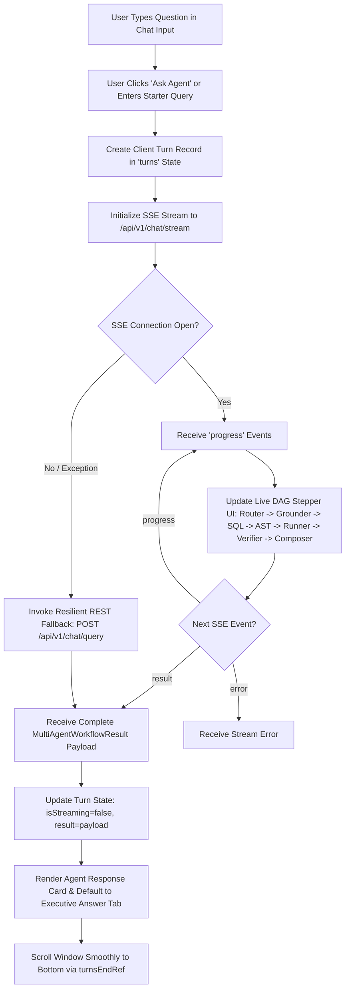
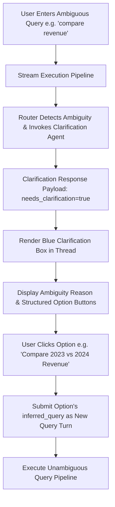
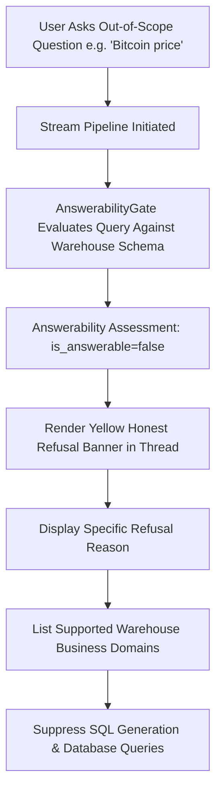
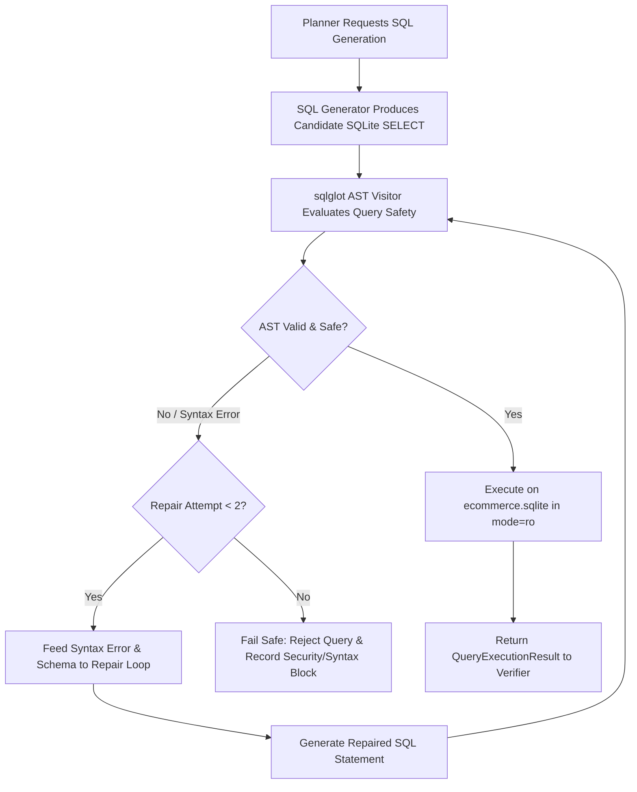
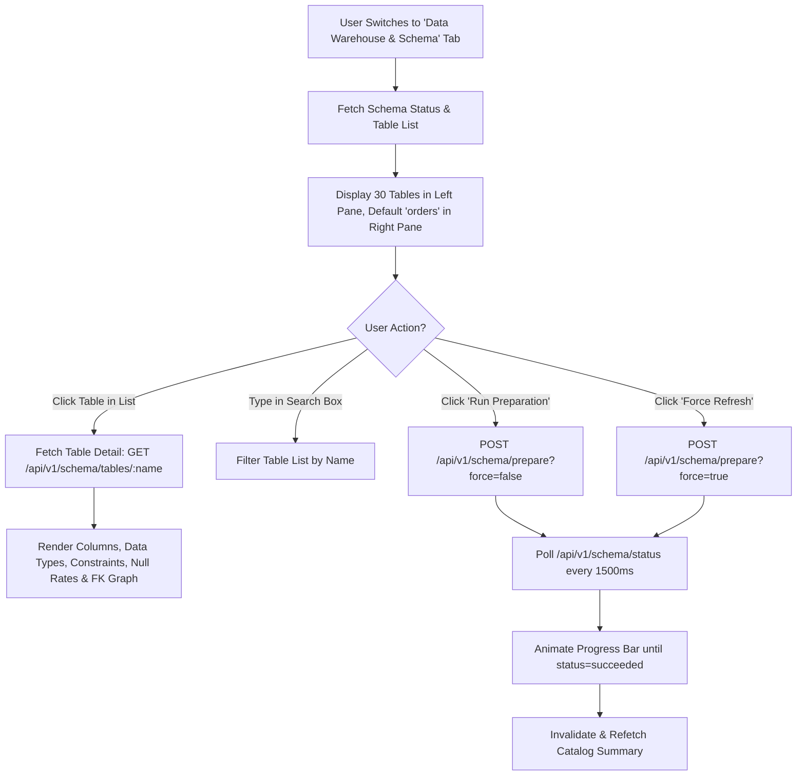

# Complete Frontend Reverse Engineering & Architectural Report
**AI for BI — Data Scientist Agent**
*Prepared by Senior Frontend Architect, Full-Stack Reverse Engineer, UI/UX Analyst, and API Integration Documentation Engineer*
*Documentation Target: Baseline for AI-Driven Frontend Redesign*

---

## Executive Summary

The **AI for BI Data Scientist Agent** is an enterprise conversational Business Intelligence and analytics web application. It connects business stakeholders to an underlying 30-table, 334,503-row retail and logistics data warehouse (`ecommerce.sqlite`), providing natural language exploration, deterministic statistical/predictive modeling, dynamic Plotly visualizations, schema exploration, and real-time operational telemetry.

The frontend is implemented as a single-page application (SPA) using **Next.js 14.2 (App Router)**, **React 18.3**, **TypeScript 5.4**, **Tailwind CSS 3.4**, **TanStack Query 5**, **Zod 3**, **Plotly.js**, and **Lucide React**.

This report delivers a complete reverse-engineering of the frontend codebase, detailing every route, screen, component, user interaction, state lifecycle, API dependency, visual design token, and existing limitation. It serves as the authoritative source of truth for redesigning and modernizing the user interface without compromising underlying business logic, API contracts, or architectural invariants.

---

## SECTION A — Application Overview & Architecture

### A.1 Core Application Purpose

Based on repository evidence (`DEVELOPMENT_HISTORY.md`, `README.md`, `docs/ARCHITECTURE.md`, `docs/DATASET_PROFILE.md`), the application provides:
1. **Conversational Business Intelligence:** Answers natural language business questions using strict schema grounding, deterministic SQL generation, AST security guardrails, and automated bounded repair.
2. **Deterministic Data Science & Machine Learning Tools:** Executes non-LLM Python algorithms for customer churn risk ranking (Wilson score intervals), Median Absolute Deviation (MAD) anomaly detection, Holt-Winters/exponential smoothing time-series forecasting, what-if elasticity simulation, and SLSQP marketing budget optimization.
3. **Interactive Visual Analytics:** Automatically derives Plotly.js chart specifications (line, bar, pie/donut) with seamless tabular data fallbacks and PNG/CSV/JSON export.
4. **Data Warehouse & Schema Catalog Explorer:** Provides an interactive catalog of 30 tables, foreign key lineage graphs, null distributions, distinct counts, and sample ranges with asynchronous background profiling.
5. **System Readiness & High-Resolution Telemetry:** Real-time observability tracking p50, p95, and p99 latency percentiles, error classifications, verification outcomes, and security block records stored in an isolated SQLite database (`agent_app.sqlite`).

### A.2 User Types & Roles

Currently, the application implements **no user authentication, session logins, or role-based access control (RBAC)**:
- **Single Universal Role:** All users interact as an enterprise Business Analyst / Data Scientist.
- **Client Session Isolation:** Each browser tab randomly generates an ephemeral `sessionId` (format: `sess-[random7]`, e.g., `sess-a8b2c9d`) on mount, which is transmitted with every chat query to isolate multi-turn context memory in `agent_app.sqlite`.
- **Default Hardcoded Identity:** API endpoints in `backend/app/api/v1/endpoints/memory.py` default `user_id` to `"default_user"`.

### A.3 Main Functional Modules

```
┌────────────────────────────────────────────────────────────────────────┐
│                   AI for BI — Frontend Module Structure                │
├────────────────────────────────┬───────────────────────────────────────┤
│ Module                         │ Primary Implementation Files          │
├────────────────────────────────┼───────────────────────────────────────┤
│ 1. Application Shell & Nav     │ app/layout.tsx, app/page.tsx,         │
│                                │ components/Header.tsx                 │
├────────────────────────────────┼───────────────────────────────────────┤
│ 2. Conversational BI & Chat    │ components/ChatInterface.tsx,         │
│                                │ components/PlotlyChartRenderer.tsx    │
├────────────────────────────────┼───────────────────────────────────────┤
│ 3. Data Warehouse Catalog      │ components/SchemaReadinessSection.tsx │
├────────────────────────────────┼───────────────────────────────────────┤
│ 4. Telemetry & Observability   │ components/ObservabilityDashboard.tsx │
├────────────────────────────────┼───────────────────────────────────────┤
│ 5. System Health & Readiness   │ components/HealthReadinessCard.tsx,   │
│                                │ app/page.tsx (Pipeline Section)       │
├────────────────────────────────┼───────────────────────────────────────┤
│ 6. API Client & Contracts      │ lib/api.ts, types/api.ts              │
└────────────────────────────────┴───────────────────────────────────────┘
```

### A.4 Technology Stack Inventory

- **Frontend Framework:** Next.js `14.2.15` (App Router architecture, React Server Components enabled but all interactive pages use `"use client"`).
- **UI Runtime:** React `18.3.1`, React DOM `18.3.1`.
- **Language:** TypeScript `5.4.3` (`strict: true` in `tsconfig.json`).
- **Styling Framework:** Tailwind CSS `3.4.1`, PostCSS `8.4.38`, Autoprefixer `10.4.19`, `clsx` `2.1.0`, `tailwind-merge` `2.2.2`.
- **State & Server Cache:** `@tanstack/react-query` `5.28.9` (QueryClient with 5-second default `staleTime`, `refetchOnWindowFocus: false`).
- **Data Contract Validation:** `zod` `3.22.4` (Full bidirectional schema validation for all API request/response envelopes).
- **Data Visualization:** `plotly.js-dist-min` `4.2.0`, `@types/plotly.js-dist-min` `2.3.4` (dynamically loaded via client-side `import()`).
- **Icons:** `lucide-react` `0.359.0`.
- **Backend Technology:** Python `3.14.7`, FastAPI `0.141.1`, Pydantic `2.13.5`, `sqlglot` `30.21.0`, `sqlite3`, `sse-starlette` `3.2.0`, Uvicorn.
- **Data Stores:**
  - `ecommerce.sqlite` (30 tables, 334,503 rows) — strictly read-only (`mode=ro`).
  - `agent_app.sqlite` — writable store for session memory, turn history, and telemetry traces.

### A.5 Overall Frontend-Backend Architecture

```
User Browser (Port 3001)
  │
  ├─► Next.js App Router (app/layout.tsx, app/page.tsx)
  │     │
  │     ├── Providers (TanStack QueryClientProvider)
  │     ├── Header (Liveness badge & version)
  │     └── Tab Navigation Router (Local State: 'chat' | 'schema' | 'observability' | 'system')
  │           │
  │           ├── [chat]          ──► ChatInterface.tsx
  │           │                         ├─► SSE Stream (/api/v1/chat/stream)
  │           │                         ├─► REST Query (/api/v1/chat/query)
  │           │                         └─► PlotlyChartRenderer.tsx
  │           │
  │           ├── [schema]        ──► SchemaReadinessSection.tsx
  │           │                         ├─► Status Poller (/api/v1/schema/status)
  │           │                         ├─► Async Profiler (/api/v1/schema/prepare)
  │           │                         ├─► Tables List (/api/v1/schema/tables)
  │           │                         └─► Table Detail (/api/v1/schema/tables/{name})
  │           │
  │           ├── [observability] ──► ObservabilityDashboard.tsx
  │           │                         ├─► Metrics (/api/v1/ops/metrics)
  │           │                         └─► Traces (/api/v1/ops/traces?limit=25)
  │           │
  │           └── [system]        ──► HealthReadinessCard.tsx
  │                                     └─► Readiness Probe (/api/v1/ready)
  │
  ▼
HTTP / SSE Requests (CORS / Direct / Rewrites)
  │
  ▼
FastAPI Application (Port 8001: backend/app/main.py)
  ├─► RequestIdMiddleware (X-Request-ID, X-Process-Time-Ms)
  ├─► CORSMiddleware (allow_origins, localhost regex)
  ├─► API Router (/api/v1/*)
  │     ├─► /ready, /health, /system/status
  │     ├─► /schema/* (job.py, service.py)
  │     ├─► /chat/* (orchestrator.py, stream)
  │     ├─► /retrieval/* (hybrid.py, semantics.py)
  │     ├─► /analysis/* (registry.py, churn, anomalies, forecast)
  │     ├─► /memory/* (service.py, SQLite store)
  │     └─► /ops/* (tracer.py, telemetry percentiles)
  │
  ├── ecommerce.sqlite (mode=ro, strictly read-only business data)
  └── agent_app.sqlite (read/write agent session state & traces)
```

### A.6 Build and Startup Mechanics

- **Frontend Development:** `npm run dev` executes `next dev -p 3001`.
- **Frontend Production Build:** `npm run build` executes `next build` (compiled with standalone SWC compiler; verified 0 errors).
- **Frontend Production Start:** `npm run start` executes `next start -p 3001`.
- **Backend Startup:** `python -m uvicorn backend.app.main:app --port 8001 --reload`.
- **API Base URL Configuration:** Defined in `frontend/src/lib/api.ts`:
  ```ts
  const API_BASE_URL = process.env.NEXT_PUBLIC_API_URL || "http://localhost:8001";
  ```
- **Next.js Rewrite Configuration (`next.config.mjs`):**
  ```js
  const backendPort = process.env.BACKEND_PORT || '8001';
  // Rewrites /api/backend/:path* -> http://localhost:${backendPort}/api/v1/:path*
  ```
  *(Important finding: `frontend/src/lib/api.ts` currently fetches directly from `${API_BASE_URL}/api/v1/...` rather than routing through the `/api/backend/` rewrite proxy. This creates direct cross-origin HTTP calls.)*

### A.7 Architectural Classification

- **Architecture:** Client-heavy Single-Page Application (SPA) delivered via Next.js App Router.
- **Server vs. Client Components:** All active components declare `"use client"`. No Next.js Server Actions or server-side data fetching (`getServerSideProps` / async RSC) are utilized.
- **Client State Paradigm:** Server data is managed via TanStack Query; interactive component state is managed with React `useState` and `useRef`.

### A.8 Confirmed Implementation vs. Areas of Uncertainty

| Aspect | Confirmed via Source Code | Uncertain / Requires Verification |
|---|---|---|
| Routes & Screens | Only 1 top-level route (`/`) with 4 tabbed screen views. | Whether multi-route URLs (`/chat`, `/schema`, `/ops`) are desired in redesign. |
| Authentication | Zero authentication code exists; ephemeral sessions only. | Whether production deployment requires JWT / OAuth2 / SSO. |
| Database Mutability | Strictly read-only connection enforced in backend; 0 mutation endpoints. | None (confirmed 100% immutable). |
| Real-time Streaming | SSE via `sse-starlette` and `fetch` with `ReadableStream` reader. | Reconnection / retry behavior when network drops mid-stream. |
| Plotly Bundle Size | Dynamically imported in browser only; prevents SSR window crashes. | Plotly bundle weight (~3MB) impacts initial component load. |
| Unused Endpoints | 5 frontend API functions are declared in `api.ts` but never mounted in UI. | Whether these 5 endpoints should be surfaced as UI features. |

---

## SECTION B — Complete Page and Route Inventory

The application implements a single Next.js route (`/`) containing four tabbed functional views that operate as distinct full-screen workspaces.

### Route Inventory Table

| View Identifier | URL Path | Component | Parent Layout | Authentication | Access Roles | Data Fetched on Load | Key Backend Endpoints |
|---|---|---|---|---|---|---|---|
| **Home / Conversational BI** | `/` (default tab: `"chat"`) | `ChatInterface` | `app/layout.tsx` | None | Public / All | None (idle state until user submits query) | `POST /api/v1/chat/stream`, `POST /api/v1/chat/query` |
| **Data Warehouse & Schema** | `/` (tab: `"schema"`) | `SchemaReadinessSection` | `app/layout.tsx` | None | Public / All | Schema status, table list, default table detail (`"orders"`) | `GET /api/v1/schema/status`, `GET /api/v1/schema/tables`, `GET /api/v1/schema/tables/orders`, `POST /api/v1/schema/prepare` |
| **Telemetry & Observability** | `/` (tab: `"observability"`) | `ObservabilityDashboard` | `app/layout.tsx` | None | Public / All | Aggregated latency KPIs, recent 25 execution traces | `GET /api/v1/ops/metrics`, `GET /api/v1/ops/traces?limit=25` |
| **System Health & Architecture** | `/` (tab: `"system"`) | `HealthReadinessCard` + Pipeline Steps | `app/layout.tsx` | None | Public / All | Overall readiness, warehouse stats, LLM provider status, persistence store | `GET /api/v1/ready` |

### Special Screens & Overlays
- **Offline Error Screen:** When `GET /api/v1/ready` fails or backend is unreachable, `HealthReadinessCard` renders a full-card error state displaying exact command instructions to start the backend.
- **Clarification Selection Modal/Banner:** Embedded inline inside the conversational thread when queries are ambiguous (e.g., "compare revenue").
- **Honest Refusal Banner:** Embedded inline inside conversational thread when questions exceed warehouse boundaries (e.g., cryptocurrency, dates outside 2023–2025).
- **Live SSE Multi-Agent Stepper:** Dynamically renders during active query execution, animating through 7 distinct DAG pipeline stages.

---

## SECTION C — Detailed Description of Every Page & View

### View 1: Root Application Shell & Header
- **Purpose:** Provides persistent application header, live backend connectivity status dot, version pill, top-level tabbed navigation bar, and persistent footer.
- **Route:** `/`
- **Source Files:**
  - Layout: `frontend/src/app/layout.tsx` (`RootLayout`)
  - Page Controller: `frontend/src/app/page.tsx` (`HomePage`)
  - Header Component: `frontend/src/components/Header.tsx` (`Header`)
  - Providers: `frontend/src/app/providers.tsx` (`Providers`)
- **Visual Hierarchy:**
  1. **Top Header Bar:** Left side has Sparkles icon, "AI for BI Data Scientist Agent" title, `v0.1.0` version pill, and subtitle. Right side displays a live pulsating status dot (`bg-success animate-pulse` when online, `bg-warning` when connecting) and text ("Backend Online" / "Connecting...").
  2. **Sticky Navigation Bar:** Below header, `sticky top-0 z-30` with `backdrop-blur`. Contains 4 pill-style navigation tabs with icons, labels, and dynamic badge pills.
  3. **Main Content Container:** Centered max-width container (`max-w-7xl mx-auto px-6 py-6`).
  4. **Footer:** Simple subtle border-top bar with center-aligned copyright and mission statement.
- **Tab Badges Evidenced in Code:**
  - `Conversational BI`: Badge text `"Active Thread"`.
  - `Data Warehouse & Schema`: Dynamic badge `${data?.database?.table_count ?? 30} Tables`.
  - `Telemetry & Latency`: Badge text `"p50 / p95 Traces"`.
  - `System Health & Pipeline`: Dynamic badge `data?.ready ? "Verified" : "Connecting"`.
- **State Management:**
  - Local state: `activeTab: NavigationTab` (`"chat" | "schema" | "observability" | "system"`), defaults to `"chat"`.
  - TanStack Query: `queryKey: ["readiness"]`, calling `fetchReadiness()`, polling every 15,000ms (`refetchInterval: 15000`).

---

### View 2: Conversational BI (`ChatInterface`)
- **Purpose:** Core user workspace for natural language business analytics. Accepts business questions, runs real-time Server-Sent Events DAG streaming, displays multi-turn message history, renders executive answers with citations, embeds interactive Plotly charts, exposes deterministic ML tool artifacts, displays AST-validated SQL with repair history, renders data tables with CSV/JSON export, and provides clickable follow-up questions.
- **Route:** `/` (when `activeTab === "chat"`)
- **Source Files:** `frontend/src/components/ChatInterface.tsx`, `frontend/src/components/PlotlyChartRenderer.tsx`.
- **Layout Structure:**
  1. **Query Input Card (Top):**
     - Header with MessageSquare icon, title, "Shared Memory & Streaming Active" badge, random session ID pill (e.g. `sess-4f2k9a`), and "+ New Session" button.
     - Single-line search/query input form with right-aligned action button ("Ask Agent" / "Running DAG...").
     - Starter queries rack: Lightbulb icon followed by 7 clickable sample query pills.
  2. **Conversational Thread (Scrollable Area Below):**
     - Renders array of `turns: ChatTurn[]`.
     - User message bubble aligned to the right (blue background `bg-primary text-white`), displaying timestamp, query text, and standalone rewrite label if ContextResolver modified the text.
     - Streaming progress card (animated pulse border) with live step message and 7-stage DAG progress stepper.
     - Execution error card (red alert) if an uncaught exception occurred.
     - Completed agent response card with meta badges, grounded table pills, and sub-view navigation tabs.
- **Sub-Tabs in Completed Agent Card:**
  - **Executive Answer (`narrative`):** Formatted text narrative with citations, Copy Narrative button, embedded Plotly chart preview, "Verified Factual Findings" grid, and "Data Coverage & Caveats" warning box.
  - **Chart (`chart`):** Full standalone interactive Plotly visualization.
  - **Analysis (`analysis`):** Dedicated statistical/ML tool artifact (Customer Churn Risk table, Anomaly Detection table with z-scores, Forecast table with 80%/95% confidence intervals, or SLSQP Budget Allocation).
  - **DAG (`plan`):** Execution plan step breakdown with step IDs, tool names, descriptions, dependencies, and completed status badges.
  - **SQL (`sql`):** AST-validated SQLite query with Copy SQL button, syntax highlighting block, and Bounded SQL Repair Trail (showing error message and repaired statement for attempts 1 and 2).
  - **Data (`data`):** Interactive data grid of executed query results with row count, execution time in ms, Export CSV button, Export JSON button, and 50-row clipping notice.
  - **Trace (`trace`):** Detailed pipeline execution trace listing step names, status indicators, descriptions, and millisecond durations.
- **Follow-up Suggestions Card:** Positioned at the bottom of each turn card, displaying trending up icon and 3 clickable contextual analytical follow-up buttons.
- **Input & Validation:**
  - Input field: `min_length: 2`, `max_length: 1000`. Trimmed on submission.
  - Submit button disabled when input is whitespace or while `isSubmitting === true`.
- **Backend Communication:**
  - Primary: `POST /api/v1/chat/stream` (SSE text/event-stream).
  - Fallback: `POST /api/v1/chat/query` (Standard JSON REST request executed if stream closes prematurely or throws an exception).

---

### View 3: Data Warehouse & Schema Catalog Explorer (`SchemaReadinessSection`)
- **Purpose:** Explores the 30 tables and relationships in `ecommerce.sqlite`. Displays table summary statistics, column types, null percentages, distinct counts, sample ranges, primary/foreign keys, and provides an on-demand schema profiling trigger.
- **Route:** `/` (when `activeTab === "schema"`)
- **Source Files:** `frontend/src/components/SchemaReadinessSection.tsx`.
- **Layout Structure:**
  1. **Schema Preparation Job Card (Top):**
     - Header with title, "Catalogue Active" (green) or "Unprepared" (yellow) badge, and descriptive subtitle.
     - Action buttons: "Run Preparation" (triggers idempotent profiling) and "Force Refresh" (forces full re-profiling bypassing cache).
     - Live progress bar: Appears when a profiling job is running, showing animated percentage bar (`0%` to `100%`) and current processing table.
     - Summary KPI strip: Displays Profiled Tables (`30`), Total Records (`334,503`), SHA-256 Fingerprint snippet, and "Cached & Ready" status.
  2. **Two-Pane Explorer (Bottom):**
     - **Left Pane (Table Selector - 4 columns wide on lg):** Search filter input (`"Filter tables..."`), table counter, and scrollable vertical list of table cards showing table name and row count badge. Active table is highlighted in blue.
     - **Right Pane (Table Profile Inspector - 8 columns wide on lg):** Detailed inspector for selected table.
       - Title, row count pill, column count pill, primary key list, foreign key count, and index count.
       - Full columns table: Column Name, SQLite Type, Constraints (PK, FK, Date, Num, NN), Null Rate (color-coded red >50%, yellow >0%), Distinct Count, Sample Values / Range (`min -> max`).
       - Foreign Key Lineage cards: Grid showing relational mappings (`source_column -> target_table.target_column`).
- **State Management:**
  - Local state: `selectedTableName` (defaults to `"orders"`), `searchTerm` (filters table list).
  - TanStack Query:
    - `["schemaStatus"]`: Polled every 1,500ms when job is active; every 15,000ms when idle.
    - `["schemaTables"]`: Fetches all table summaries.
    - `["tableDetail", selectedTableName]`: Fetches detailed column metrics for selected table.
  - Mutation: `prepareMutation` calling `triggerSchemaPreparation(force)`.

---

### View 4: Telemetry & Observability Dashboard (`ObservabilityDashboard`)
- **Purpose:** Surfaces production telemetry captured in `agent_app.sqlite`. Provides non-parametric latency percentiles (p50, p95, p99), success rates, safety block counters, error class breakdowns, and an audit table of recent query executions.
- **Route:** `/` (when `activeTab === "observability"`)
- **Source Files:** `frontend/src/components/ObservabilityDashboard.tsx`.
- **Layout Structure:**
  1. **Header & Refresh Bar:** Title, "p50 / p95 / p99 Latency Tracer" badge, explanatory text, and "Refresh Telemetry" button.
  2. **Aggregated KPI Cards Grid (7 columns on lg):**
     - Total Runs (`total_runs`)
     - Success Rate (`success_rate_pct` with CheckCircle2 icon)
     - Latency p50 (`latency_p50_ms` with Clock icon)
     - Latency p95 (`latency_p95_ms` with Clock icon)
     - Latency p99 (`latency_p99_ms` with Clock icon)
     - Avg Latency (`avg_latency_ms`)
     - Security Blocks (`safety_block_count` with ShieldAlert icon)
  3. **Recorded Anomalies / Refusals Strip:** Renders when `error_classes_breakdown` has entries, displaying pill badges with error class name and count.
  4. **Recent Execution Traces Table:**
     - Displays up to 25 recent traces from `agent_app.sqlite`.
     - Columns: Time, Query (truncated with hover tooltip), Intent badge, Latency (color-coded: green `<1000ms`, yellow `1000-3000ms`, red `>3000ms`), Rows returned, Verification status badge (verified, blocked, refused), and SQL Action ("Copy SQL" button with 2-second checkmark feedback).
- **State Management:**
  - Local state: `copiedSql` (trace ID of copied SQL).
  - TanStack Query:
    - `["observabilityMetrics"]`: Polled every 10,000ms (`refetchInterval: 10000`).
    - `["recentTraces"]`: Polled every 10,000ms (`refetchInterval: 10000`).

---

### View 5: System Health & Pipeline Overview (`HealthReadinessCard` + Pipeline Steps)
- **Purpose:** Displays runtime infrastructure readiness, validates database read-only immutability, inspects LLM provider configuration, checks agent checkpoint store readiness, and provides a reference map of the 10-step multi-agent execution pipeline.
- **Route:** `/` (when `activeTab === "system"`)
- **Source Files:** `frontend/src/app/page.tsx`, `frontend/src/components/HealthReadinessCard.tsx`.
- **Layout Structure:**
  1. **Health Readiness Card (Top):**
     - Header: Title, readiness status pill ("Phase 1 Foundation Active" / "Action Required"), and manual refresh button.
     - 3-Column Diagnostic Grid:
       - **Business Warehouse:** Read-only verification badge (`ShieldCheck`), path (`ecommerce.sqlite`), cataloged table count (`30`), total rows (`334,503`), database size in MB (`45.2 MB`).
       - **LLM Synthesis:** Configuration badge ("Ready" / "Offline / Mock"), provider name (`gemini`), target model (`gemini-2.5-flash`), and status message.
       - **Agent Checkpoints:** Status badge ("Isolated"), target store (`agent_app.sqlite`), directory state ("Ready"), and isolation note.
  2. **Production Multi-Agent Pipeline Map (Bottom):**
     - Grid of 10 pipeline steps explaining the architecture:
       1. *Retrieve:* BM25 + Embedding RRF schema grounding
       2. *Constrain:* Allowlisted schema identifiers only
       3. *Plan:* Typed 7-step execution DAG
       4. *Generate:* Safe read-only SQLite SELECT generation
       5. *Validate:* sqlglot AST validation guardrail & bounded repair
       6. *Execute:* Strict read-only SQLite execution with row caps
       7. *Verify:* Result sanity, bounds, & arithmetic checks
       8. *Analyze:* Deterministic stats, forecasting, & ML tools
       9. *Visualize:* Plotly.js chart specifications & tables
       10. *Explain:* Executive narrative with citations & follow-ups

---

## SECTION D — Complete User Journeys and Frontend Flows

### Journey 1: Natural Language Conversational Query Flow



### Journey 2: Ambiguous Query & Clarification Flow



### Journey 3: Out-of-Scope Query & Honest Refusal Flow



### Journey 4: SQL Generation, AST Guardrail & Bounded Repair Flow



### Journey 5: Data Warehouse Schema Profiling & Inspection Flow



---

## SECTION E — Frontend-to-Backend Integration Summary

*(Note: Detailed per-endpoint contracts, schemas, parameters, and failure modes are compiled in Deliverable 2: `FRONTEND_BACKEND_INTEGRATION_MAP.md`.)*

### Central Integration Characteristics
1. **API Base URL Resolution:**
   - Evaluated as `process.env.NEXT_PUBLIC_API_URL || "http://localhost:8001"`.
   - All client calls currently make absolute requests directly to FastAPI on port 8001.
2. **Standard Response Envelope (`APIResponse[T]`):**
   ```ts
   {
     success: boolean;
     data?: T | null;
     error?: {
       code: string;
       message: string;
       details?: Record<string, any> | null;
       timestamp?: string;
     } | null;
     request_id?: string | null;
   }
   ```
3. **SSE Streaming Protocol:**
   - Endpoint: `POST /api/v1/chat/stream`.
   - Request body: `{"query": string, "session_id": string}`.
   - Response headers: `Content-Type: text/event-stream`.
   - Event types:
     - `progress`: JSON data `{"step": string, "message": string}`.
     - `result`: Full `MultiAgentWorkflowResult` JSON object.
     - `error`: JSON data `{"error": string}`.
     - `done`: Termination sentinel `{"status": "completed"}`.
   - Normalization: `lib/api.ts` converts `\r\n` to `\n` to ensure chunk boundaries split reliably on all operating systems.
4. **Session Management:**
   - Ephemeral client-generated session ID transmitted in query body.
   - Cleared on user click of "+ New Session".
   - Persisted server-side in `agent_app.sqlite` with multi-turn ContextResolver.

---

## SECTION F — UI Component & Reusability Inventory

| Component Name | Source File | Category | Reusability Status | Direct Dependencies |
|---|---|---|---|---|
| `RootLayout` | `app/layout.tsx` | App Shell | Single instance | `Providers`, `globals.css` |
| `Providers` | `app/providers.tsx` | Context Provider | Single instance | `@tanstack/react-query` |
| `HomePage` | `app/page.tsx` | View Router | Single instance | `Header`, `ChatInterface`, `SchemaReadinessSection`, `ObservabilityDashboard`, `HealthReadinessCard` |
| `Header` | `components/Header.tsx` | Navigation / Shell | Reusable across layouts | `lucide-react` |
| `ChatInterface` | `components/ChatInterface.tsx` | Major Workspace | Page-coupled (Monolithic) | `PlotlyChartRenderer`, `lib/api.ts`, `types/api.ts` |
| `PlotlyChartRenderer`| `components/PlotlyChartRenderer.tsx`| Visualization | **Highly Reusable** | `plotly.js-dist-min` |
| `SchemaReadinessSection` | `components/SchemaReadinessSection.tsx` | Major Workspace | Page-coupled | `lib/api.ts`, `types/api.ts` |
| `ObservabilityDashboard` | `components/ObservabilityDashboard.tsx` | Major Workspace | Page-coupled | `lib/api.ts`, `types/api.ts` |
| `HealthReadinessCard` | `components/HealthReadinessCard.tsx` | Diagnostic Card | **Reusable Widget** | `types/api.ts`, `lucide-react` |

*(Detailed component props, state hooks, and reusability breakdown are documented in Deliverable 3: `FRONTEND_COMPONENT_AND_DESIGN_INVENTORY.md`.)*

---

## SECTION G — Frontend State & Data Lifecycle

```
[ User Input / Trigger ]
         │
         ▼
[ React Local State / Mutation ]
         │
         ▼
[ Frontend API Client (lib/api.ts) ]
         │
         ▼
[ Fetch / SSE Stream HTTP Request ]
         │
         ▼
[ FastAPI Route & Pipeline Execution ]
         │
         ▼
[ Pydantic Serialization Envelope ]
         │
         ▼
[ Zod Client-Side Contract Validation (safeParse) ]
         │
         ├── Valid ──► [ TanStack Query Cache / React Turn State Update ]
         │                     │
         │                     ▼
         │             [ React UI Re-render ]
         │
         └── Invalid ─► [ Throw Error / Display User-Visible Alert ]
```

### State Management Analysis
1. **Component Local State (`useState`):**
   - Active navigation tab (`HomePage`).
   - Active sub-tab per conversation turn (`ChatInterface`).
   - Query input string and submission lock (`ChatInterface`).
   - Selected table name and table search filter (`SchemaReadinessSection`).
   - Copied SQL/Narrative ID timers for 2-second user feedback.
2. **Server State (`@tanstack/react-query`):**
   - Automatic polling of system readiness (15s).
   - Dynamic polling of schema preparation job (1.5s when active, 15s when idle).
   - Cache invalidation on mutation success (`prepareMutation` invalidates `schemaStatus` and `schemaTables`).
   - Polling of observability metrics and traces (10s).
3. **Client-Side Persistence:**
   - No `localStorage`, `sessionStorage`, or cookies are currently used.
   - Refreshing the browser resets the conversational thread and generates a new session ID.

---

## SECTION H — Existing Visual Design & Styling Architecture

- **Color System (Tailwind Dark Theme):**
  - Background: `#090d16` (Deep Obsidian Navy)
  - Card Surface: `#0f172a` (Slate 900)
  - Borders: `#1e293b` (Slate 800)
  - Primary Accent: `#3b82f6` (Blue 500)
  - Text Foreground: `#f1f5f9` (Slate 100)
  - Text Muted: `#94a3b8` (Slate 400)
  - Success: `#10b981` (Emerald 500)
  - Warning: `#f59e0b` (Amber 500)
  - Destructive: `#ef4444` (Red 500)
- **Typography:**
  - System font stack: `-apple-system, BlinkMacSystemFont, "Segoe UI", Roboto, "Helvetica Neue", Arial, sans-serif`.
  - Monospace font stack used extensively for code, SQL, schema identifiers, metrics, timestamps, and numbers (`font-mono`).
- **Layout Constraints:**
  - Standard max-width container: `max-w-7xl mx-auto px-6`.
  - Responsive breakpoints utilized: `sm:` (640px), `md:` (768px), `lg:` (1024px).
- **Interactive Feedback:**
  - `animate-pulse` on backend status dot and streaming DAG card.
  - `animate-spin` on loading refresh icons (`RefreshCw`).
  - Hover states on buttons: `hover:bg-muted`, `hover:border-primary/50`.

---

## SECTION I — Forms, Buttons, and Interaction Catalog

*(Detailed interaction specifications, event handlers, and data payloads are compiled in Deliverable 4: `USER_FLOWS_AND_INTERACTION_SPECIFICATION.md`.)*

### Summary Interaction Count
- **Primary Form Inputs:** 2 (Conversational natural language query input, Table filter input).
- **Navigation Controls:** 4 top-level navigation tabs.
- **Per-Turn View Controls:** 7 sub-tabs per chat turn (`narrative`, `chart`, `analysis`, `sql`, `data`, `plan`, `trace`).
- **Data Export Actions:** 3 (Export CSV, Export JSON, Download PNG Plotly chart).
- **Clipboard Actions:** 3 (Copy Formatted SQL, Copy Executive Narrative, Copy Trace SQL).
- **Session Controls:** 1 ("+ New Session" button).
- **Diagnostic Controls:** 3 (Run Schema Preparation, Force Schema Refresh, Refresh Telemetry).

---

## SECTION J — Assets, Dependencies, and Technical Constraints

### Dependency Audit
```json
{
  "dependencies": {
    "@tanstack/react-query": "^5.28.9",
    "@types/plotly.js-dist-min": "^2.3.4",
    "clsx": "^2.1.0",
    "lucide-react": "^0.359.0",
    "next": "^14.2.15",
    "plotly.js-dist-min": "^4.2.0",
    "react": "^18.3.1",
    "react-dom": "^18.3.1",
    "tailwind-merge": "^2.2.2",
    "zod": "^3.22.4"
  }
}
```

### Technical Constraints & Invariants
1. **Plotly.js Dynamic Loading:** Plotly relies on `window` and SVG/Canvas APIs. It cannot be rendered server-side. It must be dynamically imported via `await import("plotly.js-dist-min")` inside `useEffect` or loaded via `next/dynamic` with `{ ssr: false }`.
2. **Read-Only SQLite Invariant:** The frontend must never expose or construct SQL statements that modify the database. The backend strictly enforces `mode=ro` and blocks non-SELECT AST queries.
3. **Environment Port Decoupling:** Next.js runs on port `3001` to avoid conflicting with default port `3000`. The backend runs on port `8001` to avoid conflicting with standard port `8000`.
4. **Hydration Warning Suppression:** Random session ID rendered in `ChatInterface` uses `suppressHydrationWarning` to prevent React SSR hydration mismatches before mounting.

---

## SECTION K — Accessibility, Responsive Design, and UX Evaluation

### Accessibility Audit Findings
- **Semantic HTML:** Page uses `<header>`, `<nav>`, `<main>`, `<section>`, `<footer>`, `<button>`, and `<input>`.
- **Keyboard Navigation:** Forms support Enter key submission; buttons are standard focusable `<button>` elements.
- **Color Contrast:** Slate-100 on Slate-900/Navy background provides high contrast (`> 10:1`), well exceeding WCAG AAA standards.
- **Accessibility Limitations Identified:**
  - Lack of explicit `aria-label` attributes on icon-only buttons (e.g. Refresh buttons, download button).
  - Lack of `aria-live="polite"` on the live streaming progress container.
  - Table explorer lacks row-level keyboard arrow navigation.

### Responsive Design Behavior
- **Mobile Viewports (< 640px):**
  - Header collapses metadata; version pill and online status remain visible.
  - Top navigation bar becomes horizontally scrollable (`overflow-x-auto whitespace-nowrap`).
  - Chat input search button shrinks to icon only.
  - Sub-tabs wrap onto multiple lines.
  - Data tables enable horizontal scrolling (`overflow-x-auto`).
- **Desktop Viewports (>= 1024px):**
  - Two-pane layout for Schema Explorer (4-col list / 8-col detail).
  - 7-column grid for Observability KPI cards.
  - 7-column grid for Live SSE DAG stepper.

---

## SECTION L — Current Problems and Redesign Opportunities

### P0 — Critical (Architectural Inconsistencies & Workflow Risks)
1. **Direct Port 8001 Coupling:** `frontend/src/lib/api.ts` makes absolute HTTP calls to `http://localhost:8001` rather than using the relative Next.js rewrite proxy (`/api/backend/*`). This causes CORS vulnerabilities in production or containerized environments where port 8001 is not publicly exposed.
   - *Recommendation:* Standardize `lib/api.ts` on relative `/api/backend` paths or explicit environment variables.
2. **Ephemeral Session Loss on Page Refresh:** Session ID and conversation thread reside entirely in React memory. Refreshing the browser destroys the user's active session history, even though `agent_app.sqlite` retains session turns on the backend.
   - *Recommendation:* Persist `sessionId` in `localStorage` or URL query parameter (`?session=sess-xxx`) and fetch existing turns via `GET /api/v1/memory/sessions/:id` on mount.

### P1 — High (Usability & Feature Gaps)
1. **Monolithic Component Structure:** `ChatInterface.tsx` is over 1,100 lines long, handling session management, SSE streaming, turn history, tabular data, SQL rendering, and 4 distinct ML tool artifacts.
   - *Recommendation:* Refactor into modular subcomponents (`ChatInput`, `ChatMessageTurn`, `StreamingProgressStepper`, `ArtifactViews/ChurnArtifact`, `ArtifactViews/ForecastArtifact`).
2. **Unused Backend Endpoints:** `frontend/src/lib/api.ts` defines `fetchSessions`, `fetchSessionDetail`, `clearSessionApi`, `searchRetrieval`, and `fetchBusinessMetrics`, but the UI has no panels or sidebars to view past sessions, clear history, or inspect semantic metrics.
   - *Recommendation:* Add a collapsible "Past Sessions" sidebar and a "Semantic Business Glossary" drawer.
3. **No URL Route Persistence:** Switching between tabs ("chat", "schema", "observability", "system") updates local state only without altering the browser URL. Users cannot bookmark or share links to the Schema Explorer or Observability Dashboard.
   - *Recommendation:* Use Next.js subroutes (`/chat`, `/schema`, `/observability`, `/system`) or URL search parameters (`/?tab=schema`).

### P2 — Medium (Visual & UX Polish)
1. **Plotly Chart Re-rendering Jitter:** When switching between sub-tabs inside a chat turn, Plotly re-initializes and animates from scratch.
   - *Recommendation:* Memoize chart containers or preserve DOM nodes using CSS visibility.
2. **Table Inspector Row Limit:** The Data tab clips results at 50 rows. While CSV/JSON export is available, there is no client-side pagination or search within the returned result table.
   - *Recommendation:* Implement client-side pagination (10/25/50 rows per page) with quick text filtering.

### P3 — Low (Cosmetic Refinements)
1. **Empty State Guidance:** When the Observability Dashboard has 0 recorded runs, it shows a static text box without starter action buttons.
2. **Icon Button Tooltips:** Several icon-only buttons rely on native browser `title` attributes rather than accessible styled tooltips.

---
*End of Deliverable 1 (Master Report)*

