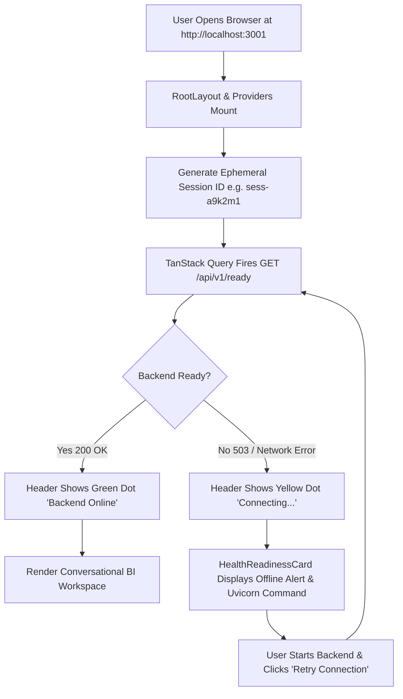
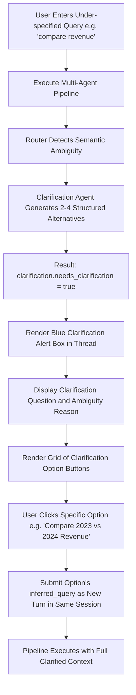
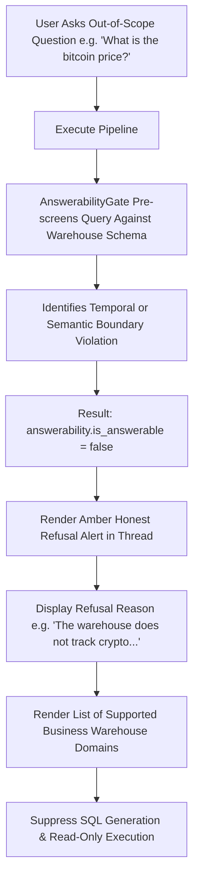
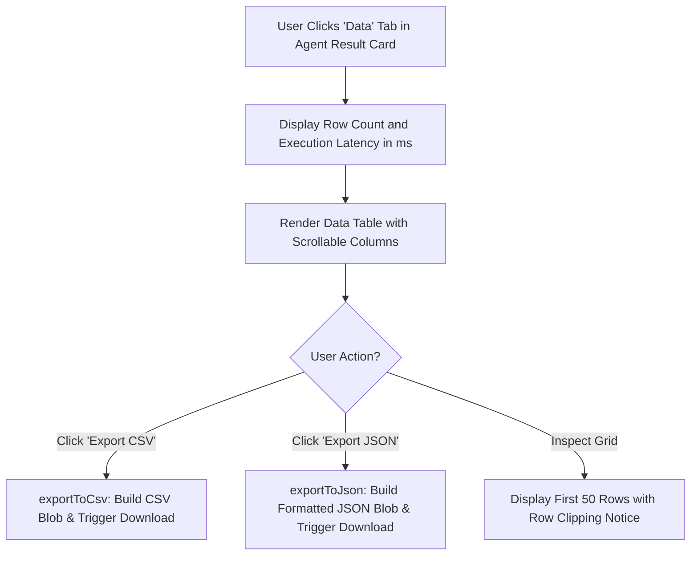
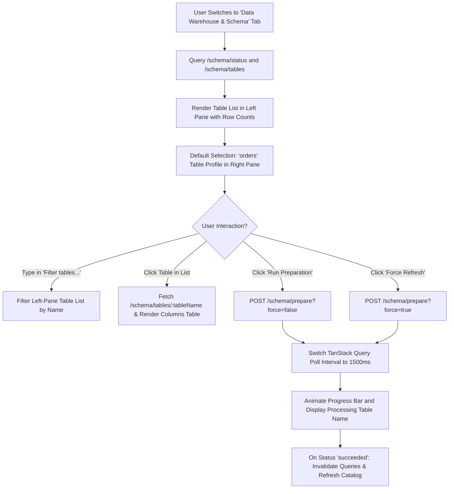
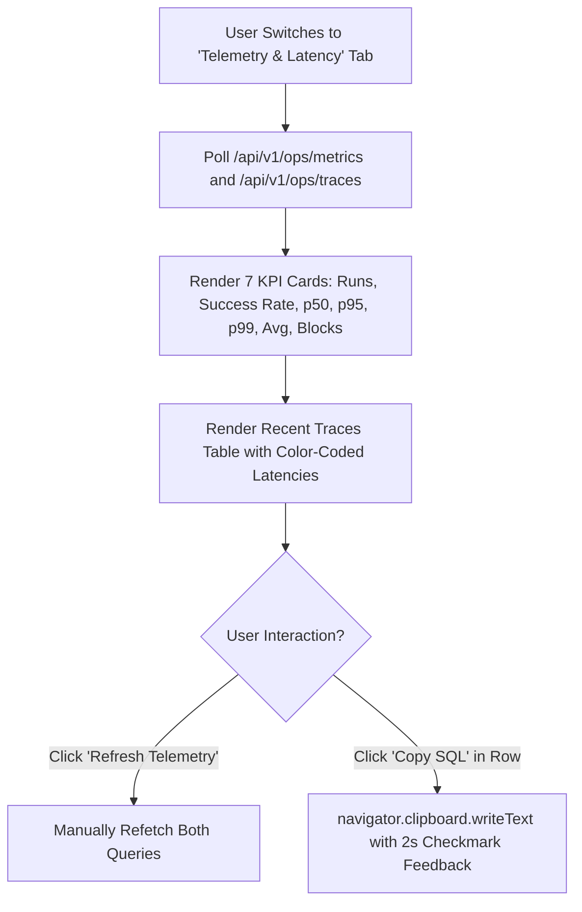

# User Flows & Interaction Specification
**AI for BI — Data Scientist Agent**
*End-to-End User Journeys, Form Controls, Event Handlers, and State Transitions*

---

## 1. Primary User Journeys & State Transition Flows

### Journey 1: First Visit, Application Entry & Readiness Probe



- **Entry Point:** Initial page visit at URL `/`.
- **Preconditions:** None (application is publicly accessible).
- **Initial State:** `activeTab = "chat"`, `sessionId = "sess-[random7]"`, `mounted = true`.
- **Automatic Background Action:** TanStack Query calls `fetchReadiness()`. Polling continues every 15,000ms.
- **Success Outcome:** Header status dot pulsates green; user is presented with the Conversational BI input card and 7 starter query pills.
- **Failure Outcome:** Header shows yellow status; system health tab displays an offline alert banner explaining how to run the FastAPI backend (`python -m uvicorn backend.app.main:app --port 8001 --reload`).

---

### Journey 2: Natural Language Question & Real-Time SSE DAG Streaming

```mermaid
flowchart TD
    A[User Types Question or Clicks Starter Query Pill] --> B[Validate: qText.trim() !== '' and !isSubmitting]
    B --> C[Append New Turn to 'turns' Array with isStreaming=true]
    C --> D[Clear Query Input Box and Scroll Smoothly to Bottom]
    D --> E[Initiate POST /api/v1/chat/stream]
    E --> F{SSE Connection Established?}
    F -->|Yes| G[Read Chunks & Normalize CRLF to LF]
    G --> H[Event: 'progress']
    H --> I[Update activeStepKey and completedSteps in Turn]
    I --> J[Live Stepper Animates Active DAG Node]
    J --> K{Next SSE Chunk}
    K -->|Event: 'result'| L[Parse MultiAgentWorkflowResult Payload]
    L --> M[Update Turn: isStreaming=false, result=payload, activeTab='narrative']
    M --> N[Render Narrative, Findings, Chart Preview, Caveats & Follow-ups]
    K -->|Event: 'error'| O[Update Turn: isStreaming=false, error=message]
    F -->|No / Stream Closes Early| P[Resilient Fallback: POST /api/v1/chat/query]
    P --> L
```

- **Entry Point:** Conversational BI Tab (`ChatInterface.tsx`).
- **User Actions:**
  - Typing a natural language query into the input field and pressing Enter or clicking "Ask Agent".
  - Alternatively, clicking one of the 7 starter query buttons:
    1. *"Show orders by status and their total amount"*
    2. *"What are our total sales and order counts by year?"*
    3. *"What are the top 5 product categories by revenue?"*
    4. *"How many customers belong to each customer segment?"*
    5. *"What is the churn risk and revenue at risk across customer segments?"*
    6. *"compare revenue"* (Clarification trigger)
    7. *"What is the current bitcoin price?"* (Refusal trigger)
- **State Changes:**
  - `isSubmitting` set to `true`.
  - `queryInput` cleared to `""`.
  - New `ChatTurn` appended to `turns`.
  - Live progress stepper updates sequentially through the 7 stages:
    `understanding_question` -> `retrieving_schema` -> `generating_query` -> `validating_query` -> `running_query` -> `verifying_results` -> `composing_answer`.
- **Final Visible Outcome:** Complete multi-tab agent answer card rendered with verified factual findings and 3 clickable follow-up suggestions.

---

### Journey 3: Ambiguous Question & Interactive Clarification Selection



- **Trigger:** Ambiguous user questions without explicit timeframes, dimensions, or entity filters.
- **Backend Response:** `result.clarification.needs_clarification === true`.
- **UI Presentation:** Blue-tinted card (`bg-primary/10 border-primary/40`) containing:
  - Clarification question and ambiguity explanation.
  - Interactive option cards with title, description, and hover arrow icon.
- **User Selection:** Clicking an option invokes `executeQueryTurn(opt.inferred_query)` in the same session, submitting the clarified question automatically.

---

### Journey 4: Out-of-Scope Query & Domain Refusal



- **Trigger:** Questions regarding cryptocurrency, public equities, weather, or dates outside January 1, 2023 – December 31, 2025.
- **Backend Response:** `result.answerability.is_answerable === false`.
- **UI Presentation:** Amber-tinted card (`bg-warning/10 border-warning/40`) containing:
  - ShieldAlert icon and "Honest Refusal: Question Outside Warehouse Scope".
  - Specific refusal explanation.
  - Bulleted list of supported warehouse domains (Orders, Customers, Catalog, Warehousing, Marketing, Financials).

---

### Journey 5: Data Export & Tabular Inspection



- **Trigger:** User clicks the `Data (N)` tab on any completed query turn.
- **UI Elements:**
  - "Export CSV" button with green spreadsheet icon (`FileSpreadsheet`).
  - "Export JSON" button with blue download icon (`Download`).
  - Data grid displaying columns and row values with NULL handling (`<span className="text-muted-foreground">NULL</span>`).
- **File Download Logic:**
  - `exportToCsv`: Encodes rows with RFC 4180 quotation handling (`""`), constructs a `data:text/csv;charset=utf-8` URI, and triggers anchor element download.
  - `exportToJson`: Serializes rows via `JSON.stringify(..., null, 2)` and triggers download.

---

### Journey 6: Schema Catalogue Exploration & Asynchronous Profiling



---

### Journey 7: Telemetry Auditing & Query Trace Copying



---

## 2. Exhaustive User Controls & Interaction Catalog

| Component | Control Label | Type | Default Value | Allowed Values / Input Type | Validation Rules | Event Handler | State Updates | API Call Triggered | UI Feedback & Result |
|---|---|---|---|---|---|---|---|---|---|
| `Header` | Status Dot & Pill | Indicator | "Backend Online" / "Connecting..." | N/A (Read-only) | N/A | None | Derived from `data?.ready` | `GET /api/v1/ready` (15s poll) | Green pulsating dot when ready, yellow dot when offline |
| `HomePage` | Navigation Tabs (4 tabs) | Pill Buttons | `"chat"` | `"chat"`, `"schema"`, `"observability"`, `"system"` | N/A | `onClick={() => setActiveTab(tab.key)}` | `activeTab = tab.key` | None (switches visible workspace component) | Selected tab highlighted with blue background (`bg-primary text-white`) |
| `ChatInterface` | Question Input Field | Text Input | `""` | Text string (max 1000 chars) | `min_length: 2`, `max_length: 1000`, non-whitespace | `onChange={(e) => setQueryInput(e.target.value)}` | `queryInput = e.target.value` | None | Controlled text input value |
| `ChatInterface` | "Ask Agent" Button | Submit Button | N/A | Click event | Disabled if `!queryInput.trim()` or `isSubmitting` | `onSubmit={handleSubmit}` | `isSubmitting = true`, new turn appended | `POST /api/v1/chat/stream` | Button shows spinning `RefreshCw` icon and "Running DAG..." |
| `ChatInterface` | Starter Query Pills (7 pills) | Button Pills | N/A | Click event | Disabled if `isSubmitting` | `onClick={() => handleSelectSuggested(sq)}` | Appends turn, sets `isSubmitting = true` | `POST /api/v1/chat/stream` | Submits selected starter query text immediately |
| `ChatInterface` | "+ New Session" Button | Action Button | N/A | Click event | N/A | `onClick={handleNewSession}` | Generates new `sessionId`, resets `turns = []`, clears input | None (client-side session reset) | Thread is cleared; new session ID displayed in badge |
| `ChatInterface` | Turn Result Sub-Tabs | Tab Strip | `"narrative"` | `"narrative"`, `"chart"`, `"analysis"`, `"sql"`, `"data"`, `"plan"`, `"trace"` | Dynamic based on result contents | `onClick={() => setTurnActiveTab(turn.turnId, tab.key)}` | `turn.activeTab = tab.key` | None | Switches visible sub-pane within the specific turn card |
| `ChatInterface` | Clarification Option Cards | Action Cards | N/A | Click event | N/A | `onClick={() => handleClarificationOption(opt.inferred_query)}` | Submits inferred query as new turn | `POST /api/v1/chat/stream` | Executes clarified query in current session |
| `ChatInterface` | "Copy SQL" Button | Utility Button | N/A | Click event | N/A | `onClick={() => handleCopySql(res.sanitized_sql, turn.turnId)}` | `copiedSqlId = turn.turnId` (resets in 2000ms) | None | Button text switches to "Copied" with green Check icon for 2 seconds |
| `ChatInterface` | "Copy Narrative" Button | Utility Button | N/A | Click event | N/A | `onClick={() => handleCopyNarrative(res.composed_answer, turn.turnId)}` | `copiedNarrativeId = turn.turnId` (resets in 2000ms) | None | Button text switches to "Copied" with green Check icon for 2 seconds |
| `ChatInterface` | "Export CSV" Button | Export Button | N/A | Click event | Disabled if no rows returned | `onClick={() => exportToCsv(res.query_result, ...)}` | None (triggers browser file download) | None | Downloads `.csv` file formatted with RFC 4180 rules |
| `ChatInterface` | "Export JSON" Button | Export Button | N/A | Click event | Disabled if no rows returned | `onClick={() => exportToJson(res.query_result, ...)}` | None (triggers browser file download) | None | Downloads `.json` file formatted with indentation |
| `ChatInterface` | Follow-up Question Buttons | Action Buttons | N/A | Click event | Disabled if `isSubmitting` | `onClick={() => handleSelectSuggested(qText)}` | Appends turn with follow-up text | `POST /api/v1/chat/stream` | Submits the follow-up analytical question to the agent |
| `PlotlyChartRenderer` | Chart / Table View Mode Toggle | Toggle Buttons | `"chart"` | `"chart"`, `"table"` | Hidden if `chartSpec.fallback_to_table === true` | `onClick={() => setViewMode("chart" / "table")}` | `viewMode = "chart"` / `"table"` | None | Switches between interactive Plotly chart and tabular data grid |
| `PlotlyChartRenderer` | Download Chart PNG Button | Utility Button | N/A | Click event | Only visible in chart view mode | `onClick={handleDownload}` | None | None | Downloads `900x600` PNG image via `Plotly.downloadImage` |
| `SchemaReadinessSection` | "Run Preparation" Button | Action Button | N/A | Click event | Disabled if `isPreparing` | `onClick={() => prepareMutation.mutate(false)}` | `isPreparing = true` | `POST /api/v1/schema/prepare?force=false` | Shows spinning icon and "Profiling..."; triggers background worker |
| `SchemaReadinessSection` | "Force Refresh" Button | Action Button | N/A | Click event | Disabled if `isPreparing` | `onClick={() => prepareMutation.mutate(true)}` | `isPreparing = true` | `POST /api/v1/schema/prepare?force=true` | Forces complete schema re-profiling bypassing cache |
| `SchemaReadinessSection` | "Filter tables..." Input | Search Input | `""` | Search text | Case-insensitive substring match on table name | `onChange={(e) => setSearchTerm(e.target.value)}` | `searchTerm = e.target.value` | None | Filters left-pane table list in real time |
| `SchemaReadinessSection` | Table List Card Selection | List Button | `"orders"` | Table name | N/A | `onClick={() => setSelectedTableName(tbl.name)}` | `selectedTableName = tbl.name` | `GET /api/v1/schema/tables/{name}` | Highlights table in blue; right pane loads column metrics |
| `ObservabilityDashboard` | "Refresh Telemetry" Button | Action Button | N/A | Click event | Disabled if `isLoading` | `onClick={handleRefresh}` | Triggers refetch for metrics & traces | `GET /api/v1/ops/metrics`, `GET /api/v1/ops/traces` | Spinner animates; KPI cards and traces table update |
| `ObservabilityDashboard` | "Copy SQL" in Trace Row | Utility Button | N/A | Click event | Disabled if `sql_executed` is null | `onClick={() => handleCopySql(trace.sql_executed, trace.run_id)}` | `copiedSql = trace.run_id` (resets in 2000ms) | None | Shows green Check icon and "Copied" for 2 seconds |
| `HealthReadinessCard` | "Retry Connection" Button | Action Button | N/A | Click event | Only rendered when backend offline | `onClick={onRefresh}` | Refetches readiness query | `GET /api/v1/ready` | Attempts reconnection to backend |

---
*End of Deliverable 4 (User Flows & Interaction Specification)*

