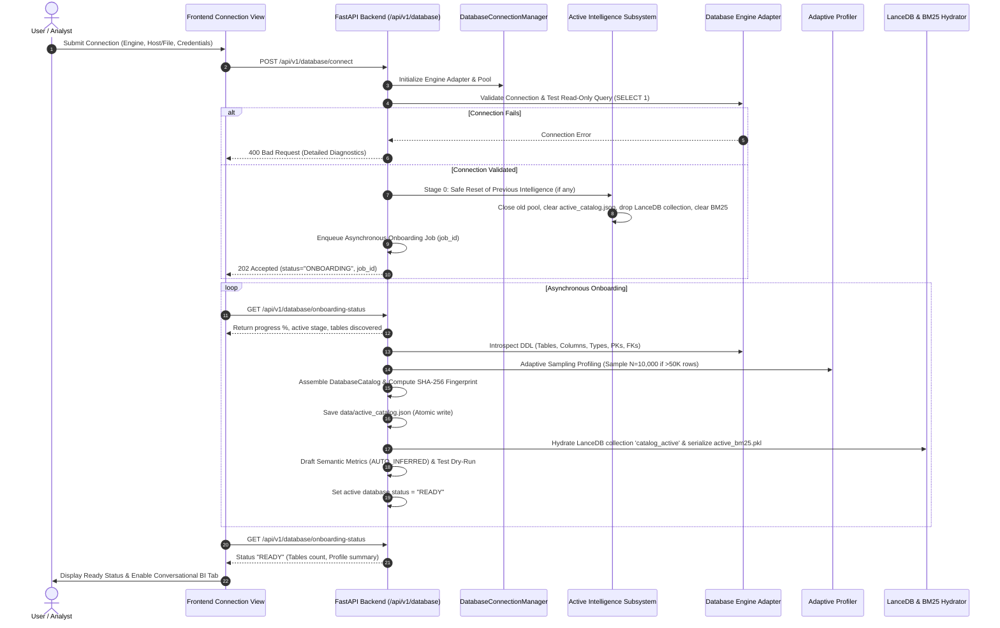

# 02 — Target Architecture Design (Single-Active-DB & Local Ollama Model)

**Target System:** Conversational Data Scientist Agent — AI for Business Intelligence  
**Author Roles:** Principal AI Architect, Senior AI Agent Engineer, Database Systems Architect  
**Document Lineage:** Final Scope Correction — Single User, One Active Database Connection, One Database Engine at a Time. Real Local LLM (Ollama `qwen3:4b`) and Real Development Database Verification.  
**Execution Boundary:** **STRICT PLANNING ONLY. Architectural Specification. Zero Implementation.**

---

## 1. Architectural Vision and Core Principles

The target Version 2 architecture transforms the single-database prototype into a robust, multi-engine AI Data Analyst platform operating with a clean, single-user deployment model:

$$\mathbf{ONE\;USER} \;\longrightarrow\; \mathbf{ONE\;ACTIVE\;DATABASE\;CONNECTION} \;\longrightarrow\; \mathbf{ONE\;DATABASE\;ENGINE\;AT\;A\;TIME}$$

### Core Architectural Principles:
1. **Universal Core Engine:** The application gateway, orchestration DAG, intent classifiers, AST safety validators, deterministic mathematical toolkits (forecasting, anomalies, variance decomposition), and visualization generators contain **zero hardcoded table names, column names, SQL formulas, or temporal boundaries**.
2. **Database-Specific Intelligence Units:** Whichever database is currently connected receives dynamically generated intelligence: structural catalog, adaptive data profile, persistent LanceDB vector collection, disk BM25 index, relationship graph, and dynamic semantic glossary.
3. **Clean Intelligence Reset upon Disconnection:** When the user disconnects the active database and connects another, previous database-specific intelligence artifacts are safely cleared or replaced, ensuring **zero stale metadata or schema leakage**, while internal application data (`agent_app.sqlite`), conversation history, and application configuration are preserved.
4. **Deterministic Math over Generative Hallucination:** LLMs handle language understanding, SQL generation, and executive narration. All statistical calculations execute strictly via deterministic Python libraries (`pandas`, `numpy`, `scipy`, `statsmodels`).
5. **Real Local LLM (Ollama `qwen3:4b`) with Strict No-Mock Policy:** All generative tasks (NLU, Text-to-SQL, clarification, narrative synthesis) execute against the locally running Ollama instance (`http://localhost:11434`, model `qwen3:4b`). No mock responses, fake SQL, or placeholder results are permitted in application runtime or E2E integration tests.
6. **Safe Read-Only Security (No Destructive Probes on User Databases):** Security relies on least-privilege accounts, driver-level transaction read-only hooks (`SET TRANSACTION READ ONLY`), `sqlglot` AST validation, query timeouts (30s), and row limits (1,000 rows). **No `CREATE TABLE` write probes are executed against connected user databases.**

---

## 2. Streamlined System Topology (6 Cohesive Subsystems)

```mermaid
flowchart TB
    subgraph UI ["Frontend Application (Next.js 14 SPA)"]
        UI_Conn["Database Connection & Engine Selector"]
        UI_Status["Active Database Status & Disconnect Button"]
        UI_Onboard["Onboarding Progress Stepper"]
        UI_Chat["Conversational Chat & Plotly Visualizer"]
        UI_Schema["Schema Explorer & Metric Settings"]
    end

    subgraph Subsystem1 ["1. Connection & Discovery Subsystem"]
        CONN_Mgr["Database Connection Manager<br/>(SQLAlchemy 2.0 Core Pool)"]
        ADP_SQLite["SQLite Adapter (sqlite3, mode=ro)"]
        ADP_PG["Postgres Adapter (psycopg, READ ONLY)"]
        ADP_MySQL["MySQL Adapter (pymysql, READ ONLY)"]
        INTR_Engine["Dialect Introspector<br/>(PRAGMA / information_schema)"]
        PROF_Engine["Adaptive Sampling Profiler<br/>(Sample N=10,000 if >50K rows)"]
    end

    subgraph Subsystem2 ["2. Metadata & Semantic Catalog Subsystem"]
        CAT_Store["Active Catalog Store<br/>(data/active_catalog.json)"]
        SEM_Repo["Dynamic Semantic Repository<br/>(agent_app.sqlite: active_semantics)"]
        DRIFT_Mon["Cryptographic Drift Detector<br/>(SHA-256 Fingerprint)"]
        REL_Graph["Relationship & Implicit Join Graph"]
    end

    subgraph Subsystem3 ["3. Persistent Hybrid Retrieval Subsystem"]
        BM25_Idx["Persistent BM25 Lexical Index<br/>(data/indexes/active_bm25.pkl)"]
        VEC_Store["Persistent Embedded Vector Store<br/>(LanceDB: collection catalog_active)"]
        RRF_Fusion["Reciprocal Rank Fusion (k=60)<br/>+ FK Graph Expansion"]
        VAL_Linker["Dynamic Value Linker<br/>(Sample Literals dist_cnt <= 10)"]
    end

    subgraph Subsystem4 ["4. Safety & Execution Subsystem"]
        AST_Val["Multi-Dialect AST Validator<br/>(sqlglot: read=dialect, Column Checks)"]
        RO_Guard["Safe Read-Only Guard<br/>(Least-Privilege + SET TRANSACTION READ ONLY)"]
        REP_Loop["Bounded SQL Repair Loop<br/>(Strictly Capped at 2 Retries)"]
        EXEC_Runner["Query Executor (30s Timeout, Limit 1000)"]
    end

    subgraph Subsystem5 ["5. Analytics & Visualization Subsystem"]
        MATH_Core["Parametric Math Engines<br/>(Holt-Winters, MAD Anomalies, SLSQP)"]
        DOM_Plugin["Schema-Gated Domain Plugins<br/>(e.g., Parametric Churn Risk)"]
        VIZ_Agent["Schema-Agnostic Visualizer<br/>(Typed Plotly Chart Specs)"]
    end

    subgraph Subsystem6 ["6. Conversational Agent Orchestrator"]
        ORCH_DAG["Deterministic Supervisor DAG<br/>(FastAPI SSE Stream Runner)"]
        RTR_Unit["Intent & Difficulty Classifier<br/>(7 PRD Categories)"]
        GATE_Unit["Grounded Answerability Gate<br/>(Dynamic Schema & Date Range Checks)"]
        CLR_Unit["Interactive Clarification Gate<br/>(Max 2 Rounds; Metric Disambiguation)"]
        OLLAMA_Client["Local Ollama Client<br/>(http://localhost:11434, qwen3:4b)"]
        COMP_Unit["Faithful Narrative Composer<br/>(Evidence Citation & Numerical Checks)"]
        MEM_Store["Active Database Memory Store<br/>(agent_app.sqlite: sessions & turns)"]
    end

    %% Wiring
    UI --> Subsystem1
    UI --> Subsystem6
    Subsystem1 <--> Subsystem2
    Subsystem2 <--> Subsystem3
    Subsystem3 --> Subsystem6
    Subsystem6 <--> Subsystem4
    Subsystem4 --> Subsystem1
    Subsystem6 <--> Subsystem5
```



---

## 3. Database Engine and Driver Architecture

### 3.1 Finalized Driver Selection
To eliminate runtime ambiguity and driver conflicts, the following concrete drivers are selected:

| Database Engine | Selected Driver | SQLAlchemy 2.0 Dialect URI | Technical Justification |
| :--- | :--- | :--- | :--- |
| **SQLite** | Standard library `sqlite3` | `sqlite+pysqlite:///{path}` | Built into Python standard library; zero external dependencies; supports URI `mode=ro` preventing operating system writes. |
| **PostgreSQL** | `psycopg` (v3 `psycopg[binary]>=3.1.18`) | `postgresql+psycopg://{user}:{pass}@{host}:{port}/{db}` | Official, modern PostgreSQL driver for Python. Binary wheel avoids C-compilation; native support for PostgreSQL data types, server-side read-only parameter binding, and robust query timeouts. |
| **MySQL / MariaDB** | `pymysql` (`pymysql>=1.1.0`) | `mysql+pymysql://{user}:{pass}@{host}:{port}/{db}` | Pure Python driver with universal cross-platform compatibility on Windows/Linux; avoids native MySQL C-client compilation errors (`mysqlclient`); stable, thread-safe, fully supported in SQLAlchemy 2.0 Core. |

### 3.2 Synchronous vs. Asynchronous Execution Model
- **Selected Architecture:** **Asynchronous HTTP/SSE Gateway with Synchronous Pooled Thread Execution.**
- **Rationale:**
  - FastAPI handles HTTP endpoints and Server-Sent Events (SSE) progress streaming asynchronously using `asyncio`.
  - Analytical database queries, Pandas DataFrame construction (`read_sql`), and statistical routines (NumPy, SciPy, Statsmodels) are **inherently synchronous and CPU-bound**.
  - Forcing asynchronous database drivers (`asyncpg`, `asyncmy`) causes impedance mismatches with Pandas, which requires synchronous DB-API cursors.
  - **Pattern:** Database query execution and data science routines execute inside FastAPI's worker thread pool using `fastapi.concurrency.run_in_threadpool`. This keeps the HTTP event loop responsive to SSE streaming while running heavy analytical queries and Pandas transformations safely on background worker threads.

### 3.3 Connection Pooling & Concurrency for the Single Active Database
Even in a single-user system, the single active database must handle concurrent requests (e.g. background profiling job running while the user chats, or multiple browser tabs open simultaneously):
- **SQLite Pooling:** Uses `SingletonThreadPool` or `NullPool` to avoid multi-thread locking issues on local SQLite files while respecting SQLite's Write-Ahead Logging (WAL) concurrency.
- **PostgreSQL & MySQL Pooling:** Uses SQLAlchemy's `QueuePool`:
  - `pool_size = 3` (base connections for active DB)
  - `max_overflow = 2` (burst capacity under concurrent query/profiling operations)
  - `pool_timeout = 10` (seconds to wait for connection checkout before raising 503)
  - `pool_recycle = 1800` (recycles connections idle for 30 minutes to prevent firewall drops)
  - `pool_pre_ping = True` (executes lightweight `SELECT 1` ping on checkout to eliminate broken connections)

### 3.4 Engine-Specific Schema Introspection
Schema introspection is abstracted behind `BaseIntrospector` with engine-specific implementations:
- **SQLite (`SQLiteIntrospector`):** Queries `sqlite_master` for table names and DDL statements; executes PRAGMAs: `PRAGMA table_info("{table}")` for columns/PKs, `PRAGMA foreign_key_list("{table}")` for foreign keys, and `PRAGMA index_list("{table}")` for indexes.
- **PostgreSQL (`PostgresIntrospector`):** Queries ANSI standard `information_schema.tables` and `information_schema.columns`; queries PostgreSQL catalog `pg_catalog.pg_constraint` (for primary keys and foreign key constraints) and `pg_catalog.pg_index` (for index definitions).
- **MySQL (`MySQLIntrospector`):** Queries `information_schema.tables`, `information_schema.columns`, `information_schema.table_constraints`, and `information_schema.key_column_usage` to extract tables, data types, primary keys, and foreign keys.

---

## 4. Local LLM Architecture (Ollama `qwen3:4b`)

To ensure deterministic, reproducible, and offline-capable operation, the system connects directly to the local Ollama instance:

### 4.1 Configuration and Connectivity
- **Service Endpoint:** `http://localhost:11434`
- **Model:** `qwen3:4b` (verified verified locally via `api/tags`)
- **Environment Settings:**
  ```ini
  LLM_PROVIDER=ollama
  OLLAMA_BASE_URL=http://localhost:11434
  OLLAMA_MODEL=qwen3:4b
  OLLAMA_TIMEOUT_SECONDS=45.0
  ```
- **Client Implementation:** Dedicated asynchronous client (`backend/app/llm/ollama_client.py`) using `httpx.AsyncClient` with connection pooling and configurable timeout.

### 4.2 Strict No-Mocking Policy
- **Runtime Standard:** Mock LLM responses, hardcoded answers, fake SQL generation, and placeholder models are **strictly prohibited** in application runtime, demonstrations, and end-to-end integration tests.
- **Error Handling:** If Ollama is offline or `qwen3:4b` is not pulled, the client immediately raises a structured `LLMProviderUnavailableError` and displays an explicit diagnostic message in the UI:
  > *"Local LLM error: Unable to connect to Ollama at http://localhost:11434. Verify that Ollama is running and model 'qwen3:4b' is available via 'ollama list'."*
- **Portability:** The client implements an abstract `BaseLLMClient` interface, allowing alternative local or cloud models to be configured via `.env` without modifying application business logic.

---

## 5. Single Active Database Lifecycle and Safe Intelligence Reset

The application maintains one active database connection at a time. The end-to-end lifecycle and safe reset procedures are defined below:



### 5.1 Database-Specific Intelligence Reset Specification
When the user disconnects the currently connected database and connects a different database:
1. **Close Connection Pool:** Forcibly dispose of the previous database connection pool (`engine.dispose()`), terminating all open network sockets or file locks.
2. **Clear Schema Catalog & Profiling Cache:** Remove or overwrite `data/active_catalog.json` with the new database catalog.
3. **Reset Vector Collection & BM25 Index:** Drop LanceDB table `catalog_active` and remove `data/indexes/active_bm25.pkl`.
4. **Clear Active Semantic Definitions:** Truncate active session metrics in `agent_app.sqlite` table `active_semantic_metrics`.
5. **Guarantee No Cross-Database Contamination:** Ensure zero previous database-specific metadata, table names, or formulas are reused.
6. **Preserve Application Internal Database & Settings:** **NEVER delete or touch `agent_app.sqlite` application state, historical conversation records, user configuration, or `.env`.**
7. **Protect User Databases:** **NEVER issue `DROP DATABASE`, `DELETE`, or write operations on either the old or newly connected user database.**
8. **Rebuild Clean Intelligence:** Discover schema directly from the newly connected database and rebuild catalog, vector collection, BM25 index, relationship graph, and candidate metrics from scratch.
9. **Enable Querying Only After Readiness:** Natural-language querying is locked until the new database's onboarding checks successfully complete.

---

## 6. Persistent Hybrid Retrieval Architecture

### 6.1 LanceDB + Disk-Serialized BM25 Engine
The retrieval architecture satisfies the requirement that the connected database receives its own database-specific retrieval intelligence without deploying external vector database microservices:
1. **Persistent Vector Store:** Uses **LanceDB** (an embedded serverless vector library stored locally on disk at `data/vector_store/`). Vector embeddings reside in an embedded table: `catalog_active`.
2. **Local Dense Embedding Model:** Generates 384-dimensional dense semantic vectors using `fastembed` (`sentence-transformers/all-MiniLM-L6-v2`) executing locally via CPU ONNX runtime in $<15\text{ms}$. **Zero external cloud API calls, zero cloud costs.**
3. **Persistent Lexical Index:** BM25Okapi token frequency statistics and corpus documents are serialized to disk at `data/indexes/active_bm25.pkl`.
4. **Reciprocal Rank Fusion (RRF):** Fuses lexical BM25 ranks and dense LanceDB ranks with $k=60$:
   $$\text{RRF Score}(t) = \frac{1}{60 + \text{Rank}_{\text{BM25}}(t)} + \frac{1}{60 + \text{Rank}_{\text{Dense}}(t)}$$
5. **Persistence Across Restarts:** When the application restarts, LanceDB reopens `catalog_active` and unpickles `active_bm25.pkl` in $<20\text{ms}$, completely eliminating the 14-second startup re-indexing bottleneck of Version 1.

---

## 7. Safe Read-Only Security Architecture

To protect user databases against accidental damage or malicious modification, security enforces **four safe read-only protective layers without executing destructive write probes against user databases**:

```
[Layer 1: Least-Privilege DB Credentials] (GRANT SELECT only / mode=ro)
                    │
                    ▼
[Layer 2: Transaction Read-Only Hook]      (SET TRANSACTION READ ONLY)
                    │
                    ▼
[Layer 3: Multi-Dialect AST Guardrail]     (sqlglot: blocks DDL/DML/ATTACH/COPY)
                    │
                    ▼
[Layer 4: Execution Limits & Timeouts]     (30s Timeout, Injected LIMIT 1000)
```

### 7.1 Safe Security Layer Breakdown
1. **Layer 1: Least-Privilege Database Account:**
   - Database administrators configure dedicated read-only accounts:
     - SQLite: Opened strictly with URI `mode=ro` (enforced by SQLite C-library).
     - PostgreSQL: Role granted `SELECT` only (`REVOKE ALL ON ALL TABLES; GRANT SELECT ON ALL TABLES`).
     - MySQL: User granted `SELECT, SHOW VIEW` only (`REVOKE ALL PRIVILEGES`).
2. **Layer 2: Transaction-Level Read-Only Hooks:**
   - Upon connection checkout, the adapter automatically executes:
     - PostgreSQL: `SET SESSION CHARACTERISTICS AS TRANSACTION READ ONLY;`
     - MySQL: `SET SESSION TRANSACTION READ ONLY;`
3. **Layer 3: Multi-Dialect AST Inspection (`sqlglot`):**
   - Parses AST with target dialect (`read="sqlite"`, `read="postgres"`, or `read="mysql"`).
   - Verifies root node is `exp.Select` or `exp.Union`.
   - Recursively blocks `Insert`, `Update`, `Delete`, `Create`, `Drop`, `Alter`, `Command`, `Truncate`.
   - Blocks engine-specific dangerous commands:
     - SQLite: `ATTACH`, `DETACH`, `LOAD_EXTENSION`, `VACUUM`.
     - PostgreSQL: `COPY`, `pg_read_file`, `pg_write_file`, `dblink`.
     - MySQL: `LOAD DATA INFILE`, `INTO OUTFILE`, `INTO DUMPFILE`, `BENCHMARK`.
   - Verifies all referenced tables and columns exist in active catalog.
4. **Layer 4: Execution Limits & Timeouts:**
   - Automatically injects `LIMIT 1000` or caps user limits exceeding 1,000.
   - Enforces a 30-second query execution timeout at driver level (`statement_timeout=30000` on Postgres, `max_execution_time=30000` on MySQL, 30s timeout on SQLite).
5. **No Destructive Write Probes against User Databases:**
   - **Correction:** The system **NEVER** attempts `CREATE TABLE __probe__` against the user's real connected database. Write-attempt tests are executed strictly against disposable, ephemeral test fixtures during automated CI test runs.

---

## 8. Semantic Layer Reliability and Provenance Tiers

To ensure that unapproved metrics never silently become authoritative definitions for critical business numbers, the semantic repository enforces three explicit lifecycle tiers:

```
[LLM Discovery Pass] ──► Tier 1: AUTO_INFERRED (Draft, Low Confidence)
                                │
                                ▼ (AST Syntax Check + Dry-Run Execution Test)
                         Tier 2: VALIDATED_CANDIDATE (Mechanically Sound)
                                │
                                ▼ (Human Review via UI / API)
                         Tier 3: USER_APPROVED (Authoritative Business Truth)
```

1. **Tier 1: `AUTO_INFERRED` (Draft):** Drafted by LLM during onboarding based on column names/samples; marked draft; **never silently used as ground truth for calculations**.
2. **Tier 2: `VALIDATED_CANDIDATE` (Mechanically Verified):** Passed `sqlglot` AST syntax checks and dry-run query tests; offered as suggested options.
3. **Tier 3: `USER_APPROVED` (Authoritative Truth):** Explicitly confirmed or edited by the user; injected into generation prompts as authoritative truth.
4. **Ambiguity Handling:** Ambiguous metrics (revenue, churn, refunds) trigger interactive clarification dialogs or an explicit assumption citation in the executive narrative.

---

## 9. Streamlined Frontend Scope

The single-user frontend provides a clean, focused user experience:

```
+──────────────────────────────────────────────────────────────────────────────+
| [Header] AI for BI Data Scientist Agent    [Engine: PostgreSQL] [Status: READY] |
|                                             [Disconnect Database Button]     |
+──────────────────────────────────────────────────────────────────────────────+
| [Connection / Onboarding Panel] (Shown when disconnected or onboarding)     |
|   1. Select Engine: [ (o) SQLite  ( ) PostgreSQL  ( ) MySQL ]                 |
|   2. Connection Parameters Form: Host, Port, Database, User, Password        |
|   3. [Test Connection] Button                                                |
|   4. Onboarding Progress Stepper: [Discovery -> Profile -> LanceDB -> Ready] |
+──────────────────────────────────────────────────────────────────────────────+
| [Main Analytics Workspace] (Active when Status is READY)                     |
|   [Tab 1: Conversational BI]  Natural-language chat, Plotly charts, data grid|
|   [Tab 2: Schema Explorer]    Discovered tables, columns, PK/FK links, stats |
|   [Tab 3: Semantic Metrics]   View/confirm inferred metrics, add custom KPIs |
|   [Tab 4: System Diagnostics] Latency p50/p95, engine details, query trace   |
+──────────────────────────────────────────────────────────────────────────────+
```

---

*This concludes Document 2 (`02_TARGET_ARCHITECTURE_DESIGN.md`). Proceeding to Document 3 (`03_TECHNICAL_DECISIONS_AND_MODULE_CHANGES.md`).*
