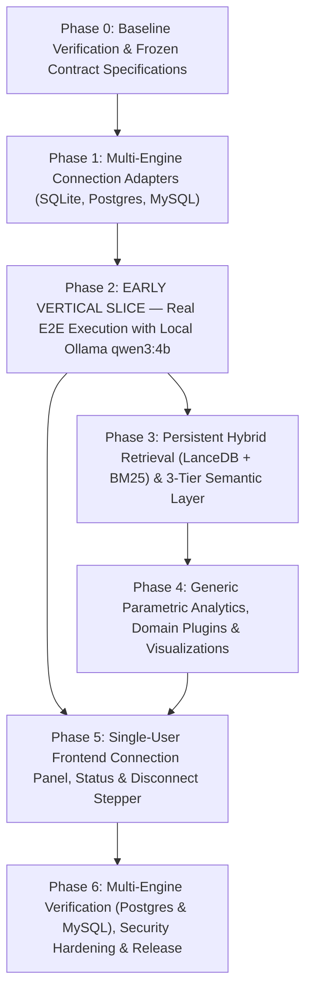

# 04 — Phase-Wise Implementation Roadmap (Single-Active-DB & Local Ollama Model)

**Target System:** Conversational Data Scientist Agent — AI for Business Intelligence  
**Author Roles:** Principal AI Architect, Senior AI Agent Engineer, Lead Test Engineer / QA Architect  
**Document Lineage:** Final Scope Correction — Single User, One Active Database Connection, One Database Engine at a Time. Real Local LLM (Ollama `qwen3:4b`) and Real Development Database Verification. Early Vertical Slice in Phase 2.  
**Execution Boundary:** **STRICT PLANNING ONLY. Engineering Roadmap. Zero Implementation.**

---

## 1. Master Phase Sequence & Early Vertical Slice Strategy

The implementation roadmap is structured into **7 milestone-driven phases** (Phases 0 through 6). An **Early Working Vertical Slice** is delivered in **Phase 2**, proving end-to-end question answering on the real development database using the local Ollama `qwen3:4b` model.

---

## 2. Phase-by-Phase Detailed Engineering Specifications

---

### Phase 0: Baseline Verification & Frozen Contract Specifications

1. **Objective:** Inspect and verify the actual existing development database, verify local Ollama connectivity (`http://localhost:11434`, model `qwen3:4b`), measure empirical V1 baselines, and freeze core Pydantic v2 contracts.
2. **Why Required:** Establishes an unshakeable empirical regression baseline before modifying a single line of application source code.
3. **Existing Problems Addressed:** Eliminates schema assumptions; verifies local model availability; prevents contract drift.
4. **Requirements Covered:** `REQ-LLM-01`, `REQ-NLU-01`, `NFR-ACC-01`, `NFR-LAT-01`.
5. **Existing Files Affected:**
   - [`scripts/run_evaluation.py`](file:///c:/D_drive/AI_FOR_BI_P/scripts/run_evaluation.py)
   - [`backend/data/gold_evaluation_set.json`](file:///c:/D_drive/AI_FOR_BI_P/backend/data/gold_evaluation_set.json)
6. **Files to Create:**
   - `docs/baseline/V1_BENCHMARK_REPORT.json` *(PROPOSED: Exact measured baseline)*
   - `backend/app/core/contracts.py` *(PROPOSED: Frozen Pydantic v2 schemas)*
7. **Files to Modify:** None.
8. **Files to Retain:** All existing application code unmodified.
9. **Technical Tasks:**
   - 0.1 **Database Inspection:** Verify existence and schema of `ecommerce.db` (46 tables, 2,418,138 rows). Confirm strict read-only access and `.gitignore` protection.
   - 0.2 **Ollama Verification:** Verify `http://localhost:11434/api/tags` reports model `qwen3:4b` is installed and ready.
   - 0.3 Execute `scripts/run_evaluation.py` on `ecommerce.db`; record AST parse latency (0.86ms p50), mock query latency (18.2ms p50), live Ollama latency, and 100% attack rejection rate to `docs/baseline/V1_BENCHMARK_REPORT.json`.
   - 0.4 Record profiling baseline on `ecommerce.db` (46 tables, 2.4M rows).
   - 0.5 Define frozen Pydantic v2 data models in `contracts.py`: `ActiveDatabaseConfig`, `DatabaseCatalog`, `TableMetadata`, `ColumnProfile`, `SemanticMetricDefinition`, and `MultiAgentWorkflowResult`.
   - 0.6 Verify all unit tests in `backend/tests/` execute and pass.
10. **Dependencies:** None.
11. **Implementation Approach:** Automated execution of evaluation harness; zero production code modification.
12. **API & Contract Implications:** Freezes core schemas for all downstream phases.
13. **Expected Deliverables:** Baseline benchmark JSON report, frozen core contracts module.
14. **Testing Requirements:** Full pytest test run; Ollama probe test.
15. **Acceptance Criteria:** Baseline benchmark JSON generated; Ollama `qwen3:4b` verified; 100% of existing tests pass.
16. **Risks & Rollback:** Low risk. No production files modified.
17. **Definition of Done:** Baseline metrics committed to repository; contracts frozen.

---

### Phase 1: Multi-Engine Connection Adapters & Active Database State

1. **Objective:** Implement multi-engine connection pooling via SQLAlchemy 2.0 Core for **SQLite**, **PostgreSQL**, and **MySQL**; implement active database connection configuration in `agent_app.sqlite`; implement early unit tests for all three engines.
2. **Why Required:** Resolves Findings `CONN-01`, `F-01`. Replaces hardcoded SQLite driver with a universal adapter abstraction supporting SQLite, PostgreSQL, and MySQL.
3. **Existing Problems Addressed:** Python `sqlite3` lock-in, absence of PostgreSQL/MySQL drivers, lack of connection pooling.
4. **Requirements Covered:** `REQ-CONN-01`, `REQ-CONN-02`, `REQ-MEM-01`, `NFR-SEC-01`, `NFR-EXT-01`.
5. **Existing Files Affected:**
   - [`backend/app/db/connection.py`](file:///c:/D_drive/AI_FOR_BI_P/backend/app/db/connection.py)
   - [`backend/app/core/config.py`](file:///c:/D_drive/AI_FOR_BI_P/backend/app/core/config.py)
   - [`backend/app/memory/store.py`](file:///c:/D_drive/AI_FOR_BI_P/backend/app/memory/store.py)
   - [`backend/app/observability/tracer.py`](file:///c:/D_drive/AI_FOR_BI_P/backend/app/observability/tracer.py)
6. **Files to Create:**
   - `backend/app/db/adapters/base.py` *(PROPOSED: BaseDatabaseAdapter)*
   - `backend/app/db/adapters/sqlite.py` *(PROPOSED: SQLiteAdapter via sqlite3)*
   - `backend/app/db/adapters/postgres.py` *(PROPOSED: PostgresAdapter via psycopg)*
   - `backend/app/db/adapters/mysql.py` *(PROPOSED: MySQLAdapter via pymysql)*
   - `backend/app/db/active_db.py` *(PROPOSED: ActiveDatabaseManager)*
   - `backend/tests/test_adapters.py` *(PROPOSED: Early unit tests for SQLite, Postgres, and MySQL)*
7. **Files to Modify:**
   - `backend/app/db/connection.py` (Delegates to connection manager with `QueuePool`)
   - `backend/app/memory/store.py` (Associate sessions with active database fingerprint)
   - `backend/app/observability/tracer.py` (Record active engine in traces)
8. **Files to Retain:**
   - `backend/app/core/errors.py` (Retain `DatabaseReadOnlyViolationError`).
9. **Technical Tasks:**
   - 1.1 Implement `BaseDatabaseAdapter` defining `get_connection()`, `execute_read_only()`, and `get_dialect_name()`.
   - 1.2 Implement `SQLiteAdapter` using standard library `sqlite3` with URI `mode=ro`.
   - 1.3 Implement `PostgresAdapter` using `psycopg` (v3) with `SET SESSION CHARACTERISTICS AS TRANSACTION READ ONLY;` on checkout.
   - 1.4 Implement `MySQLAdapter` using `pymysql` with `SET SESSION TRANSACTION READ ONLY;` on checkout.
   - 1.5 Implement `DatabaseConnectionManager` wrapping engines in SQLAlchemy 2.0 `QueuePool` (pool_size=3, max_overflow=2, pre-ping=True).
   - 1.6 Create table `active_database_config` in `agent_app.sqlite` storing engine, connection parameters (encrypted), status, and fingerprint.
   - 1.7 Implement early unit tests for **all three engines** (`test_adapters.py`) using disposable test databases (asserting read-only query execution and connection pooling).
10. **Dependencies:** Phase 0.
11. **Implementation Approach:** Adapter design pattern; thread-safe connection pooling; early multi-engine testing.
12. **API & Contract Implications:** Zero breaking changes to `get_readonly_connection()` callers.
13. **Expected Deliverables:** Multi-engine adapter modules, active database manager, early test suite for all 3 engines.
14. **Testing Requirements:**
    - *Unit Tests (`test_adapters.py`):* Test SQLite, PostgreSQL, and MySQL adapters against local test databases.
    - *Regression Tests:* Verify existing `ecommerce.db` connects seamlessly.
15. **Acceptance Criteria:** Adapters initialize and execute read-only queries across SQLite, PostgreSQL, and MySQL.
16. **Risks & Rollback:** Driver import errors. Mitigate by verifying binary wheel installations.
17. **Definition of Done:** Adapters for SQLite, PostgreSQL, and MySQL pass unit tests; connection pooling verified.

---

### Phase 2: EARLY VERTICAL SLICE — Real E2E Execution with Local Ollama `qwen3:4b`

1. **Objective:** **Deliver a working end-to-end vertical slice.** Connect to the real development database (`ecommerce.db`), discover schema dynamically, adaptive sampling profile ($N=10,000$ if $>50\text{K}$ rows), validate AST with target dialect, generate real SQL using local Ollama `qwen3:4b`, execute query, and compose executive narrative. **Strictly no mock LLMs.**
2. **Why Required:** Proves the universal database-agnostic core early in the development cycle using real local LLM reasoning and real database metadata.
3. **Existing Problems Addressed:** Eliminates mock LLM dependencies; proves multi-dialect AST validation and dynamic schema discovery end-to-end.
4. **Requirements Covered:** `REQ-SCH-01`, `REQ-SCH-02`, `REQ-META-01`, `REQ-LLM-01`, `REQ-SQL-01`, `REQ-SQL-02`, `REQ-SQL-04`.
5. **Existing Files Affected:**
   - [`backend/app/schema/service.py`](file:///c:/D_drive/AI_FOR_BI_P/backend/app/schema/service.py)
   - [`backend/app/schema/models.py`](file:///c:/D_drive/AI_FOR_BI_P/backend/app/schema/models.py)
   - [`backend/app/sql/validator.py`](file:///c:/D_drive/AI_FOR_BI_P/backend/app/sql/validator.py)
   - [`backend/app/sql/executor.py`](file:///c:/D_drive/AI_FOR_BI_P/backend/app/sql/executor.py)
   - [`backend/app/sql/repair.py`](file:///c:/D_drive/AI_FOR_BI_P/backend/app/sql/repair.py)
   - [`backend/app/workflow/orchestrator.py`](file:///c:/D_drive/AI_FOR_BI_P/backend/app/workflow/orchestrator.py)
6. **Files to Create:**
   - `backend/app/schema/introspectors/base.py` *(PROPOSED)*
   - `backend/app/schema/introspectors/sqlite.py` *(PROPOSED: SQLiteIntrospector)*
   - `backend/app/schema/introspectors/postgres.py` *(PROPOSED: PostgresIntrospector)*
   - `backend/app/schema/introspectors/mysql.py` *(PROPOSED: MySQLIntrospector)*
   - `backend/app/schema/profiler.py` *(PROPOSED: AdaptiveSamplingProfiler)*
   - `backend/app/schema/catalog_store.py` *(PROPOSED: ActiveCatalogStore)*
   - `backend/app/llm/ollama_client.py` *(PROPOSED: Native Ollama qwen3:4b client)*
   - `backend/tests/test_vertical_slice.py` *(PROPOSED: E2E slice verification)*
7. **Files to Modify:**
   - `backend/app/schema/service.py` (Coordinates introspectors and profiler)
   - `backend/app/sql/validator.py` (Parameterize `parse_one(read=dialect)`; add column-level catalog checks)
   - `backend/app/sql/executor.py` (Executes via active database adapter with 30s timeout)
   - `backend/app/workflow/orchestrator.py` (Invokes Ollama `qwen3:4b`; injects dialect-specific guidance)
8. **Files to Retain:**
   - Top-level `MultiAgentOrchestrator` execution DAG and SSE event protocol.
9. **Technical Tasks:**
   - 2.1 Implement `SQLiteIntrospector` (PRAGMAs), `PostgresIntrospector` (`information_schema`), and `MySQLIntrospector`.
   - 2.2 Implement `AdaptiveSamplingProfiler`: for tables $>50,000$ rows, sample $N=10,000$ rows; compute min/max dates and null rates.
   - 2.3 Implement `ActiveCatalogStore`: writes active catalog to `data/active_catalog.json` using atomic file rename.
   - 2.4 Implement `OllamaClient` in `backend/app/llm/ollama_client.py`: connects to `http://localhost:11434` with model `qwen3:4b`; report clear error if offline; zero mock fallbacks.
   - 2.5 Parameterize `SQLValidator` with `read=dialect`; enforce column existence validation in AST; block `COPY`, `LOAD DATA`, and `ATTACH`.
   - 2.6 Wire end-to-end slice: API route `/api/v1/chat/query` takes question, discovers schema dynamically, prompts local `qwen3:4b`, validates AST with dialect, executes query, and composes answer.
10. **Dependencies:** Phase 1.
11. **Implementation Approach:** Vertical slice through introspection, AST validation, execution, and local LLM generation.
12. **API & Contract Implications:** `/api/v1/chat/query` fully functional on active database with local Ollama model.
13. **Expected Deliverables:** Working vertical slice, dialect introspectors, adaptive profiler, dialect AST validator, Ollama client.
14. **Testing Requirements:**
    - *Integration Tests (`test_vertical_slice.py`):* Submit business questions to `ecommerce.db`; assert real `qwen3:4b` generates valid SQL, validated with `read=dialect`, executed, and returned.
    - *Profiling Benchmark:* Verify profiling `ecommerce.db` completes in $<5\text{s}$ (down from 14.2s).
15. **Acceptance Criteria:** Real question answering working end-to-end using local `qwen3:4b` on real database; column hallucinations caught by AST validator; profiling completed in $<5\text{s}$.
16. **Risks & Rollback:** Local model latency or syntax variance. Mitigate via prompt schema formatting and 2-attempt repair.
17. **Definition of Done:** Early vertical slice working end-to-end on real database with local Ollama `qwen3:4b`.

---

### Phase 3: Persistent Hybrid Retrieval (LanceDB + BM25) & Three-Tier Semantic Layer

1. **Objective:** Implement persistent hybrid retrieval using embedded LanceDB dense vector collections and disk-serialized BM25 statistics; eliminate the hardcoded `"orders"` fallback; implement the three-tier dynamic semantic repository (`AUTO_INFERRED`, `VALIDATED_CANDIDATE`, `USER_APPROVED`).
2. **Why Required:** Resolves Findings `F-06`, `F-07`, `F-08`, `F-09`, `F-10`. Provides persistent vector search that survives restarts in $<20\text{ms}$ and prevents unapproved metrics from becoming silent authoritative truth.
3. **Existing Problems Addressed:** Cold-start re-indexing delays, lack of semantic synonym matching, static e-commerce metrics injecting invalid SQL.
4. **Requirements Covered:** `REQ-RET-01`, `REQ-RET-02`, `REQ-SEM-01`, `REQ-SEM-02`, `NFR-LAT-02`.
5. **Existing Files Affected:**
   - [`backend/app/retrieval/hybrid.py`](file:///c:/D_drive/AI_FOR_BI_P/backend/app/retrieval/hybrid.py)
   - [`backend/app/retrieval/bm25.py`](file:///c:/D_drive/AI_FOR_BI_P/backend/app/retrieval/bm25.py)
   - [`backend/app/retrieval/retriever.py`](file:///c:/D_drive/AI_FOR_BI_P/backend/app/retrieval/retriever.py)
   - [`backend/app/retrieval/semantics.py`](file:///c:/D_drive/AI_FOR_BI_P/backend/app/retrieval/semantics.py)
   - [`backend/app/retrieval/value_linker.py`](file:///c:/D_drive/AI_FOR_BI_P/backend/app/retrieval/value_linker.py)
6. **Files to Create:**
   - `backend/app/retrieval/vector_store.py` *(PROPOSED: LanceDB embedded vector manager)*
   - `backend/app/retrieval/persistent_hybrid.py` *(PROPOSED: Scoped Hybrid Retriever)*
   - `backend/app/semantics/repository.py` *(PROPOSED: Three-Tier Semantic Repository)*
   - `backend/app/api/v1/endpoints/semantics.py` *(PROPOSED: Semantic REST CRUD APIs)*
   - `backend/tests/test_persistent_retrieval.py` *(PROPOSED)*
   - `backend/tests/test_semantic_repository.py` *(PROPOSED)*
7. **Files to Modify:**
   - `backend/app/retrieval/bm25.py` (Serialize model to `data/indexes/active_bm25.pkl`)
   - `backend/app/retrieval/retriever.py` (Eliminate `"orders"` fallback; return explicit abstention on grounding failure)
   - `backend/app/retrieval/semantics.py` (Delegates to `SemanticRepository`)
   - `backend/app/retrieval/value_linker.py` (Dynamically link sample literals from catalog)
8. **Files to Retain:**
   - Reciprocal Rank Fusion algorithm ($k=60$) in `hybrid.py`.
9. **Technical Tasks:**
   - 3.1 Implement `LanceDBVectorStore` managing embedded collection `catalog_active` in `data/vector_store/`; generate 384-d embeddings using `fastembed` locally in $<15\text{ms}$.
   - 3.2 Update `BM25Retriever` to serialize token frequency statistics to `data/indexes/active_bm25.pkl`.
   - 3.3 Implement `PersistentHybridRetriever`: blends BM25 and LanceDB ranks via RRF ($k=60$); expands implicit joins based on naming patterns; survives server restart in $<20\text{ms}$.
   - 3.4 In `retriever.py`, remove `selected.add("orders")`; return empty set when grounding fails so the Answerability Gate can abstain cleanly.
   - 3.5 Create table `semantic_metrics` in `agent_app.sqlite` with columns for `provenance`, `confidence`, `status`, and `approved_by`.
   - 3.6 Implement `SemanticRepository` supporting CRUD operations, AST formula syntax validation, and dry-run SQL testing.
   - 3.7 In `value_linker.py`, dynamically link categorical sample literals ($distinct \le 10$) extracted during profiling.
10. **Dependencies:** Phase 2.
11. **Implementation Approach:** Embedded serverless vector store; local ONNX embeddings; relational metric storage.
12. **API & Contract Implications:** New `/api/v1/database/metrics` REST endpoints.
13. **Expected Deliverables:** LanceDB vector integration, persistent hybrid retriever, 3-tier semantic repository, dynamic value linker.
14. **Testing Requirements:**
    - *Unit Tests (`test_persistent_retrieval.py`):* Hydrate indexes, restart process, verify index reloads from disk in $<50\text{ms}$; verify Recall@5 $\ge 0.95$.
    - *Integration Tests (`test_semantic_repository.py`):* Create `USER_APPROVED` metric; verify formula injection; verify `AUTO_INFERRED` metrics are flagged as draft.
15. **Acceptance Criteria:** Index hydration $<50\text{ms}$ on restart; zero `"orders"` hallucinations; unapproved metrics never treated as authoritative truth.
16. **Risks & Rollback:** LanceDB dependency installation issues. Fallback to serialized TF-IDF matrix if LanceDB fails to load.
17. **Definition of Done:** Persistent hybrid retrieval operational for active database; 3-tier semantic layer operational.

---

### Phase 4: Generic Parametric Analytics, Domain Plugins & Visualizations

1. **Objective:** Generalize analytical tools into 100% parametric mathematical engines, refactor `churn.py` into a schema-gated domain plugin, eliminate mock dummy arguments in orchestrator, and dynamically ground the Answerability Gate.
2. **Why Required:** Resolves Findings `F-11`, `F-12`, `F-13`. Eliminates crashes on unfamiliar schemas and prevents false query refusals on dates outside 2023-2025.
3. **Existing Problems Addressed:** Hardcoded temporal boundaries (2023-2025), analytical crashes on alternative schemas, mock scenario arguments.
4. **Requirements Covered:** `REQ-ANL-01`, `REQ-ANL-02`, `REQ-VIZ-01`, `REQ-NLU-02`.
5. **Existing Files Affected:**
   - [`backend/app/analysis/churn.py`](file:///c:/D_drive/AI_FOR_BI_P/backend/app/analysis/churn.py)
   - [`backend/app/analysis/registry.py`](file:///c:/D_drive/AI_FOR_BI_P/backend/app/analysis/registry.py)
   - [`backend/app/agents/clarification.py`](file:///c:/D_drive/AI_FOR_BI_P/backend/app/agents/clarification.py)
   - [`backend/app/agents/router.py`](file:///c:/D_drive/AI_FOR_BI_P/backend/app/agents/router.py)
   - [`backend/app/agents/visualization.py`](file:///c:/D_drive/AI_FOR_BI_P/backend/app/agents/visualization.py)
   - [`backend/app/workflow/orchestrator.py`](file:///c:/D_drive/AI_FOR_BI_P/backend/app/workflow/orchestrator.py)
6. **Files to Create:**
   - `backend/app/analysis/plugins/base.py` *(PROPOSED: DomainPlugin interface)*
   - `backend/app/analysis/plugins/churn_plugin.py` *(PROPOSED: Parametric churn plugin)*
   - `backend/tests/test_analytics_parametric.py` *(PROPOSED)*
   - `backend/tests/test_answerability_gate.py` *(PROPOSED)*
7. **Files to Modify:**
   - `backend/app/analysis/registry.py` (Two-tier registry: Universal Core Tools + Domain Plugins)
   - `backend/app/agents/clarification.py` (Evaluate answerability against active catalog and discovered date bounds)
   - `backend/app/agents/router.py` (Remove hardcoded entity suggestions)
   - `backend/app/agents/visualization.py` (Add multi-series forecast confidence bands and anomaly markers)
   - `backend/app/workflow/orchestrator.py` (Parse baseline scenario arguments dynamically from data)
8. **Files to Retain:**
   - Pure math implementations: `anomalies.py` (MAD), `forecasting.py` (Holt-Winters), `diagnostic.py` (variance decomposition), `descriptive.py` (period comparison).
9. **Technical Tasks:**
   - 4.1 Define `DomainPlugin` interface requiring `required_entities()` and `is_supported(catalog)`.
   - 4.2 Refactor `churn.py` into `ChurnRiskPlugin`: accepts parametric table/column names; only activates when segment tables exist in catalog.
   - 4.3 In `orchestrator.py`, parse baseline values for `simulate_scenario` and channels for `optimize_budget_allocation` dynamically from SQL results rather than mock dummy constants.
   - 4.4 Refactor `AnswerabilityGate`: evaluate query dates against `catalog.temporal_bounds` (min/max dates from profiling) instead of hardcoding `2023 <= year <= 2025`; eliminate hardcoded `UNSUPPORTED_DOMAINS` e-commerce text.
   - 4.5 In `RouterAgent`, classify intent purely by analytical question structure; eliminate hardcoded suggestions (`orders`, `expenses`).
   - 4.6 Enhance `VisualizationAgent` to generate Plotly shaded confidence bands for forecast intervals and marker highlights for anomalies.
10. **Dependencies:** Phase 2, Phase 3.
11. **Implementation Approach:** Plugin architecture; dynamic date grounding; parametric mathematical dispatching.
12. **API & Contract Implications:** Zero breaking changes to `AnalysisResult` or chart contracts.
13. **Expected Deliverables:** Parametric analytics registry, churn plugin, dynamic answerability gate, enhanced Plotly specifications.
14. **Testing Requirements:**
    - *Unit Tests (`test_analytics_parametric.py`):* Execute Holt-Winters, MAD anomalies, and variance decomposition on synthetic data; assert zero errors.
    - *Answerability Tests (`test_answerability_gate.py`):* Query dates in 2020 on a dataset spanning 2020; verify query is NOT refused.
    - *Plugin Tests:* Run churn analysis on `novacart_ecommerce.db` with configured segment table; assert zero crashes.
15. **Acceptance Criteria:** Generic tools execute across arbitrary datasets; zero false refusals on valid historical dates; dummy mock arguments eliminated.
16. **Risks & Rollback:** Over-permissive answerability gate allowing hallucinations. Mitigate via strict schema grounding score threshold.
17. **Definition of Done:** All analytical tools parameterized; answerability gate fully grounded in active catalog.

---

### Phase 5: Single-User Frontend Connection Panel, Status & Disconnect Stepper

1. **Objective:** Implement the single-user frontend connection panel: engine selection (SQLite, PostgreSQL, MySQL), connection configuration form, connection testing, real-time onboarding progress stepper, active database status badge, and disconnect/reconnect controls.
2. **Why Required:** Resolves Findings `FRONT-01`, `F-16`. Enables the user to configure, test, monitor onboarding, and disconnect databases from the user interface.
3. **Existing Problems Addressed:** Inability to interact with or configure databases from the UI.
4. **Requirements Covered:** `REQ-UI-01`, `REQ-ONBD-01`.
5. **Existing Files Affected:**
   - [`frontend/src/app/page.tsx`](file:///c:/D_drive/AI_FOR_BI_P/frontend/src/app/page.tsx)
   - [`frontend/src/components/Header.tsx`](file:///c:/D_drive/AI_FOR_BI_P/frontend/src/components/Header.tsx)
   - [`frontend/src/lib/api.ts`](file:///c:/D_drive/AI_FOR_BI_P/frontend/src/lib/api.ts)
6. **Files to Create:**
   - `frontend/src/components/ConnectionPanel.tsx` *(PROPOSED: Connection form & engine selector)*
   - `frontend/src/components/OnboardingStepper.tsx` *(PROPOSED: Progress stepper)*
7. **Files to Modify:**
   - `frontend/src/app/page.tsx` (Add connection state banner and tab lock until database status is READY)
   - `frontend/src/components/Header.tsx` (Add active engine badge, status pill, and Disconnect button)
   - `frontend/src/lib/api.ts` (Implement `/api/v1/database/*` client calls)
8. **Files to Retain:**
   - `ChatInterface.tsx`, `PlotlyChartRenderer.tsx`, `DataTable.tsx`, `StreamingStepper.tsx`.
9. **Technical Tasks:**
   - 5.1 Implement `ConnectionPanel.tsx` providing engine selection radio buttons (SQLite, PostgreSQL, MySQL), parameters form (host, port, user, password, database, file path), and "Test Connection" button.
   - 5.2 Implement `OnboardingStepper.tsx`: polls `GET /api/v1/database/onboarding-status`, displaying progress bar, completed stages, and discovered table count.
   - 5.3 In `Header.tsx`, display active database status pill (`CONNECTED: PostgreSQL - analytics_dw`), read-only badge, and `[Disconnect Database]` button.
   - 5.4 Implement Disconnect action: calls `POST /api/v1/database/disconnect`, cleans active state, and displays Connection Panel.
   - 5.5 Update `lib/api.ts` with typed methods: `connectDatabase()`, `getDatabaseStatus()`, `disconnectDatabase()`, `getOnboardingStatus()`.
10. **Dependencies:** Phase 2, Phase 3.
11. **Implementation Approach:** React component integration using TanStack React Query.
12. **API & Contract Implications:** Frontend communicates with `/api/v1/database/*` REST endpoints.
13. **Expected Deliverables:** Connection panel, onboarding stepper, header status bar, disconnect handler.
14. **Testing Requirements:** Walk through connecting a database in browser; assert onboarding stepper reflects progress; click disconnect and verify connection panel reappears cleanly.
15. **Acceptance Criteria:** User can connect, test, monitor onboarding, query, and disconnect database seamlessly from UI without browser reload.
16. **Risks & Rollback:** React state desynchronization. Mitigate via React Query cache invalidation on disconnect.
17. **Definition of Done:** Complete single-user database configuration and disconnect workflow operational in frontend.

---

### Phase 6: Multi-Engine Verification (Postgres & MySQL), Security Hardening & Release

1. **Objective:** Execute comprehensive cross-engine verification across **SQLite, PostgreSQL, and MySQL** using real test databases; execute 50-payload adversarial penetration test; measure local Ollama `qwen3:4b` latency and accuracy; package the release.
2. **Why Required:** Proves that the platform meets all accuracy, security, and performance criteria across diverse engines and unfamiliar domains using the real local LLM.
3. **Existing Problems Addressed:** Validates cross-engine compatibility, proves defense-in-depth security, and certifies release readiness.
4. **Requirements Covered:** `NFR-ACC-01`, `NFR-SEC-01`, `NFR-SEC-02`, `NFR-SEC-03`, `NFR-LAT-01`, `NFR-REL-01`.
5. **Existing Files Affected:**
   - [`scripts/run_evaluation.py`](file:///c:/D_drive/AI_FOR_BI_P/scripts/run_evaluation.py)
   - [`backend/tests/test_security_adversarial.py`](file:///c:/D_drive/AI_FOR_BI_P/backend/tests/test_security_adversarial.py)
   - [`docs/EVALUATION.md`](file:///c:/D_drive/AI_FOR_BI_P/docs/EVALUATION.md)
   - [`README.md`](file:///c:/D_drive/AI_FOR_BI_P/README.md)
6. **Files to Create:**
   - `backend/data/test_fixtures/healthcare_sample.sqlite` *(PROPOSED: Healthcare dataset)*
   - `backend/tests/test_cross_engine_compatibility.py` *(PROPOSED: SQLite, Postgres, MySQL)*
   - `backend/tests/test_intelligence_reset.py` *(PROPOSED: Disconnect and reset verification)*
   - `docs/PERFORMANCE_BENCHMARK_REPORT_V2.md` *(PROPOSED)*
   - `docs/SECURITY_AUDIT_REPORT_V2.md` *(PROPOSED)*
7. **Files to Modify:**
   - `scripts/run_evaluation.py` (Supports running against active database and Ollama client)
   - `README.md` (Update setup instructions, Ollama configuration, and architecture diagrams)
   - `docs/EVALUATION.md` (Publish final multi-engine evaluation results)
8. **Files to Retain:** All production modules.
9. **Technical Tasks:**
   - 6.1 Execute cross-engine test suite (`test_cross_engine_compatibility.py`) evaluating SQLite (`ecommerce.db`), PostgreSQL (`pagila_postgres`), and MySQL (`sakila_mysql`).
   - 6.2 Execute disconnect and reset test suite (`test_intelligence_reset.py`): connect DB 1 $\rightarrow$ disconnect $\rightarrow$ connect DB 2; verify 100% of DB 1 intelligence is reset, zero stale table leakage, `agent_app.sqlite` preserved.
   - 6.3 Execute 50-payload adversarial security penetration test spanning SQLite, PostgreSQL, and MySQL syntax bypasses; assert 100.0% block rate.
   - 6.4 Measure latency percentiles with local Ollama `qwen3:4b`: verify p50 $<3.5\text{s}$ and p95 $<6.5\text{s}$.
   - 6.5 Update `README.md` and publish final benchmark reports.
10. **Dependencies:** Phases 1 through 5.
11. **Implementation Approach:** Automated pytest test suites running against multiple test databases; performance benchmarking.
12. **API & Contract Implications:** Stable, production-ready API.
13. **Expected Deliverables:** Cross-engine test suite, reset verification suite, performance and security audit reports, finalized documentation.
14. **Testing Requirements:** Full regression suite, cross-engine compatibility suite, adversarial penetration suite.
15. **Acceptance Criteria:** Text-to-SQL execution accuracy $\ge 80\%$ using local `qwen3:4b`; 100% pass on reset tests; 100% attack rejection rate; zero baseline regressions.
16. **Risks & Rollback:** Local model accuracy variance on complex SQL. Mitigate via prompt tuning and 2-attempt bounded repair.
17. **Definition of Done:** Platform proven functional, accurate, safe, and portable across SQLite, PostgreSQL, and MySQL with local Ollama `qwen3:4b`.

---

*This concludes Document 4 (`04_PHASE_WISE_IMPLEMENTATION_ROADMAP.md`). Proceeding to Document 5 (`05_TESTING_AND_VALIDATION_STRATEGY.md`).*
