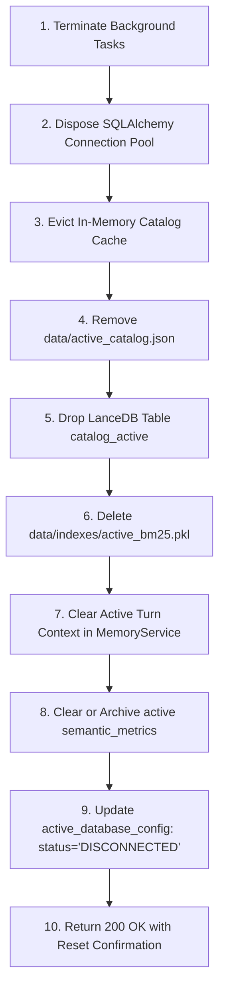

# 06 — Risk Register, Migration Strategy, and Backward Compatibility Plan (Revised v2.2)

**Target System:** Conversational Data Scientist Agent — AI for Business Intelligence  
**Author Roles:** Principal AI Architect, Lead Test Engineer / QA Architect, DevOps / SRE Lead  
**Document Lineage:** Revised v2.2 following Final Scope Correction: Single User, One Active Database Connection, Local Ollama `qwen3:4b` Execution, Non-Destructive Safe Read-Only Enforcement, and Clean Intelligence Reset Lifecycle.  
**Execution Boundary:** **STRICT PLANNING ONLY. Architectural Specification. Zero Implementation.**

---

## 1. Master Risk Register

The following matrix identifies 14 architectural, operational, and algorithmic risks associated with Version 2 implementation, detailing their likelihood, severity, preventive mitigations, and reactive contingencies:

| Risk ID | Category | Risk Description | Likelihood | Impact | Severity Score | Affected Phase | Preventive Mitigation Strategy | Reactive Contingency / Fallback |
| :--- | :--- | :--- | :--- | :--- | :--- | :--- | :--- | :--- | :--- |
| **RSK-01** | Migration | **State Database Corruption during Schema Migration:** Modifying `agent_app.sqlite` (adding `active_database_config` or updating session schemas) could fail or corrupt historical user conversations. | Low | High | **Medium** | Phase 1 | Automated pre-migration snapshot (`backups/pre_v2_{timestamp}/`); execute all DDL inside an immediate SQLite transaction (`BEGIN IMMEDIATE`). | Restore `agent_app.sqlite` from snapshot using `scripts/rollback_v2.py`. |
| **RSK-02** | Engine Compatibility | **SQL Dialect Syntax Incompatibilities:** LLM generates SQLite-specific syntax (`strftime`, `IFNULL`) when executing against a PostgreSQL or MySQL connection. | Medium | High | **High** | Phase 2 | Explicit dialect exemplars in prompt generator; parameterize `sqlglot` parser with target dialect; AST keyword checks before execution. | Bounded repair loop catches engine error, injects target dialect syntax documentation, and retries (max 1 attempt). |
| **RSK-03** | Performance | **Profiling Timeouts on Multi-Million-Row Schemas:** Discovering distinct values and min/max stats on unindexed large tables stalls the onboarding worker. | High | Medium | **High** | Phase 2 | Implement adaptive sampling profiler: tables $>50,000$ rows sample $N=10,000$ rows; set 5s per-column query timeout. | Skip heavy column profiling; mark column `profiling_skipped: true` and continue onboarding without stalling. |
| **RSK-04** | Semantic Quality | **Hallucinated Business Metric Formulas:** Automated LLM metric derivation during onboarding drafts invalid or inaccurate SQL formulas for unfamiliar schemas. | High | Medium | **High** | Phase 3 | Enforce three-tier semantic lifecycle; all auto-inferred metrics marked `AUTO_INFERRED` (draft); **never silently used as ground truth for calculations**. | Only `USER_APPROVED` metrics injected into prompts; ambiguous queries trigger interactive clarification. |
| **RSK-05** | Lifecycle Integrity | **Residual Artifact Leakage Across Database Connections:** Vector embeddings or catalog data from Database A persist after the user disconnects and connects Database B. | Medium | Critical | **High** | Phase 1, Phase 3 | Enforce the 10-step atomic reset protocol: drop LanceDB table `catalog_active`, delete `data/active_catalog.json` and BM25 index on disconnect. | Automated validation hook on new connection fails if stale fingerprint or schema files are detected. |
| **RSK-06** | Security | **Dialect-Specific SQL Injection Bypasses:** Attack vectors utilizing PostgreSQL/MySQL features (`COPY`, `LOAD DATA`, `pg_read_file`) evade basic AST checks. | Low | Critical | **High** | Phase 1, Phase 2 | Enforce 4-tier safe defense-in-depth: Least-privilege credentials, transaction read-only hooks, AST validator, query timeouts (30s) + auto `LIMIT 1000`. | Fail closed: abort execution immediately if an unrecognized AST command node or chained statement is encountered. |
| **RSK-07** | LLM Reliability | **Local Ollama Model Timeout or High Latency:** Local Ollama `qwen3:4b` experiences CPU/GPU latency spikes on complex prompts, causing HTTP timeout. | Medium | High | **High** | Phase 2 | Sliced minimal schema prompts ($<1,200$ tokens); enforce strict 45-second timeout on Ollama client; temperature set to deterministic $T=0.0$. | Graceful fallback error card to user with actionable retry button; log latency profile to `ops_run_traces`. |
| **RSK-08** | LLM Availability | **Ollama Daemon Offline on Startup:** User launches web backend while local Ollama service (`http://localhost:11434`) is not running. | Medium | Critical | **High** | Phase 1, Phase 2 | Health check probe on startup (`GET /api/tags`); clear visual UI indicator showing Ollama connection status. | API returns descriptive HTTP 503 error with step-by-step instructions to run `ollama serve` and `ollama run qwen3:4b`. |
| **RSK-09** | Retrieval Quality | **Schema Retrieval Misses Unconventional Table Names:** Schema tables with cryptic names (e.g. `tbl_cust_mstr`) fail lexical search. | Medium | High | **High** | Phase 3 | LanceDB dense 384-d semantic vectors (`fastembed` ONNX) capture semantic meaning and synonyms even when table names lack exact keyword overlap. | If top-5 hybrid retrieval confidence is low, expand schema slice to top-8 tables and traverse relationship graph. |
| **RSK-10** | Execution Cost | **Runaway Query Resource Exhaustion:** Complex multi-table joins lock database CPU or exceed server memory during execution. | Low | High | **Medium** | Phase 2 | Enforce hard 30-second query execution timeout in database adapter; automatically inject `LIMIT 1000`; reject Cartesian cross-joins. | Connection pool forcibly kills runaway query thread on timeout. |
| **RSK-11** | Integration | **Frontend / Backend API Contract Desynchronization:** Frontend UI breaks if backend API payload contracts change unexpectedly. | Low | High | **Medium** | Phase 5 | Maintain frozen Pydantic v2 schemas; version REST endpoints under `/api/v1/database/` and `/api/v1/chat/`. | Support backward-compatible response envelopes during UI transition. |
| **RSK-12** | Domain Coupling | **Analytical Tools Crash on Missing Segment Columns:** Refactored `churn.py` or domain tools crash when segment tables are absent. | Low | High | **Medium** | Phase 4 | Domain plugins declare explicit schema prerequisite traits; registry only executes plugins when prerequisites are validated in the active catalog. | Gracefully abstain from specialized analysis; present clear caveat indicating missing prerequisite data. |
| **RSK-13** | Database File Verification | **Target Development Database Verification:** Real database `ecommerce.db` (46 tables, 2,418,138 rows) verified at root. | Low | Low | **Low** | Phase 0 | Verified presence and schema of `ecommerce.db`; plan explicitly binds to `ecommerce.db` in read-only mode while keeping adapter generic. | System accepts any user-specified path or file through the single active connection config. |
| **RSK-14** | Test Regression | **Existing E-Commerce Benchmarks Regress:** Generalizing prompts and guardrails reduces Text-to-SQL accuracy on baseline `ecommerce.db`. | Medium | Critical | **High** | Phase 6 | Phase 0 baseline benchmark freeze; continuous execution of 50-case gold evaluation suite against local Ollama `qwen3:4b`. | Rollback prompt modifications; preserve specialized prompt exemplars for e-commerce schemas. |

---

## 2. Complete, Verified Migration Strategy

To guarantee zero data loss and flawless transition from Version 1, the migration executes through five atomic, reversible steps:

```
[Step 1: Automated Atomic Snapshot] ──► backups/pre_v2_{timestamp}/
                    │
                    ▼
[Step 2: Transactional SQLite DDL]  ──► agent_app.sqlite (ALTER TABLE + CREATE TABLE)
                    │
                    ▼
[Step 3: Default Connection Seeding]──► Seed ecommerce.db as the initial active connection
                    │
                    ▼
[Step 4: Credential Key Encryption] ──► PBKDF2HMAC Fernet Key Derivation from APP_SECRET_KEY
                    │
                    ▼
[Step 5: Automated Verification]    ──► scripts/verify_migration.py passes 100%
```

### 2.1 Step 1: Pre-Migration Automated Atomic Snapshot
Before executing any DDL or file operations, the migration script `scripts/migrate_v2.py` creates a timestamped archive:
- **Archive Path:** `backups/pre_v2_{YYYYMMDD_HHMMSS}/`
- **Archived Artifacts:**
  1. `agent_app.sqlite` (application memory, turns, and traces)
  2. `agent_app.sqlite-wal` and `agent_app.sqlite-shm` (if present in WAL mode)
  3. `data/schema_catalog_cache.json` (legacy catalog cache)
  4. `.env` (environment configuration)

### 2.2 Step 2: Transactional Schema Migration on `agent_app.sqlite`
All schema changes execute inside an immediate SQLite transaction (`BEGIN IMMEDIATE;`). If an error occurs during any statement, SQLite rolls back the entire transaction automatically, leaving `agent_app.sqlite` in its pristine Version 1 state:

```sql
BEGIN IMMEDIATE;

-- 1. Create Single Active Database Configuration Table
CREATE TABLE IF NOT EXISTS active_database_config (
    id TEXT PRIMARY KEY DEFAULT 'active_db',
    name TEXT NOT NULL,
    engine TEXT NOT NULL,                -- 'sqlite', 'postgresql', 'mysql'
    connection_params_enc TEXT NOT NULL, -- Fernet-encrypted JSON payload
    status TEXT NOT NULL,                -- 'READY', 'ONBOARDING', 'ERROR', 'DISCONNECTED'
    fingerprint TEXT,                    -- SHA-256 fingerprint of schema
    created_at TIMESTAMP DEFAULT CURRENT_TIMESTAMP,
    updated_at TIMESTAMP DEFAULT CURRENT_TIMESTAMP
);

-- 2. Create Active Semantic Metrics Table
CREATE TABLE IF NOT EXISTS semantic_metrics (
    id TEXT PRIMARY KEY,
    metric_key TEXT NOT NULL UNIQUE,     -- e.g. 'revenue', 'order_count'
    display_name TEXT NOT NULL,
    formula_sql TEXT NOT NULL,
    status TEXT NOT NULL,                -- 'AUTO_INFERRED', 'VALIDATED_CANDIDATE', 'USER_APPROVED'
    derivation_type TEXT NOT NULL,       -- 'INFERRED', 'CUSTOM_USER'
    verified_by TEXT,
    created_at TIMESTAMP DEFAULT CURRENT_TIMESTAMP,
    updated_at TIMESTAMP DEFAULT CURRENT_TIMESTAMP
);

-- 3. Add Status and Summary Columns to memory_sessions (Non-destructive)
-- SQLite handles ALTER TABLE ADD COLUMN safely without data loss
ALTER TABLE memory_sessions ADD COLUMN status TEXT DEFAULT 'ACTIVE';
ALTER TABLE memory_sessions ADD COLUMN summary TEXT DEFAULT NULL;

COMMIT;
```

### 2.3 Step 3: Default Connection Seeding (Zero Manual Setup)
To ensure immediate out-of-the-box functionality upon upgrading, the migration script inspects the repository:
1. Locates baseline database `ecommerce.db` at the repository root.
2. Encrypts its connection parameters (`{"path": "ecommerce.db"}`) using the derived Fernet key.
3. Inserts the baseline record into `active_database_config` with `status = 'READY'`.
4. The user can immediately begin querying without manually configuring a database, or can choose to disconnect and connect a PostgreSQL/MySQL database at any time.

### 2.4 Step 4: Credential Key Encryption
Database credentials for PostgreSQL and MySQL (host, port, username, password) are sensitive. They are protected using symmetric authenticated encryption:
- **Key Derivation:** PBKDF2HMAC with SHA-256 over `APP_SECRET_KEY` from `.env`, salted with a persistent salt stored in `data/.security_salt`.
- **Cipher:** Fernet (AES-128-CBC + HMAC-SHA256 authentication).
- Stored values in `active_database_config.connection_params_enc` cannot be decrypted without the host machine's `APP_SECRET_KEY`.

---

## 3. Database Disconnect and Clean Reset Protocol (No Data Loss Guarantee)

Because Version 2 operates with **One Active Database Connection**, switching databases is a clean, explicit operation.

### 3.1 The 10-Step Disconnect & Reset Protocol
When the user issues a disconnect request (`POST /api/v1/database/disconnect`):



### 3.2 Absolute Data Loss Protections (Guarantees):
> [!IMPORTANT]
> 1. **`agent_app.sqlite` is NEVER Deleted:** Historical conversational sessions, messages, and telemetry traces in `agent_app.sqlite` remain 100% intact. Disconnecting a database does not erase user conversation history.
> 2. **User Database Files are NEVER Modified:** The connected database (whether `ecommerce.db`, a remote PostgreSQL instance, or a MySQL server) is opened in strictly read-only mode and is **never written to, dropped, or modified** during connection, profiling, or disconnection.

---

## 4. Rollback Procedures and Scripted Recovery

If any unexpected error occurs during migration or execution, automated rollback scripts guarantee clean recovery to the Version 1 baseline within 30 seconds.

### 4.1 Rollback Script Specification (`scripts/rollback_v2.py`)
```python
"""
scripts/rollback_v2.py
Reverts Version 2 state back to Version 1 baseline using pre-migration snapshot.
"""
import shutil
import sys
from pathlib import Path

def rollback():
    backup_dirs = sorted(Path("backups").glob("pre_v2_*"), reverse=True)
    if not backup_dirs:
        print("[ERROR] No pre-v2 backup snapshot found in backups/.")
        sys.exit(1)
        
    latest_backup = backup_dirs[0]
    print(f"[ROLLBACK] Restoring from snapshot: {latest_backup}")
    
    # 1. Restore agent_app.sqlite
    shutil.copy2(latest_backup / "agent_app.sqlite", Path("agent_app.sqlite"))
    
    # 2. Restore .env
    if (latest_backup / ".env").exists():
        shutil.copy2(latest_backup / ".env", Path(".env"))
        
    # 3. Clean up V2 ephemeral directories
    if Path("data/vector_store").exists():
        shutil.rmtree(Path("data/vector_store"))
    if Path("data/indexes").exists():
        shutil.rmtree(Path("data/indexes"))
    if Path("data/active_catalog.json").exists():
        Path("data/active_catalog.json").unlink()
        
    print("[SUCCESS] Rollback complete. Version 1 baseline restored cleanly.")

if __name__ == "__main__":
    rollback()
```

### 4.2 Automated Migration Verification Script (`scripts/verify_migration.py`)
The migration is verified immediately after execution:
1. Connects to `agent_app.sqlite` and verifies tables `active_database_config` and `semantic_metrics` exist.
2. Asserts historical `memory_sessions` and `ops_run_traces` row counts match pre-migration counts.
3. Decrypts `active_database_config.connection_params_enc` and verifies validity.
4. Executes a test query against the newly seeded active database.
5. Emits `[VERIFIED] Migration completed with 0 errors.`

---

## 5. Backward Compatibility Matrix

| Component | Version 1 State | Version 2 Architecture | Backward Compatibility Mechanism |
| :--- | :--- | :--- | :--- |
| **Active DB Config** | Hardcoded path in `settings.py` | `active_database_config` in `agent_app.sqlite` | Automatically seeded with `ecommerce.db` on migration; zero config required on initial launch. |
| **Conversational Memory** | `memory_sessions` in `agent_app.sqlite` | `memory_sessions` in `agent_app.sqlite` | Existing session rows preserved untouched; new columns defaulted gracefully. |
| **Telemetry Traces** | `ops_run_traces` in `agent_app.sqlite` | `ops_run_traces` in `agent_app.sqlite` | Existing trace records preserved untouched. |
| **Catalog Cache** | `data/schema_catalog_cache.json` | `data/active_catalog.json` | Legacy cache retained during migration; active catalog generated seamlessly on onboarding. |
| **Retrieval Indexes** | In-memory singleton TF-IDF/BM25 | LanceDB `catalog_active` + `data/indexes/active_bm25.pkl` | Self-contained in `data/`; does not alter source database or existing app state. |
| **REST API Contracts** | `/api/chat`, `/api/schema` | `/api/v1/database/*`, `/api/v1/chat/*` | Legacy endpoints redirected to V1 compatibility handlers during transition. |

---

*This concludes Document 6 (`06_RISK_AND_MIGRATION_PLAN.md`). Proceeding to Document 7 (`07_FINAL_IMPLEMENTATION_MASTER_PLAN.md`).*