# 07 — Final Implementation Master Plan (Revised v2.2)

**Target System:** Conversational Data Scientist Agent — AI for Business Intelligence  
**Author Roles:** Principal AI Architect, Senior AI Agent Engineer, Lead Test Engineer / QA Architect  
**Document Lineage:** Consolidated Master Architecture and Implementation Plan for Project Owner Review and Sign-Off. Revised v2.2 following Final Scope Correction: Single User, One Active Database Connection, Local Ollama `qwen3:4b` Execution (Strict No-Mocking Policy), Non-Destructive Safe Read-Only Enforcement (No Write Probes on User DBs), Early MySQL Validation, and Clean Intelligence Reset Protocol. Synthesizes Documents `01` through `06` in `docs/implementation_plan_v2/`.  
**Execution Boundary:** **STRICT PLANNING ONLY. Zero Source Code or Application State Modified. Awaiting Explicit Project-Owner Approval.**

---

## 1. Executive Briefing and Project Objectives

This master plan defines the finalized engineering strategy for evolving the Version 1 prototype into an enterprise-grade, general-purpose, schema-grounded **Conversational Data Scientist Agent and BI Platform**.

### Core Product Scope & Constraints:
1. **Single User, One Active Database Connection, One Database Engine at a Time:** The application operates strictly for a single user interacting with one active database at any given moment. All unnecessary multi-tenant and multi-database registry complexity has been eliminated. The user can disconnect the active database and connect another at any time.
2. **Three Supported Database Engines:** Unified connection abstraction across **SQLite**, **PostgreSQL**, and **MySQL**, utilizing dedicated production-grade drivers (`sqlite3`, `psycopg` v3, `pymysql`), connection pooling (`QueuePool`), and dialect-aware query generation.
3. **Local LLM Engine (Ollama `qwen3:4b`) with Strict No-Mocking Policy:** All LLM inference is powered by local **Ollama** running at `http://localhost:11434` with model `qwen3:4b` ($T=0.0$, 45s timeout, single-retry bounded repair). No mock LLMs are used for runtime or end-to-end evaluation.
4. **Persistent Vector Retrieval & Hybrid Search:** Single persistent embedded **LanceDB** vector table (`catalog_active`) backed by local CPU ONNX embeddings (`fastembed`, 384-d, $<15\text{ms}$) combined with disk-serialized BM25 token statistics (`data/indexes/active_bm25.pkl`) via Reciprocal Rank Fusion ($k=60$). Survives application restarts in $<20\text{ms}$; zero cloud API costs.
5. **Clean Database Disconnect and Intelligence Reset Protocol:** When switching databases, a 10-step atomic reset cleans in-memory pools, active catalog cache (`data/active_catalog.json`), LanceDB table `catalog_active`, BM25 index, and active semantic metrics, while **guaranteeing zero data loss** for `agent_app.sqlite` and user database files.
6. **Four-Tier Safe Read-Only Security (Strictly Non-Destructive):** Enforces least-privilege credentials, driver transaction-level read-only hooks, dialect AST parsing (`sqlglot`), and statement timeouts (30s) + auto `LIMIT 1000`. **Under no circumstances are destructive `CREATE TABLE __probe__` write probes executed against user databases.**
7. **Deterministic Analytics over Hallucinated Generative Math:** All statistical calculations, variance decompositions, forecasts, and anomaly detection execute via deterministic Python libraries (`pandas`, `numpy`, `scipy`, `statsmodels`).
8. **Real Development Database Confirmation:** Inspection verified that **`ecommerce.db`** (SQLite 3, 219.8 MB, 46 tables, 8 views, 29 indexes, 2,418,138 rows) is the primary development and baseline validation database at `C:\D_drive\AI_FOR_BI_P\ecommerce.db`. All queries run strictly in read-only mode (`mode=ro`). The file is protected from Git commits via `.gitignore`.

---

## 2. Existing Architecture Summary vs. Target Architecture

```mermaid
graph LR
    subgraph V1 ["Existing Version 1 Prototype"]
        direction TB
        V1_DB["Single SQLite Hardcoded Path"]
        V1_PR["sqlite_master & PRAGMA Introspection"]
        V1_CA["Single Un-Scoped Cache (schema_catalog_cache.json)"]
        V1_RE["Ephemeral In-Memory TF-IDF + BM25 Singleton"]
        V1_SE["Static CANONICAL_METRICS (6 E-Commerce Metrics)"]
        V1_CH["Hardcoded Churn SQL (churn.py)"]
        V1_GT["Hardcoded Answerability Dates (2023-2025)"]
    end

    subgraph V2 ["Target Version 2 Enterprise Platform (6 Subsystems)"]
        direction TB
        V2_S1["1. Connection & Discovery: SQLite, Postgres, MySQL (QueuePool)"]
        V2_S2["2. Metadata & Semantics: Active Catalog + 3-Tier Metric Store"]
        V2_S3["3. Hybrid Retrieval: Persistent LanceDB Table + Disk BM25"]
        V2_S4["4. Safety & Execution: 4-Tier Safe Read-Only + Dialect AST"]
        V2_S5["5. Analytics & Viz: Parametric Math Tools + Domain Plugins"]
        V2_S6["6. Orchestrator: Local Ollama qwen3:4b + Dynamic Answerability"]
    end

    V1 -.->|Phase-Wise Evolution| V2
```

---

## 3. Key Architectural Decisions Summary (ADR Resolutions)

The target architecture is governed by 12 finalized Architectural Decision Records (ADRs):

1. **Concrete Database Drivers (ADR-01):**
   - SQLite: Standard library `sqlite3` (dialect `sqlite+pysqlite`).
   - PostgreSQL: Modern `psycopg` (v3 `psycopg[binary]>=3.1.18`, dialect `postgresql+psycopg`).
   - MySQL: Pure-python `pymysql` (`pymysql>=1.1.0`, dialect `mysql+pymysql`).
   - Execution Model: Asynchronous FastAPI endpoints with synchronous analytical queries running in worker thread pools via `run_in_threadpool`. Connection pooling via SQLAlchemy `QueuePool` (Postgres/MySQL) and `SingletonThreadPool` (SQLite).
2. **Single Active Database Connection & Clean Reset Lifecycle (ADR-02):**
   - Single active connection managed in `agent_app.sqlite` (`active_database_config`).
   - Zero multi-tenant complexity, zero multi-DB routing headers.
   - Disconnecting triggers a clean 10-step atomic reset of in-memory pools, caches, LanceDB vector table, and BM25 index without touching application memory or user files.
3. **Dynamic Schema Discovery & Adaptive Sampling Profiling (ADR-03):**
   - Standard SQLAlchemy 2.0 `Inspector` extracts tables, columns, data types, primary keys, and foreign keys.
   - For tables $>50,000$ rows, profiler samples $N=10,000$ rows, slashing profiling time from 14.2s to $<5.0\text{s}$ on multi-million row datasets like `novacart_ecommerce.db`.
4. **Persistent Embedded Hybrid Retrieval (ADR-04):**
   - Embedded serverless **LanceDB** instance stored at `data/vector_store/` with table `catalog_active`.
   - Local CPU ONNX embeddings via `fastembed` (`all-MiniLM-L6-v2`, 384-d, $<15\text{ms}$) + disk-serialized BM25 index (`data/indexes/active_bm25.pkl`) fused via Reciprocal Rank Fusion ($k=60$).
   - Hydrates in $<20\text{ms}$ on application boot without re-profiling.
5. **Three-Tier Semantic Layer & Interactive Provenance (ADR-05):**
   - Tier 1: `AUTO_INFERRED` (draft, low confidence; never silent ground truth).
   - Tier 2: `VALIDATED_CANDIDATE` (AST-verified and execution-tested).
   - Tier 3: `USER_APPROVED` (authoritative, verified by user).
   - Ambiguous metrics (revenue, churn, refunds) trigger interactive clarification rather than guessing.
6. **Four-Tier Safe Read-Only Security (ADR-06):**
   - (1) Least-privilege DB user, (2) Driver transaction read-only hooks (`SET TRANSACTION READ ONLY`), (3) Multi-dialect AST parser (`sqlglot`), (4) Query timeout (30s) and automatic `LIMIT 1000`.
   - **Strict prohibition:** Zero destructive write probes (`CREATE TABLE __probe__`) on user databases.
7. **Streamlined Five-Stage Onboarding Lifecycle (ADR-07):**
   - Consolidates onboarding into 5 macro-stages: (1) Connection Validation, (2) Adaptive Schema Profiling, (3) Catalog Assembly, (4) Persistent Index Hydration, (5) Semantic Metric Drafting.
   - Tracked via persistent job state with heartbeat-based crash recovery.
8. **Local LLM Engine Architecture (ADR-08):**
   - Powered by local Ollama running at `http://localhost:11434` with model `qwen3:4b`.
   - Deterministic temperature ($T=0.0$), minimal schema prompt slicing (5-7 tables, $<1,200$ tokens), 45-second execution timeout, single-retry bounded repair loop.
   - Strict no-mocking policy for runtime and integration/E2E test suites.
9. **Two-Tier Analytics Framework (ADR-09):**
   - Tier 1: Universal parametric tools (anomaly screening, Holt-Winters forecasting, variance decomposition) operating on generic schemas.
   - Tier 2: Schema-gated domain plugins (e-commerce churn) executing only when prerequisite tables/columns are verified in the catalog.
10. **Dynamic Temporal Boundary Discovery (ADR-10):**
    - Eliminates hardcoded `2023-01-01` to `2025-12-31` date filters. Temporal bounds derived dynamically from active database timestamp columns.
11. **Conversational Memory & Single-Session Follow-Up Resolution (ADR-11):**
    - Single active session context maintained in `agent_app.sqlite`. Follow-up queries resolve elliptical references against active turn state.
12. **Zero-Data-Loss Migration & Rollback Strategy (ADR-12):**
    - Automated pre-migration snapshot (`backups/pre_v2_{timestamp}/`), transactional DDL (`BEGIN IMMEDIATE`), default seeding with `ecommerce.db`, scripted verification (`scripts/verify_migration.py`), and one-command rollback (`scripts/rollback_v2.py`).

---

## 4. Master 7-Milestone Roadmap with Early Vertical Slice

```mermaid
gantt
    title Revised 7-Milestone Roadmap (Early Vertical Slice in Phase 2)
    dateFormat  X
    axisFormat  Day %x

    section Milestone 1: Foundations
    Phase 0: Baseline Benchmarking & Frozen Contracts :p0, 0, 1
    Phase 1: Multi-Engine Adapters & Read-Only Safety  :p1, after p0, 2d

    section Milestone 2: Early Vertical Slice
    Phase 2: End-to-End Query Slice (Ollama qwen3:4b)  :p2, after p1, 3d

    section Milestone 3: Intelligence Depth
    Phase 3: Persistent Retrieval (LanceDB) & Semantics:p3, after p2, 3d

    section Milestone 4: Analytics & UI
    Phase 4: Generic Parametric Analytics & Plugins   :p4, after p3, 2d
    Phase 5: Streamlined Single-DB Frontend UI        :p5, after p4, 3d

    section Milestone 5: Verification & Delivery
    Phase 6: Full System Integration & Benchmarking   :p6, after p5, 2d
```

### Milestone Breakdown:
- **Phase 0: Baseline Benchmarking & Frozen Contracts (Days 1–2):**
  - Run existing test suite; freeze baseline metrics (`tests/baselines/v1_baseline.json`).
  - Isolate legacy endpoints; freeze Pydantic schemas.
- **Phase 1: Multi-Engine Adapters & Read-Only Safety (Days 3–4):**
  - Implement SQLite, PostgreSQL (`psycopg`), and MySQL (`pymysql`) connection adapters with `QueuePool`.
  - **Early MySQL tests included and validated.**
  - Implement 4-tier safe read-only defense (AST validator, connection hooks, timeouts, limits).
  - Migrate `agent_app.sqlite` with `active_database_config` table and seed `ecommerce.db`.
- **Phase 2: Early Working Vertical Slice with Local Ollama `qwen3:4b` (Days 5–7):**
  - Connect real local Ollama instance (`http://localhost:11434`, model `qwen3:4b`).
  - Adaptive sampling schema profiler ($<5\text{s}$ on large datasets).
  - Execute live end-to-end question answering against real `ecommerce.db`.
  - Verify AST validation and bounded 1-retry repair loop with zero mocks.
- **Phase 3: Persistent Hybrid Retrieval & Three-Tier Semantics (Days 8–10):**
  - Integrate embedded LanceDB (`catalog_active`) with local ONNX embeddings + disk BM25.
  - Implement 10-step atomic database disconnect and intelligence reset protocol.
  - Implement 3-tier semantic metric repository in `agent_app.sqlite`.
- **Phase 4: Dynamic Answerability & Generic Statistical Data Science Tools (Days 11–12):**
  - Dynamic date bounds inference (remove hardcoded 2023-2025).
  - Parametric mathematical tools (anomalies, forecasting, variance decomposition).
  - Schema-gated domain plugins.
- **Phase 5: Streamlined Frontend for Single Active Database (Days 13–15):**
  - Single active database status card with engine badges (SQLite/Postgres/MySQL).
  - Clean Disconnect and Connect modals with progress tracking.
  - Active schema inspector and semantic metrics management UI.
- **Phase 6: Full System Integration, Performance Verification & Delivery (Days 16–17):**
  - 50-case adversarial security test suite (100% rejection rate).
  - 50-case cross-engine evaluation benchmark with live Ollama `qwen3:4b` (Execution accuracy $\ge 82\%$).
  - Full end-to-end regression validation against Phase 0 baseline.

---

## 5. Implementation Planning Boundaries & Authorizations

### Planning Status:
- **Comprehensive Plan Completed:** Documents `01` through `07` in `docs/implementation_plan_v2/` are 100% written, cross-referenced, and aligned with all user requirements and architectural constraints.
- **Strict Prohibition Enforced:** Zero source code files modified, zero dependencies installed, zero migrations applied, zero database records altered.
- **Next Step:** Awaiting explicit authorization from the project owner to begin Phase 0.

---

*This concludes Document 7 (`07_FINAL_IMPLEMENTATION_MASTER_PLAN.md`).*